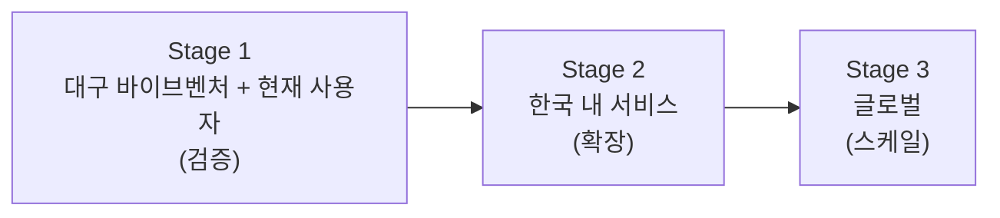

# BUSINESS.md — Gyro 비즈니스 전략 문서 (v0.2)

> **2026-10-30 전략 업데이트:** 주 고객을 소비자 발견자보다 **바이브코딩으로 초기 서비스를 만든
> 빌더**로 재정의한다. 최신 구상은 `ideation.md` §13이다. 이 문서 §1의 현재 제품 설명 및 §2~§9의
> 기존 조사·성장 가설은 참고 기록이며, 소비자 발견 플랫폼 확장이나 지표 판매를 현재 우선 전략으로
> 해석하지 않는다. 시장 비교의 우위·수익 추정은 이번 업데이트에서 재검증하지 않았다.

> 본 문서는 `prd.md`/`trd.md`에 정의된 실제 구현 제품인 **Gyro**(스와이프 기반 서비스/프로젝트 발견
> 앱)를 대상으로 한다. 과거 이 저장소에 섞여 있던 "Luggy"(지도 기반 캐리어 C2C 렌탈) 문서/코드는
> 미구현 상태였으며 모두 제거되어, 이제 저장소 전체가 Gyro 단일 제품 기준으로 정리되어 있다.

## 0. 한 줄 요약
Gyro의 새 방향은 **"초기 서비스 빌더가 목표 사용자에게 도달하고, 실제 사용·이탈 이유를 근거로
다음 개선 실험을 결정하도록 돕는 마케팅·실사용 검증 서비스"**다. PMF를 대신 찾아주거나 인증하는
것이 아니라, PMF를 탐색하는 반복 검증 과정을 돕는다. 바이브벤처는 첫 검증 현장이며 교육 전용
시장으로 한정하지 않는다.

**포지셔닝 변경:** 기존 발견·추천 화면은 사용자 유입 채널로 활용하고, 빌더가 실행하는 검증
사이클을 상품 단위로 제안한다. 초기에는 수동 모집·관찰·리포트로 효용을 검증하며, 이후 빌더의
반복 이용과 기관의 프로그램 단위 구매 가능성을 확인한다. 사용자 자동 공급, 기관 계약, 지불 의사,
PMF 달성은 검증되지 않았다.

**현재 구현과 구분:** 배포 제품의 계약은 여전히 `prd.md`/`trd.md`다. 이번 변경은 전략·구상
기록이며 기능 승격이 아니다. 첫 파일럿·측정 정의·개인정보 경계를 합의한 뒤 필요한 항목만
요구사항으로 승격한다. 상세 실험안과 발표 준비 제안은 `ideation.md` §13을 따른다.

**교차검토 후 첫 상품 가설:** 2팀부터 수동으로 운영하는 “Gyro 검증 스프린트”.
단일 서비스의 실제 과업을 관찰하고 다음 수정·고객군 전환·중단 결정을 돕는다.
사용자 모집과 기존 폼·분석 도구 대비 차별성은 미검증이다. 빌더의 실제 결과 활용·후속 실험과
기관의 다음 코호트 도입은 별도로 확인하며, 기록 자동화는 반복 수작업의 비용·오류가 확인된 뒤
판단한다(`ideation.md` §13.8).

---

## 1. 현재 제품 정의 (Stage 0 as-is)

| 항목 | 내용 |
| --- | --- |
| 제품명 | Gyro (`gyro.` 워드마크) |
| 핵심 UX | 사용자 유형(학생/교사/학부모/기타) + 관심사 선택 → 서비스 카드 스와이프(최대 10장 라운드) → 관심 서비스 결과 + 선택적 이메일 저장 |
| 데이터 소스 | 대구 "학생 바이브벤처" 프로그램에서 매월 배출되는 학생 제작 웹앱 카탈로그(현재 `apps/api/src/catalog.ts`에 정적 등록, 약 90여 개) |
| 수익화 | 없음(순수 검증 단계) — 익명 이벤트/이메일 리드만 수집 |
| 비즈니스 목적 | (a) 학생 창업 산출물에 대한 실사용자 관심도·클릭률 검증, (b) 스와이프 발견 UX 자체의 전환율 가설 검증 |

### 1.1 "바이브벤처" 프로그램 맥락 (시장 리서치)
- 대구시교육청 창의융합교육원이 운영하는 초·중·고 대상 디지털 창업 교육 프로젝트로, 생성형 AI
  "바이브 코딩"으로 학생이 직접 실생활 문제 해결 앱을 기획·개발·배포하고 창업까지 연계한다.
- 2026년 기준 대구 관내 학생 30명을 선발해 4~11월(8개월) 동안 2~3인당 멘토 1인(MS 전문가·교수진)
  매칭으로 진행되며, 개발 도구/클라우드 비용은 전액 지원된다.
- 산출물은 온라인 전시를 통해 공개되고 사용자 피드백을 받는 구조 — Gyro는 바로 이 "전시 → 피드백"
  단계의 병목(발견성 부족, 산재된 링크, 낮은 관심 전환)을 해결하는 도구로 기능한다.
- 즉 Gyro의 1단계 고객은 **(a) 바이브벤처 운영기관(교육청/교육원)**, **(b) 참가 학생(창업자)**,
  **(c) 전시물을 소비하는 일반 사용자(학생/교사/학부모)** 3자로 구성된 다면 시장이다.

---

## 2. 시장 리서치 — 유사 서비스 비교

### 2.1 스와이프/틴더 스타일 발견 UX 비즈니스 모델

| 서비스 | 카테고리 | 핵심 수익 모델 | Gyro에 대한 시사점 |
| --- | --- | --- | --- |
| Tinder / Bumble / Hinge | 데이팅 | 구독(무제한 스와이프, 역방향 좋아요), 소모성 아이템(부스트/슈퍼라이크), 광고 | 구독+소모성 아이템 하이브리드가 ARPU를 극대화. 가입 후 30일 내 결제 전환이 집중됨 |
| "Tinder for Jobs" 류 구직 스와이프 앱 | 채용 | 구직자 구독 + **기업 파트너십(매칭 후보 풀 접근 유료화)** | B2B(공급자 과금) 모델이 Gyro의 "학생 창업팀/기관 과금"과 가장 구조적으로 유사 |
| Depop 등 쇼핑 스와이프 | 커머스 | 판매자 수수료, 프로모션 노출 유료화 | "피처드 카드" 과금 아이디어의 선례 |

### 2.2 제품/스타트업 큐레이션·발견 플랫폼 (직접 비교군)

| 서비스 | 포지션 | 수익 모델 | Gyro 대비 차이 |
| --- | --- | --- | --- |
| **Product Hunt** | 글로벌 신규 제품 발견/런칭 커뮤니티 | ① Featured/프로모션 노출 과금 ② Ship(메이커용 SaaS 구독) ③ 광고 ④ Jobs Board ⑤ Founder Club 멤버십 (연 추정 매출 $3.9M~$11M) | Gyro는 발견 UX가 "리스트+업보트"가 아닌 "스와이프"로, 수동 탐색 피로도가 낮고 관심/비관심 시그널이 이진적이라 추천 데이터 품질이 더 높음 |
| **로켓펀치** (국내) | 스타트업·채용 네트워킹 | 채용공고/기업홍보 유료화, B2B HR 솔루션, 이벤트 스폰서십 | 기관(바이브벤처 운영사, 액셀러레이터) 대상 B2B 과금 구조의 국내 선례 |
| **더브이씨(THE VC)** (국내) | 스타트업 투자 데이터베이스 | 유료 리포트/구독, 기관 대상 데이터 판매 | "검증 지표 데이터(관심도·전환율)"를 기관에 유료 리포트로 판매하는 모델의 참고 |
| **와디즈** | 크라우드펀딩/신규 브랜드 발굴 | 펀딩 거래 수수료, 입점 수수료, 마케팅 패키지 | "발견 → 실제 전환(펀딩/구매)"까지 책임지는 수수료 모델의 선례. Gyro도 장기적으로 "발견 → 실사용/가입 전환"까지 확장 시 전환 수수료 모델 가능 |

### 2.3 종합 시사점
1. **다면 시장 구조**: 성공한 비교군 대부분이 "일반 사용자(무료)" + "공급자/기관(유료)" 구조. Gyro도
   일반 사용자 무과금, 공급자(창업팀/학교/기관) 과금이 1차 수익화 방향으로 가장 자연스럽다.
2. **데이터 자산화**: 더브이씨·로켓펀치처럼 축적된 관심도/전환 데이터 자체가 상품이 될 수 있다 —
   Gyro의 `card_like/dislike/result_view/service_click` 퍼널 이벤트는 "어떤 유형의 사용자가 어떤
   카테고리 서비스에 반응하는가"라는 데이터 자산이 된다.
3. **스와이프의 구조적 강점**: 평점/텍스트 리뷰보다 노이즈가 적은 이진 신호(좋아요/싫어요)이기 때문에
   추천 로직이 단순해도 설명 가능한 추천(explainable recommendation)이 가능하다(현재 `recommendationReason`
   구현과 정합).
4. **확장 리스크**: Tinder류는 공급(사람)이 자생적으로 늘어나지만, Gyro의 공급(학생/스타트업 산출물)은
   외부 프로그램(바이브벤처, 추후 타 기관)에 의존적 — 공급 파이프라인 다변화가 확장의 핵심 과제다.

---

## 3. 단계별 전략 개요

| 구분 | Stage 1: 현재 (대구) | Stage 2: 한국 확장 | Stage 3: 글로벌 |
| --- | --- | --- | --- |
| 공급(카탈로그) | 대구 바이브벤처 월별 산출물 ~90여 개 | 전국 교육청 디지털 창업 프로그램, 대학 캡스톤/해커톤, 지역 액셀러레이터 데모데이 | 글로벌 액셀러레이터(YC, Techstars 등), 인디메이커(Product Hunt 대체/보완), 에듀테크 해커톤 |
| 수요(사용자) | 대구 학생/교사/학부모 | 전국 학생/교사/학부모, 교육 관계자, 지역 투자자 | 글로벌 메이커 커뮤니티, 초기 사용자(early adopter), 엔젤/엑셀러레이터 |
| 핵심 수익원 | 없음(검증), 일부 기관 리포트 | 기관 과금(SaaS), 피처드 노출, 리드 중개 수수료 | 구독(Pro 메이커), 데이터/분석 API, 광고/스폰서십 |
| 조직 형태 | 1인/소규모 팀, 바이브벤처 협력 | 법인화, 교육청/지자체 B2G 계약 | 글로벌 SaaS 법인, 다국어/다통화 |

---

## 4. Stage 1 — 대구 바이브벤처 + 현재 사용자 (검증 단계)

### 4.1 비즈니스 모델 캔버스 (Business Model Canvas)

| 블록 | 내용 |
| --- | --- |
| **고객 세그먼트** | ① 바이브벤처 참가 학생(창업자, 노출/피드백 필요) ② 일반 발견 사용자(학생/교사/학부모) ③ 대구시교육청 창의융합교육원(프로그램 성과 증빙 필요) |
| **가치 제안** | 창업팀에는 "내 서비스가 적합한 사용자에게 도달·클릭되는 채널", 사용자에게는 "1분 스와이프로 나에게 맞는 서비스 발견", 교육원에는 "프로그램 성과(관심도·클릭률·전환율) 데이터" |
| **채널** | 웹앱(링크 공유), 바이브벤처 전시/행사 QR, 학교 공지/교사 커뮤니티 |
| **고객 관계** | 셀프서비스(사용자), 기관 파트너십(교육원 — 수동 온보딩) |
| **핵심 자원** | 카탈로그 데이터, 퍼널 이벤트 데이터, 설명 가능한 추천 로직 |
| **핵심 활동** | 카탈로그 큐레이션/헬스체크, UX 개선(스와이프 전환율), 퍼널 지표 분석·리포트 |
| **핵심 파트너** | 대구시교육청 창의융합교육원, 바이브벤처 멘토단(MS 전문가/교수진) |
| **비용 구조** | 클라우드 호스팅(Azure), 개발 인건비(1인 체제), 도메인/모니터링 |
| **수익 흐름** | (현재) 없음 → (검증 후) 교육원 대상 "성과 리포트/대시보드" 소액 유료화 테스트 |

### 4.2 린 캔버스 (Lean Canvas)

| 블록 | 내용 |
| --- | --- |
| **문제** | 월별로 쏟아지는 학생 창업 서비스가 링크만 나열되어 실제 사용자 발견/관심 전환이 거의 일어나지 않음 |
| **고객군** | 대구 학생/교사/학부모(발견자) + 바이브벤처 참가 학생(공급자) + 교육원(스폰서) |
| **고유 가치 제안** | "틴더처럼 10장만 넘기면, 내 상황에 맞는 서비스를 찾는다" |
| **솔루션** | 유형/관심사 선택 → 설명 가능한 추천 스와이프 → 결과 + 선택적 이메일 저장 |
| **채널** | 전시 QR, 학교/교사 커뮤니티, 바이브벤처 공식 채널 |
| **수익원** | (검증 단계) 없음. 이후 교육원 리포트 유료화 테스트 |
| **비용 구조** | 클라우드 호스팅, 1인 운영 인건비 |
| **핵심 지표** | 랜딩→첫 카드 도달률, 카드당 결정 시간, 링크 클릭률, 이메일 저장률 (prd.md §7과 동일) |
| **경쟁 우위** | 실제 대구 교육 현장 데이터와 멘토 네트워크 접근성(바이브벤처 파트너십), 설명 가능한 추천으로 신뢰 확보 |

### 4.3 수익 구조 (Stage 1)
- **현재**: 수익화하지 않음(제품-시장 적합성 및 퍼널 전환율 검증이 목적).
- **테스트 가능한 1차 수익원** (확장 신호 확인 전 소규모 파일럿만 권장):
  1. **기관 리포트 과금**: 교육원/운영기관 대상 "서비스별 관심도·클릭률 월간 리포트" 유료 제공(건당 또는 프로그램 단위 소액).
  2. **피처드 슬롯(제한적)**: 창업팀이 자기 서비스를 라운드 상단에 우선 노출하길 원할 경우 유료 옵션 — 단, 바이브벤처는 전액 지원 프로그램이므로 **참가 학생에게 직접 과금하지 않고**, 교육원/스폰서 예산으로 묶어 제공하는 방식을 우선 검토.
- **Out of scope(1단계)**: 광고, 구독, 거래 수수료 — 데이터 볼륨이 작아 단가가 안 나옴.

---

## 5. Stage 2 — 한국 내 서비스 확장

### 5.1 비즈니스 모델 캔버스

| 블록 | 내용 |
| --- | --- |
| **고객 세그먼트** | ① 전국 교육청·대학 캡스톤/해커톤 프로그램(공급 파트너) ② 지역 액셀러레이터/창조경제혁신센터(데모데이 성과 증빙 수요) ③ 전국 일반 사용자(학생/주니어 직장인/얼리어답터) ④ 초기 스타트업(발견 채널 필요 B2B 고객) |
| **가치 제안** | 공급자에게는 "데모데이 이후에도 지속되는 발견 채널", 수요자에게는 "전국 단위 신규 서비스를 내 관심사 기준으로 빠르게 발견", 기관에게는 "표준화된 성과 대시보드(SaaS)" |
| **채널** | B2B 세일즈(교육청/혁신센터 제휴), 바이럴(결과 공유 링크), SEO/콘텐츠(발견된 서비스 큐레이션 아티클) |
| **고객 관계** | SaaS 셀프서비스 + 기관 전담 CS, 커뮤니티(메이커 디스코드/슬랙) |
| **핵심 자원** | 멀티 프로그램 카탈로그 파이프라인, 추천 알고리즘 고도화, 기관용 대시보드 |
| **핵심 활동** | 파트너십 영업, 카탈로그 수집 자동화(제출 폼/API), 추천 품질 개선, 신뢰·안전(가짜 서비스 필터링) |
| **핵심 파트너** | 창조경제혁신센터, 대학 산학협력단, 지역 테크 밋업/해커톤 운영사 |
| **비용 구조** | 인프라 스케일 비용, 영업/파트너십 인력, 콘텐츠 운영팀 |
| **수익 흐름** | 기관 SaaS 구독, 피처드 노출 과금, 리드 중개 수수료(관심 전환 시 과금) |

### 5.2 린 캔버스

| 블록 | 내용 |
| --- | --- |
| **문제** | 전국 각지의 데모데이/해커톤/캡스톤 산출물이 행사 종료 후 발견되지 않고 사장됨; 초기 스타트업은 저비용 발견 채널이 부족함 |
| **고객군** | 교육·창업 지원 기관(공급), 전국 발견 사용자(수요), 초기 스타트업(B2B 고객) |
| **고유 가치 제안** | "데모데이가 끝나도 계속되는 발견 — 전국 단위 스와이프 발견 플랫폼" |
| **솔루션** | 멀티 프로그램 온보딩 API/제출 폼, 지역·카테고리 필터, 기관용 성과 대시보드 |
| **채널** | 기관 파트너십 영업, 바이럴 결과 공유, 콘텐츠 마케팅 |
| **수익원** | 기관 SaaS 구독(월/연), 피처드 노출, 전환 기반 리드 수수료 |
| **비용 구조** | 인프라, 영업 인력, 콘텐츠/큐레이션 인력 |
| **핵심 지표** | 활성 공급 기관 수, MAU, 기관당 ARPU, 리드 전환율 |
| **경쟁 우위** | 대구 바이브벤처 레퍼런스 케이스(성과 데이터 보유), 설명 가능한 추천, 스와이프 UX 전환율 데이터 축적 |

### 5.3 수익 구조 (Stage 2)
| 수익원 | 과금 대상 | 구조 | 비고 |
| --- | --- | --- | --- |
| 기관 SaaS 구독 | 교육청/혁신센터/대학 | 월 구독(캠페인/프로그램 단위) | 더브이씨·로켓펀치 B2B 모델 참고 |
| 피처드 노출 | 초기 스타트업/창업팀 | 노출 슬롯 단가제 | Product Hunt Featured 모델 참고 |
| 리드 중개 수수료 | 초기 스타트업(B2B) | 유효 관심/클릭 리드 건당 또는 전환 성공 수수료 | 와디즈식 거래 연동형 수수료로 발전 가능 |
| 데이터 리포트 | 기관/투자자 | 분기별 트렌드 리포트 유료 판매 | 더브이씨 리포트 모델 참고 |
| (검토) 광고 | 에듀테크/B2C 브랜드 | 결과 화면 네이티브 스폰서십 | 사용자 경험 저해 우려로 후순위 |

### 5.4 서비스 소유자 피드백 포털 (로그인 기반, 신규 수익 후보)
> 현재 MVP는 로그인/계정을 지원하지 않는다(`prd.md` §5 Out of Scope, `AGENTS.md` §4). 아래는
> Stage 2에서 검토할 **확장 전용 기획**이며, 구현 시점에는 `prd.md`/`trd.md` 범위 재정의가
> 선행되어야 한다.

- **개념**: 바이브벤처 참가 학생/스타트업(서비스 소유자)이 **회원가입/로그인** 후 전용 대시보드에서
  자신의 서비스에 쌓인 익명 사용자 피드백(`trd.md` §6.3의 `service_feedback_submit` 퍼널 이벤트 —
  별점 1~5 + 코멘트)을 모아서 볼 수 있다.
- **무료 티어**: 로그인 후 자기 서비스의 원시 피드백(평균 별점, 코멘트 목록)을 그대로 열람.
- **유료 티어("서비스 개선방안 리포트")**: 원시 피드백을 가공한 **정성 분석 + 우선순위 제안**을
  제공한다 — 예) "코멘트에서 가장 많이 언급된 불편 키워드 Top 3", "유사 카테고리 서비스 대비 상대적
  강약점", "다음 전시 라운드 전 개선하면 좋을 우선순위 체크리스트". 분석은 초기에는 사람이 직접
  작성하는 소규모 유료 컨설팅 형태로 시작하고, 수요가 검증되면 자동 리포트 생성으로 전환을 검토한다.
- **과금 방식(후보)**: ① 건당 리포트 구매(1회성) ② 월 구독(지속 업데이트) ③ 교육원/운영기관이
  참가 학생 전체 분을 묶어 단체 구매(교육 프로그램 성격상 참가 학생 개인 직접 과금은 지양).
- **전제 조건**: 소유자 계정 시스템(회원가입/로그인), 소유자-서비스 소유권 검증(현재 카탈로그는
  소유자 식별자가 없으므로 매핑 체계 필요), 결제 연동, 피드백 데이터의 악용/도배 방지(레이트 리밋,
  스팸 필터) — 모두 미구현이며 별도 PRD/TRD가 필요하다.

---

## 6. Stage 3 — 글로벌 확장

### 6.1 비즈니스 모델 캔버스

| 블록 | 내용 |
| --- | --- |
| **고객 세그먼트** | ① 글로벌 액셀러레이터/인큐베이터(YC, Techstars, 각국 정부 지원 프로그램) ② 글로벌 인디메이커 커뮤니티 ③ 글로벌 얼리어답터 발견 사용자 ④ VC/엔젤(초기 신호 데이터 수요자) |
| **가치 제안** | "틴더처럼 가벼운 글로벌 신규 서비스 발견 + 설명 가능한 추천"으로 Product Hunt 대비 더 낮은 진입장벽과 더 높은 전환 신호 품질 제공 |
| **채널** | 글로벌 메이커 커뮤니티(Indie Hackers, Hacker News, X), 액셀러레이터 공식 파트너십, 다국어 SEO |
| **고객 관계** | 셀프서비스 글로벌 SaaS, 엔터프라이즈 영업(액셀러레이터/VC) |
| **핵심 자원** | 글로벌 카탈로그 파이프라인(제출 API), 다국어 추천 엔진, 관심도 데이터 API |
| **핵심 활동** | 글로벌 파트너십, 다국어/현지화, 추천 알고리즘 고도화(ML 전환 검토), 신뢰·안전/사기 방지 |
| **핵심 파트너** | 글로벌 액셀러레이터, 메이커 커뮤니티 플랫폼, 결제/정산 인프라사 |
| **비용 구조** | 글로벌 인프라, 현지화/번역, 신뢰·안전 운영팀, 글로벌 영업 |
| **수익 흐름** | 구독(Pro 메이커 플랜), 기관 엔터프라이즈 계약, 데이터/분석 API 판매, 글로벌 스폰서십 |

### 6.2 린 캔버스

| 블록 | 내용 |
| --- | --- |
| **문제** | Product Hunt류 리스트/업보트 기반 발견은 피로도가 높고 공급 과잉 속 신호 품질이 낮음; 액셀러레이터 데모데이 이후 산출물 발견성이 전 세계적으로 동일하게 취약함 |
| **고객군** | 글로벌 액셀러레이터/메이커(공급), 글로벌 얼리어답터(수요), VC/엔젤(데이터 구매자) |
| **고유 가치 제안** | "세계에서 가장 가벼운 신규 서비스 발견 — 스와이프 10장이면 충분" |
| **솔루션** | 글로벌 제출 API, 다국어 추천, 관심도 데이터 대시보드/API |
| **채널** | 메이커 커뮤니티 바이럴, 액셀러레이터 엔터프라이즈 파트너십 |
| **수익원** | Pro 구독, 엔터프라이즈 계약, 데이터 API, 스폰서십 |
| **비용 구조** | 글로벌 인프라, 현지화, 신뢰·안전, 영업 |
| **핵심 지표** | 글로벌 MAU, 국가별 공급 파트너 수, 데이터 API 매출, NRR(순매출유지율) |
| **경쟁 우위** | 한국 단계에서 축적한 관심도 데이터셋과 설명 가능한 추천 노하우, Product Hunt 대비 낮은 피로도 UX |

### 6.3 수익 구조 (Stage 3)
| 수익원 | 과금 대상 | 구조 | 참고 모델 |
| --- | --- | --- | --- |
| Pro 메이커 구독 | 글로벌 메이커/스타트업 | 월 구독(고급 분석, 피처드 우선권) | Product Hunt Ship, Tinder 구독 |
| 엔터프라이즈 계약 | 액셀러레이터/VC | 연간 계약(화이트라벨 발견 채널 + 성과 대시보드) | 더브이씨 B2B 데이터 판매 |
| 데이터/분석 API | VC/시장 리서치사 | 사용량 기반 API 과금 | Crunchbase류 데이터 상품화 |
| 글로벌 스폰서십/광고 | 대형 브랜드/플랫폼 | 네이티브 스폰서 슬롯 | Product Hunt 광고 |
| 거래 연동 수수료(검토) | 유료 전환 서비스 | 발견→가입 전환 성공 수수료 | 와디즈식 거래 수수료, 구직 스와이프 앱의 B2B 모델 |

---

## 7. 단계별 수익화 로드맵 요약

| 단계 | 핵심 KPI | 주 수익원 | 목표 |
| --- | --- | --- | --- |
| Stage 1 (대구) | 카드 도달률, 링크 클릭률, 이메일 저장률 | 없음 / 기관 리포트 파일럿 | 발견 UX·추천 로직의 PMF 신호 확보 |
| Stage 2 (한국) | 활성 공급 기관 수, MAU, ARPU | 기관 SaaS, 피처드 노출, 리드 수수료 | 재현 가능한 B2B 영업 모션 확보, 손익분기 접근 |
| Stage 3 (글로벌) | 글로벌 MAU, NRR, 데이터 API 매출 | Pro 구독, 엔터프라이즈 계약, 데이터 API | 플랫폼형 발견 레이어로 포지셔닝, 데이터 자산 수익화 |

---

## 8. 리스크 및 추가 검증 과제
1. **공급 의존 리스크**: Stage 1의 카탈로그가 바이브벤처 단일 프로그램에 전적으로 의존 — Stage 2 진입 전 2개 이상의 외부 공급 파트너 확보가 선행 지표가 되어야 한다.
2. **문서 정합성 리스크 (해결됨)**: 과거 `prd.md`/`trd.md`/`AGENTS.md`/`design.md`가 "Luggy"(캐리어 C2C 렌탈)를 주 제품으로 기술해 실제 구현(Gyro)과 불일치했으나, 해당 문서/코드를 모두 제거하고 Gyro 단일 제품 기준으로 재작성했다.
3. **수익화 타이밍 리스크**: 교육 프로그램 성격상 참가 학생에게 직접 과금하는 모델은 신뢰도 리스크가 크므로, 1차 수익화는 반드시 "기관/스폰서 과금"에서 시작해야 한다.
4. **데이터·개인정보 리스크**: Stage 2/3의 데이터 상품화(리포트/API)는 prd.md §10의 개인정보 고지·동의 체계를 전제로 해야 하며, 글로벌 확장 시 GDPR 등 역외 규제 검토가 선행되어야 한다.
5. **제품 방향 연계**: `ideation.md`에서 구상 중인 "검증 루프"(체험→피드백→개선→재검증, `prd.md` §14/`trd.md` §10 초안 참고)가 실제 구현되면, 본 문서 §5/§6의 "데이터 자산화"·"빌더 과금" 수익원이 훨씬 더 구체적인 상품(빌더 대시보드 구독, 검증 리포트 API)으로 연결될 수 있다. 단, 해당 기능은 아직 미구현이므로 현재 수익화 로드맵(§7)의 전제로 사용하지 않는다.

## 9. 병행 성장 경로 — 사람과 개인 AI 에이전트의 발견·활용 시장

> 방향 가설이며 수요·수익성이 검증된 시장 분석이 아니다. 아래 후보 기능은 `prd.md`/`trd.md` 승격
> 전에는 구현하지 않는다. 현재 제품과의 연결 및 기술·안전 경계는 `ideation.md` §12를 따른다.

**포지셔닝**: 출시 당일의 주목을 얻는 곳에 그치지 않고, "지금 내 작업을 해결할 기존 도구"를 찾아
쓰게 하는 발견 플랫폼. Product Hunt형 제품 발견/공급자 참여를 지향하면서도, 스와이프의 낮은
진입장벽과 작업·환경 적합성, 확인 가능한 출처·최신 링크, 실제 활용 안내를 차별화 가설로 삼는다.

| 단계 | 현재 제품에서 연결할 자산 | 실험할 가치와 진입 채널 | 진행 판단에 필요한 근거 |
| --- | --- | --- | --- |
| 기반 | 전체 셔플과 주기적 URL 점검(이번 구현) | 발견 뒤 접속 실패 감소 | 장애·이동 로그와 수동 카탈로그 품질 확인 |
| 사람용 확장 후보 | 생산성/AI 관심사, 10장 카드, 설명·결과 | 소규모 개발·자동화 큐레이션을 개발자/바이브코더 커뮤니티에 공유 | 문서 이동과 활용 자기보고, 기존 사용자 전환 저하 여부 |
| 스킬/MCP 확장 후보 | 같은 발견 UI와 공급자 피드백 루프 | 에이전트 활용 커뮤니티에서 환경별 활용 가이드 검증 | 호환성 정보 완성도, 연결 시도·활용 응답을 분리 측정 |
| 에이전트 진입 후보 | 동일한 출처 기반 카탈로그 | 읽기 전용 API 또는 Gyro MCP를 통한 도구 발견 | 조회의 유용성·재이용 수요·응답 신뢰성·운영 비용 |
| 공급자 확장 후보 | 빌더 대시보드/소유권 확인 기획 | 기존 제품과 신규 제품의 등록·업데이트·재발견 | 공급자의 자발적 갱신과 피드백 후 개선 사례 |

**성장 루프 가설**: 사람이 도구 발견 → 공식 경로로 활용 → 선택적 피드백 → 공급자가 정보/제품 개선 →
더 신뢰할 수 있는 카탈로그 → 사람과 에이전트의 재이용. 현재의 좋아요와 클릭은 관심 신호일 뿐,
실사용·설치·호환성의 증거가 아니다. 새 지표는 익명·최소 수집 원칙으로 별도 요구사항을 정한다.

**수익화 후보**: 발견자 무료 접근을 유지하고, 공급자용 분석/업데이트 관리, 명시된 스폰서 노출,
장기적으로 사용량 기반 카탈로그 API를 검토한다. 유료 게재를 추천 품질 보증으로 팔지 않으며,
MCP 실행·키 보관·자동 설치를 수익화의 필수 전제로 두지 않는다. 초기에는 넓은 카탈로그 수보다
작업별 활용 성공 사례와 정보 유지 비용을 검증한다.
