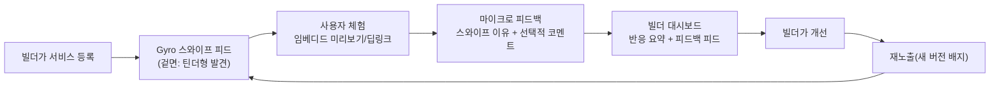
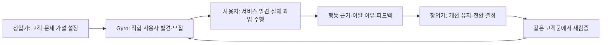

# ideation.md — Gyro PMF 발견·검증 플랫폼 구상 (v0.3)

> **2026-10-30 전략 업데이트:** 최신 제품 방향은 §14다. §14는 발견 사용자(제품의 사용자)와
> 창업가(검증 서비스를 이용하는 핵심 고객)를 분리한 양면 플랫폼 구상이며, 연결된 빌더 중심
> 마케팅·검증 스프린트 제안을 사용자 경험과 PMF 검증 방법까지 확장한다. 기존 MVP와 기능 승인
> 범위는 바꾸지 않는다.

> 이 문서는 `prd.md`/`trd.md`가 정의하는 **현재 구현된 MVP 범위를 바꾸지 않는다.** 여기 적힌 내용은
> 다음 단계 제품 방향을 구상하기 위한 **아이디어 저장소(ideation)**이며, 실제 반영 시에는 별도로
> `prd.md`/`trd.md`를 갱신하고 `AGENTS.md`의 MVP In/Out of Scope를 다시 합의해야 한다.
> (현재 MVP는 로그인/계정 없는 1회성 스와이프 세션이 원칙이며, 이 문서의 일부 아이디어는 이 원칙과
> 충돌할 수 있다 — §7 "MVP 원칙과의 충돌 지점"에 명시해 둔다.)
>
> **업데이트**: 이 문서의 아이디어는 요구사항/기술설계 초안 형태로 `prd.md` §14(Phase 2 — "검증
> 루프" 요구사항 초안)와 `trd.md` §10(Phase 2 기술 설계 초안)에 이미 구조화되어 있다. §14.3/§10.1
> (계정 불필요 항목: 스와이프 이유 마이크로 피드백, 미리보기 재체험 의향 질문, 퍼널 드롭오프 집계)은
> **구현 완료**되어 각 문서의 정식 섹션(prd.md §5/§9-2/§12, trd.md §2.1/§5/§6/§7)으로 승격되었다.
> 빌더 계정·서비스 제출/수정 승인·기본 대시보드·공개 댓글/신고는 사용자 결정으로 `prd.md` §9-9 /
> `trd.md` §13에 승격되었다. 나머지 A/B 테스트·유료 리포트 등은 아직 미승격 아이디어다.
> 세부 배경 설명과 오픈 퀘스천은 이 문서를 계속 참고한다.

## 0. 한 줄 요약
Gyro는 **사용자에게는 지금 필요한 서비스를 찾고 써보는 경험을, 창업가에게는 목표 사용자를 만나
실제 사용 근거를 모아 다음 제품 결정을 내리는 검증 루프를 제공하는 양면 플랫폼**을 지향한다.
최신 구상과 검증 방법은 §14를 기준으로 읽는다.

목표는 PMF를 점수로 판정하거나 보장하는 것이 아니라, **발견 → 적합한 사용자 연결 → 실제 과업
수행 → 근거 있는 피드백 → 개선 → 재검증**을 반복 가능하게 만드는 것이다. 틴더 같은 스와이프는
사용자 발견과 초기 관심을 만드는 인터페이스이지, PMF의 증거 자체는 아니다.

---

## 1. 문제 정의

바이브코딩(생성형 AI 보조 개발)으로 만든 서비스가 폭발적으로 늘고 있지만, 만든 사람 입장에서는 이런
문제가 반복된다.

1. **실사용 통로 부족**: 완성해도 "누구에게 보여줄지"가 없다. SNS에 올려도 노출이 바이브코딩과 무관한
   팔로워에게 흩어지고, 정작 "이 문제를 겪는 잠재 사용자"에게 닿지 않는다.
2. **리뷰/피드백 채널 부재**: 사용자가 써보고도 피드백을 남길 공식적인 창구가 없다. DM이나 댓글은
   휘발되고, 구조화되지 않아 "무엇을 왜 안 좋아했는지"가 남지 않는다.
3. **검증 수단 부재**: "이 서비스가 진짜 쓸모 있는가"를 증명할 지표(관심도, 재방문, 전환)가 없어서,
   다음 버전을 만들 때도, 포트폴리오/창업 지원 사업에 제출할 때도 근거가 없다.
4. **개선 루프 단절**: 설령 피드백을 받아도 그게 다시 제품 개선으로 이어지는 구조(우선순위화 →
   반영 → 재노출 → 재검증)가 없어 일회성으로 끝난다.

즉, 바이브코딩 생태계에는 **"만들기"는 쉬워졌지만 "만든 뒤 검증하기"는 여전히 어려운 공백**이 있다.
Gyro는 지금도 "전시 → 발견"까지는 풀고 있으니, 그 뒤의 "체험 → 피드백 → 개선 → 재검증"까지
확장하면 공백 전체를 메울 수 있다.

---

## 2. 기회: 왜 Gyro가 이 문제를 풀기 좋은가

- 이미 **스와이프 자체가 이진 신호(관심 있음/없음)를 수집하는 구조**라, "써봤다"는 사실과 "첫인상"을
  동시에 포착한다 — 이는 피드백의 가장 저비용 1단계다.
- 이미 **임베디드 미리보기(iframe)**가 있어 사용자가 링크를 새로 열지 않고 같은 화면에서 "체험"까지
  할 수 있다 — 체험 데이터(체류시간, 재방문)를 붙이기만 하면 된다.
- 이미 **랭킹(인기 서비스)**이 있어 "검증된 서비스"를 가시화하는 틀이 있다 — 여기에 "만든 사람에게
  보이는 피드백 요약"을 더하면 빌더용 가치가 즉시 생긴다.
- **설명 가능한 추천 이유**를 이미 노출하고 있어, 나중에 "왜 이 유형의 사용자가 반응했는지"를
  빌더에게 그대로 보여줄 수 있는 기반이 있다.

정리하면: **지금 쌓고 있는 이벤트/UX 자산을 "사용자 발견" 용도에서 "빌더 검증" 용도로 재해석만 하면
되는 구조**라 확장 비용이 생각보다 낮다.

---

## 3. 제품 컨셉 — "Gyro 검증 루프"

겉에서 보면 사용자는 여전히 "카드를 넘기며 서비스를 발견하는" 가벼운 경험을 한다. 다만 그 뒤에서는
① 체험(임베디드) ② 피드백(이유 태그) ③ 랭킹/검증 배지 ④ 빌더 대시보드 ⑤ 재검증 루프까지
하나의 파이프라인으로 연결된다.

### 3.1 핵심 역할(페르소나) 재정의

| 역할 | 기존 Gyro | 확장된 Gyro |
| --- | --- | --- |
| **발견자(사용자)** | 카드 스와이프 후 결과만 봄 | 동일 경험 + "왜 관심 없음을 눌렀는지" 1탭 마이크로 피드백 요청받음(선택) |
| **빌더(바이브코더)** | 카탈로그에 등록만 되는 수동적 존재 | **1차 고객**. 자기 서비스의 반응 데이터·피드백·검증 배지를 보는 대시보드 소유자 |
| **운영기관(바이브벤처 등)** | 프로그램 성과 리포트 수신자 | 동일 + "어떤 팀이 피드백을 반영해 개선했는가"까지 추적 가능 |

---

## 4. 기능 브레인스토밍 (영역별)

### 4.1 서비스 제공(Delivery) — "써보게 하기"
- **임베디드 체험 모드 강화**: 현재의 미리보기 iframe에 "체험 시작/종료" 신호를 붙여 체류시간을
  측정(완전 추적이 아니라 체류시간 버킷 정도의 가벼운 신호로 충분).
- **딥링크 변형 테스트**: 같은 서비스라도 소개 카피/스크린샷 버전을 다르게 보여주는 A/B 카드(§4.4).
- **"같이 써보기" 공유 링크**: 결과 화면에서 특정 서비스 카드를 그대로 공유 가능한 OG 카드로 추출
  (교사가 반 학생들에게 특정 서비스만 바로 보내고 싶을 때).

### 4.2 마케팅(Marketing) — "맞는 사람에게 닿게 하기"
- **인기 랭킹 고도화**(이미 1차 구현됨): 전체 랭킹 외에 "유형별 랭킹"(학생이 가장 좋아하는 서비스,
  교사가 가장 좋아하는 서비스)으로 세분화.
- **빌더 프로필/스토리 카드**: 서비스 카드 뒷면에 "이 서비스를 왜 만들었는지" 1줄 빌더 스토리를
  노출해 발견자의 공감을 유도(단순 기능 소개보다 전환율이 높다는 Product Hunt류 선례).
- **검증 배지**: "100명 체험", "관심 있음 70% 이상" 등 누적 지표 기반 배지를 카드에 노출해 신규
  진입 서비스도 신뢰를 빠르게 얻도록 지원.
- **라운드 믹스 전략**: 신규 등록 서비스를 상위 랭킹 서비스 사이사이에 일정 비율로 섞어 노출해
  "콜드 스타트 서비스"도 최소 노출량을 보장(현재 추천 정렬 로직에 "탐색(exploration)" 비중 추가).

### 4.3 피드백 → 서비스 개선(Feedback Loop) — "진짜 이유를 남기기"
- **스와이프 이유 마이크로 설문**: "관심 없음"을 선택한 직후 선택적으로 1탭 이유 태그 노출
  (예: "설명이 이해 안 됨 / 내 상황과 안 맞음 / 디자인이 별로 / 이미 써봄"). 강제하지 않고 스킵 가능
  해야 현재의 "가볍다"는 UX 원칙을 해치지 않는다.
- **임베디드 체험 후 1문항 피드백**: 미리보기를 닫을 때 "이 서비스, 다시 써보고 싶나요?" 같은 단일
  문항(예/아니오/글쎄요)만 받아 피로도 없이 신호를 더함.
- **빌더용 피드백 피드**: 자기 서비스에 쌓인 이유 태그 분포 + (동의한 경우) 자유 코멘트를 대시보드에
  모아 보여줌 — "설명이 이해 안 됨"이 1위면 카피 개선이 우선순위라는 식의 실행 가능한 인사이트.
- **"개선함" 마킹 → 재검증**: 빌더가 설명/스크린샷/링크를 갱신하면 "업데이트됨" 배지와 함께 재노출,
  이전 버전 대비 반응 변화(관심 있음 비율 변화)를 비교해 보여줌 — 개선이 실제로 먹혔는지 검증.

### 4.4 UX/제품 검증(Validation) — "진짜 쓸모 있는지 증명하기"
- **A/B 카드 테스트**: 같은 서비스에 대해 소개 카피/썸네일을 2개 버전으로 등록 → 세션을 무작위
  분배해 관심 있음 비율을 비교, 빌더에게 "어떤 버전이 더 잘 먹히는지" 리포트.
- **코호트 비교**: 유형(학생/교사/학부모)·관심사별 반응률 분리 제공 — "이 서비스는 교사에게는
  약하지만 학생에게는 강하다"는 식의 세그먼트 인사이트.
- **퍼널 드롭오프 분석**: 카드 노출 → 미리보기 클릭 → 체험 지속 → 관심 있음까지 단계별 이탈률을
  빌더 대시보드에 제공, 어느 단계에서 신뢰를 잃는지 짚어줌.
- **PMF 신호 스코어**: 관심 있음 비율, 재체험 의향 응답률, 재방문(동일 세션 내 재접속) 등을
  가중합해 "초기 PMF 신호 점수"를 산출 — 과장된 지표가 아니라 "다음에 더 investigate 해볼 가치가
  있는가"를 알려주는 방향성 지표로 포지셔닝.

---

## 5. 빌더 대시보드 (개념 스케치)

빌더가 자기 서비스를 보는 화면 하나만 있으면 위 아이디어 대부분이 실질적 가치로 연결된다. 최소
구성안:

| 섹션 | 보여줄 것 |
| --- | --- |
| 요약 | 누적 노출 수, 관심 있음 비율, 전주 대비 변화, 검증 배지 현황 |
| 피드백 | "관심 없음" 이유 태그 분포(막대그래프 수준), 자유 코멘트 목록(동의 건만) |
| 세그먼트 | 유형별/관심사별 반응률 비교 |
| 버전 이력 | 등록 이후 설명/스크린샷 변경 시점과 그 전후 반응률 비교 |
| 체험 데이터 | 미리보기 클릭 수, 평균 체류시간 버킷, 재체험 의향 응답 비율 |

> 이 대시보드는 사실상 "빌더 계정"을 전제로 한다 — 현재 MVP의 "로그인 없음" 원칙과 충돌하는
> 지점이므로 §7에서 별도로 다룬다.

---

## 6. 단계별 전략 연결 (기존 `BUSINESS.md`와의 접점)

| 구분 | Stage 1: 현재(대구 바이브벤처) | Stage 2: 한국 확장 | Stage 3: 글로벌 |
| --- | --- | --- | --- |
| 검증 루프 범위 | 마이크로 피드백 태그 + 랭킹까지만(계정 없이 가능한 범위) | 빌더 자가 등록 + 경량 대시보드(매직링크 등 무비밀번호 인증 검토) | 범용 "바이브코딩 제품 검증 플랫폼"으로 포지셔닝, API로 외부 메이커 커뮤니티/플랫폼과 연동 |
| 수익 연결 | 없음(신호 수집에 집중) | 빌더 대시보드 Pro 플랜(세그먼트 분석, A/B 테스트), 기관 리포트 과금 | 구독 + 데이터 API + 파트너(액셀러레이터/에듀테크) 연동 수수료 |
| 리스크 | 참가 학생은 바이브벤처 소속이라 "계정 생성" 요구가 과한 부담일 수 있음 — opt-in 수준으로 제한 | 빌더 수가 늘면 품질 낮은 서비스가 섞여 랭킹 신뢰도 저하 가능 — 최소 노출/검증 기준 필요 | 다국어 피드백 태그, 문화권별 반응 차이 해석 필요 |

---

## 7. MVP 원칙과의 충돌 지점 (반드시 검토 후 반영)

`AGENTS.md`/`prd.md`의 현재 MVP 원칙은 "로그인 없음, 계정 영속화 없음, 자동 개인화 모델 없음"이다.
이 문서의 아이디어 중 다음은 그 원칙과 직접 충돌하므로, 실제 구현 전 범위를 좁혀 합의가 필요하다.

1. **빌더 대시보드**는 본질적으로 "빌더 계정"이 있어야 한다 — 다만 이는 **발견자(일반 사용자)**가
   아니라 **빌더(공급자)**를 위한 별도 역할이므로, "일반 사용자 로그인 금지" 원칙과는 분리해서 논의
   가능하다(예: 발견자 플로우는 지금처럼 완전 익명 유지, 빌더만 가벼운 인증 적용).
2. **A/B 카드 테스트/세그먼트 분석**은 "자동 개인화 모델 없음" 원칙과는 다르다 — 모델 기반 추천이
   아니라 **집계 통계**이므로 원칙 위반이 아니지만, 혼동 방지를 위해 prd.md에 명시가 필요하다.
3. **마이크로 피드백 태그**는 선택적(opt-in) + 완전 익명으로 설계하면 현재 익명 퍼널 이벤트 체계
   (`POST /api/events`)를 그대로 확장해서 수용 가능 — 계정 없이도 1단계는 바로 시작할 수 있다.

**권장 우선순위**: §4.3의 "스와이프 이유 마이크로 설문"과 §4.4의 "퍼널 드롭오프 분석(집계 통계)"이
계정 없이도 구현 가능하고 즉시 빌더 가치를 만드는 가장 작은 첫걸음이다. 빌더 대시보드/계정은 그 다음
단계로 미루는 것을 제안한다.

---

## 8. 오픈 퀘스천
- 빌더 인증은 어떤 수준이 적정한가(매직링크 이메일 vs. 깃허브 OAuth vs. 바이브벤처 기관 발급 코드)?
- 마이크로 피드백 태그를 스킵 가능하게 하면 응답률이 너무 낮아지지 않는가 — 최소 응답을 유도할
  인센티브(예: 결과 화면에서 "피드백 남기면 랭킹에 내 선택도 반영돼요" 같은 가벼운 동기부여)가
  필요한가?
- 검증 배지("100명 체험" 등)의 최소 표본 기준은 얼마가 적절한가 — 너무 낮으면 신뢰도 문제, 너무
  높으면 콜드 스타트 서비스가 영원히 배지를 못 얻는 문제.
- A/B 카드 테스트가 "같은 서비스인데 다른 설명"으로 보여 발견자에게 혼란을 주지 않는가 — 세션당
  일관성(같은 사용자에게는 항상 같은 버전) 보장이 필요.

---

## 9. 아이디어: 미리보기를 "서비스 상세 아티클" 페이지로 재설계

> 상태: 아티클형 미리보기는 `prd.md` §9-3으로 승격되어 구현되었다. 빌더 계정·서비스 업데이트는
> `prd.md` §9-9로 승격되어 구현 중이며, 공개 댓글·신고·숨김 기능도 같은 섹션에서 다룬다. 공개 배포 전
> 미성년자, 개인정보, 권리·삭제 요청 및 운영기관 역할에 대한 확인이 필요하다.

### 9.1 배경 / 제안 내용
현재 미리보기(`#preview-overlay`)는 서비스 iframe만 크게 띄우는 "기능 미리보기" 형태다. 이를
**아티클/기사형 상세 페이지**로 바꾸자는 제안:

1. 상단에 **서비스 이름 + 한 줄/짧은 설명**(카드에 쓰인 소개 카피 재사용)
2. 그 아래 **미리보기**(현재의 iframe 임베드를 유지, 다만 전체 화면 대신 본문 내 한 섹션으로 축소)
3. (향후 §14.4 빌더 계정이 생기면) **원작자가 직접 남긴 설명/업데이트 노트** — "왜 만들었는지",
   "최근에 뭘 고쳤는지" 등 빌더 본인 코멘트 섹션. 빌더 계정이 없는 현재는 이 섹션을 비워두거나
   숨긴 채로 레이아웃만 먼저 마련한다.
4. 맨 아래 **댓글(피드백) 섹션** — 발견자가 자유 텍스트로 피드백을 남기는 공간. 기존 §4.3 "스와이프
   이유 마이크로 설문"이 1탭 태그였다면, 이건 그보다 한 단계 더 적극적인 사용자가 자발적으로 남기는
   서술형 피드백이다.

즉 레이아웃 순서는: **이름 → 설명 → 미리보기(임베드) → (있으면) 원작자 코멘트 → 댓글/피드백**.

### 9.2 레퍼런스 조사 (유사 "제품 상세 + 피드백" 레이아웃 패턴)

웹 검색으로 조사한 기존 서비스들의 상세 페이지 구조는 공통적으로 "위에서 아래로 소개 → 체험/증거 →
제작자 목소리 → 커뮤니티 반응" 순서를 따른다. 참고할 만한 레퍼런스 3가지:

1. **Product Hunt 제품 상세 페이지**
   - 순서: 히어로 이미지/스크린샷 → 제품명·태그라인 → 짧은 설명(문제/베네핏 중심, 1~3문단) →
     "Get It" 등 CTA → **메이커 코멘트**(제작자가 올리는 첫 댓글, "왜 만들었는지" 스토리 + 피드백
     요청으로 마무리) → **디스커션(댓글) 스레드**(메이커 배지 표시, 질문/답변/찬사 혼재, 업보트 가능).
   - 우리 제안과 가장 유사한 지점: "메이커 코멘트가 디스커션의 첫 항목으로 고정"되는 패턴 — 우리의
     "원작자 설명" 섹션도 댓글 스레드 맨 위에 고정하는 형태로 참고할 수 있다.
2. **Apple App Store / Google Play 앱 상세 페이지**
   - 순서: 아이콘·이름·부제 → 스크린샷/프리뷰 영상 → 설명(기능/베네핏) → "새로운 기능" 업데이트
     노트 → **평점/리뷰** → **개발자의 리뷰 답글**(리뷰 바로 아래 공개로 달림).
   - 참고할 지점: "업데이트 노트"가 설명 섹션 바로 아래 별도로 존재 — 이는 우리 §9.1의 "원작자
     업데이트" 섹션 설계에 직접 참고 가능(빌더가 서비스를 고칠 때마다 짧은 업데이트 노트를 남기는
     형태). 또한 "개발자가 리뷰에 달아주는 답글"은 우리 댓글 섹션에 "빌더 답글" 기능을 나중에 추가할
     근거가 된다.
3. **Medium/기술 블로그형 아티클 레이아웃** (일반적 패턴, 별도 출처 조사 불요 — 업계 표준)
   - 순서: 제목 → 부제/요약 → 대표 이미지 → 본문 → 저자 소개(글 하단, 선택적) → 댓글.
   - 참고할 지점: "저자 소개가 본문 하단에 위치"하는 점 — 우리도 원작자 코멘트를 미리보기(본문)
     하단, 댓글 위에 배치하는 안과 일치한다.

### 9.3 이 저장소 MVP 범위와의 관계
- **지금 바로 구현 가능한 부분**: (1) 이름+설명, (2) 미리보기 임베드 레이아웃 재배치는 계정 없이도
  가능 — 기존 카드 데이터(이름/설명/링크)만 재사용하면 된다.
- **계정이 필요한 부분**: (3) "원작자 설명/업데이트 노트"는 `prd.md` §14.4(빌더 계정, 아직 미구현)에
  의존한다 — 빌더 계정이 생기기 전까지는 이 섹션을 빈 상태(또는 "아직 원작자 코멘트가 없습니다")로
  둔다.
- **댓글/피드백 섹션**: AGENTS.md §4에서 금지하는 "계정/프로필 영속화"와 충돌하지 않도록, 댓글
  작성 자체는 **발견자 로그인 없이** 가능해야 한다(기존 이메일 리드 수집처럼 선택적 닉네임/이메일
  정도만). 단, 댓글 데이터를 누가 조회·관리하는지(공개 여부, 신고/모더레이션)는 별도 설계가
  필요하며 아직 미정 — §9.4 오픈 퀘스천 참고.

### 9.4 오픈 퀘스천 (추가)
- 댓글은 완전 공개(다른 발견자도 볼 수 있음)인가, 빌더에게만 비공개로 전달되는가? 공개라면
  모더레이션(욕설/스팸 필터링) 정책이 필요하다.
- 미리보기를 "오버레이(모달)"에서 "별도 페이지/섹션(아티클 형)"으로 바꾸면 현재의 "가볍게 스와이프
  하다 바로 복귀" UX 리듬이 깨지지 않는가 — 뒤로가기/닫기 동선을 어떻게 유지할지 확인 필요.
- 댓글 작성에 최소한의 스팸 방지가 필요한가(예: rate limit, 간단한 honeypot) — 계정이 없으므로
  악용 방지 설계가 §4.3 마이크로 피드백보다 더 중요해진다.
- 원작자 코멘트/업데이트 노트가 없는 서비스(빌더 미등록 상태)에서 레이아웃이 비어 보이지 않게
  하려면 어떤 플레이스홀더/CTA("원작자이신가요? 소개를 남겨보세요")를 보여줄지.

---

## 10. 관련 문서
- `prd.md`/`trd.md`: 현재 구현된 MVP 요구사항(이 문서의 아이디어는 아직 반영되지 않음).
- `BUSINESS.md`: 단계별(대구 → 한국 → 글로벌) 비즈니스 전략, 수익 구조, 경쟁 비교.
- `AGENTS.md`: 리포지토리 작업 범위 원칙(이 문서의 아이디어 실제 반영 시 재검토 대상).

---

## 11. "셔플" — 테마별 서비스 묶음 확장 (prd.md §9-4로 승격, 구현 진행 중)

### 11.1 용어 정의
- **셔플(shuffle)**: 하나의 독립된 "질문→카드 스와이프→결과" 세트를 구성하는 서비스 카탈로그 묶음.
  지금까지 Gyro의 유일한 셔플은 "대구광역시교육청 인공지능교육센터 바이브벤처 프로그램" 참가
  서비스 묶음이며, 이를 **"바이브 벤처" 셔플**이라고 명명한다(기존 랜딩 버튼 "발견 시작하기"를
  "바이브 벤처"로 개명해 이 셔플의 진입점임을 명확히 한다).
- 이번 확장으로 테마별 셔플을 여러 개 추가한다: 1차로 **SNS / 연애 / 생산성 / 게임** 4개 테마.
  랜딩에 새 진입점 "서비스 이용하기"를 추가해, 누르면 테마 선택 화면(버튼 4개)이 뜨고 테마를
  고르면 해당 셔플로 기존과 동일한 질문→스와이프→결과 플로우를 그대로 재사용한다.

### 11.2 테마별 서비스 데이터 소스
- 각 테마 셔플은 실제 존재하는 스타트업/서비스(예: SNS 테마라면 X, Threads, LinkedIn류)로
  20~30개씩 채운다. 라운드 배칭(턴)은 기존과 동일하게 최대 10장씩.
- 데이터 수집은 **합법적인 방법만** 사용한다: 각 서비스의 공식 사이트/위키/뉴스 등 공개 정보로
  이름·공식 링크·목적을 조사하고, 설명 문구는 마케팅 카피를 복사하지 않고 직접 요약해서 작성한다.
  ToS를 위반하는 크롤링/스크레이핑은 하지 않는다. 미리보기 임베드(iframe)는 기존 메커니즘을
  그대로 쓰되, X-Frame-Options 등으로 임베드가 막히는 서비스는 기존 폴백 UI(새 탭 열기 안내)로
  자연히 처리된다.
- 테마별 관심사 태그는 기존 바이브 벤처 셔플의 태그(학습/창작/생활/생산성/협업/AI)와 다른,
  테마 전용 태그 후보를 쓴다(추천 이유 설명 가능성 유지를 위해).

### 11.3 열린 질문
- 테마별 서비스 수(20~30개)를 어떻게 지속적으로 갱신/검증할지(링크 깨짐, 서비스 종료 등) —
  접속 가능 여부·리다이렉트 변경은 `prd.md` §9-5의 10분 주기 자동 점검으로 처리한다.
  콘텐츠 변경·신규 도구 발굴·리다이렉트 없는 이전은 여전히 수동 재조사가 필요하다.
- 테마가 늘어날수록(5번째 이후) 랜딩의 테마 선택 UI가 스크롤/카테고리 그룹을 요구하게 될 수
  있음 — 1차는 4개로 버튼 나열 방식까지만 다룬다.

---

## 12. 성장 구상 — 사람과 개인 AI 에이전트를 위한 발견·활용 플랫폼

> **사용자가 제시한 장기 비전이며 아래 기능은 미구현 아이디어다.** 현재 MVP의 계정·추천 정책이나
> API 계약을 바꾸지 않는다. 기능별로 `prd.md`/`trd.md`에 먼저 승격하고, 인증·실행·데이터 정책을
> 합의한 뒤 구현한다. 이번에 구현하는 것은 기존 카탈로그의 주기 점검(§11.3 참조)뿐이다.

> **승격 현황:** §12.4의 1~3단계(유형·작업 기반 카탈로그, 검증 배지, 연결 결과 피드백)는
> `prd.md` §9-6 / `trd.md` §11로 승격되었다(구현 전). 에이전트용 조회·공급자 제출·런치 보드는 미승격.

### 12.1 누구의 어떤 문제를 푸는가

핵심 문제는 "새로운 것을 만드는 법"뿐 아니라 **"이미 누군가 만든 해결책이 있는데 존재를 몰라
못 쓰거나 다시 만드는 것"**이다. 출시한 지 오래된 도구도 현재의 작업에 적합하면 발견 대상이다.

| 발견자 | 찾고 싶은 것 | 발견 이후의 성공 |
| --- | --- | --- |
| 일반 사용자 | 생활·학습·생산성 문제를 해결하는 제품/서비스 | 공식 사이트에서 직접 사용 |
| 개발자 | 기존 서비스·API·개발 도구 및 대안 | 공식 문서에서 적용 조건을 확인하고 프로젝트에 활용 |
| 바이브코더 | 만들려는 기능을 이미 해결하는 제품·스킬·MCP | 중복 개발을 줄이고 작업 흐름에 연결 |
| Hermes·Claude 등 개인 AI 에이전트 활용자 | 자신의 에이전트/클라이언트와 호환되는 기능 | 권한·비용·호환성을 이해한 뒤 직접 연결 |

Hermes·Claude는 대상 사용자 환경의 예시이며, 현재 Gyro에 해당 제품 연동이나 호환성 보장이
있다는 뜻이 아니다. 사람이 발견하는 UI와 에이전트가 조회하는 인터페이스는 장차 같은 카탈로그를
공유하되, **조회와 설치/실행은 별개의 권한**으로 취급한다.

### 12.2 현재 Gyro와 연결하는 방법

| 현재 자산 | 다음 연결점(구현 전 승격 필요) | 그대로 보존할 원칙 |
| --- | --- | --- |
| 바이브 벤처·테마별 셔플 | 별도 "만들기·자동화" 진입점과 작업 목적별 묶음 | 기존 일반 사용자 동선·기존 테마 유지 |
| 유형·관심사 질문 + 설명 가능한 점수 | "무엇을 하려는가 / 어느 환경에서 쓰는가" 기반 탐색 | 초기에는 명시적 태그·필터, 자동 개인화 모델 불필요 |
| 10장 카드·추천 이유 | 제품/서비스/스킬/MCP의 유형과 "이 작업에 유용한 이유" | 가벼운 익명 발견, 유형/작업별 비교 |
| 아티클형 미리보기·공식 링크 | 서비스는 체험, 스킬/MCP는 문서·설정·사용 예시 안내 | 실행 불가능한 항목에 가짜 iframe 체험을 제공하지 않음 |
| 결과·관심 있음·피드백·퍼널 | 활용 가이드 및 공급자 개선 루프 | 관심 표시/문서 클릭을 실제 설치·성공으로 오인하지 않음 |
| 주기적 URL 생존·이동 확인 | 신뢰할 수 있는 카탈로그 운영의 바닥 | 접속 정상과 내용 안전·호환성·품질을 구분 |

예시 동선: "반복 보고서 자동화" 선택 → 웹 서비스와 MCP 후보를 같은 작업 기준으로 비교 →
권한·요금·내 환경 호환성 확인 → 웹 서비스 사용 또는 공식 연결 가이드로 이동 → 사용자가 원하면
활용 여부를 피드백. 스와이프는 사람용 발견 방식 중 하나로 유지하며, 향후 에이전트 조회에
스와이프 동작을 강요하지 않는다.

### 12.3 카탈로그를 넓힐 때 필요한 정보(설계 후보)

공통 정보는 안정적인 항목 ID, 항목 유형(`product`/`service`/`skill`/`mcp`), 해결하는 작업,
공식 사이트·문서·출처, 가격/라이선스, 최종 조사일, 마지막 접속 확인일이다. 제품/서비스의 경계와
동일 제품의 웹앱·스킬·MCP 관계는 먼저 편집 기준으로 정하고, 이름이 같다고 단순 합치지 않는다.

스킬에는 배포 형식·지원 에이전트/버전·설치 문서·필요 권한, MCP에는 제공 기능·transport·
로컬/원격 실행·인증 방식·지원 클라이언트/버전·공식 설정 문서를 추가 검토한다. 이는 **현재
`CatalogService`에 추가된 필드가 아니다.** URL 생존 검증과 스킬/MCP의 실제 동작 검증은 구분하고,
실행 검증이 없으면 "문서 확인"으로만 표시한다. 출처와 버전을 알 수 없으면 호환됨으로 추정하지 않는다.

### 12.4 작은 연결부터 확장하는 순서와 검증

1. **현재 기반 정비(이번 범위)**: 기존 전체 카탈로그 생존·이동 주소 자동 확인. 발견 뒤 죽은 링크로
   끝나는 낭비를 줄인다. 신규 유형·연동·가입·자동 설치는 넣지 않는다.
2. **사람용 개발·자동화 발견 실험(후보)**: 기존 생산성/AI 관심사와 연결한 소규모 수동 큐레이션으로
   제품·서비스 수요부터 확인한다. 세션별 공식 문서 이동 비율과 선택적 활용 응답을 별도 측정하고,
   기존 일반 사용자 카드 진입률/공식 링크 클릭률이 악화되지 않는지 비교한다.
3. **스킬/MCP 발견 확장(후보)**: 유형별 설명·호환성·권한·연결 가이드를 갖춘 항목만 추가한다.
   문서 확인 대비 연결 시도/활용 자기보고를 구분한다. 클릭만으로 설치 성공을 집계하지 않는다.
4. **에이전트용 읽기 전용 조회(후보)**: 같은 카탈로그를 검색 가능한 API 또는 Gyro 자체 MCP로
   제공하는 방안을 비교한다. 공식 문서/출처·검증 시각을 함께 반환하고, 사용자 요청에 맞는 후보
   조회까지만 맡긴다. 인증·요청 제한·캐시·외부 콘텐츠 프롬프트 인젝션 대응을 설계한 뒤 진행한다.
5. **공급자 생태계(일부 승격)**: 빌더 인증·소유권 확인·검수 후 등록/업데이트·피드백 대시보드는
   `prd.md` §9-9 / `trd.md` §13으로 승격되었다. 자체 등록 항목은 운영자 검수 후에만 공개한다.

단계별 수치 목표·비교 기간·진행 기준은 실험 전 합의한다. 현재 이벤트에는 설치/실사용 성공,
개발자 역할, 재방문을 신뢰성 있게 측정하는 스키마가 없으므로 기존 집계에서 추정하지 않는다.

### 12.5 차별화와 안전 경계

지향점은 **"Product Hunt형 발견 + 작업/환경 적합성 + 활용까지의 안내"**다. 기존 검증 루프와
경쟁하는 별도 제품이 아니라, 발견자 풀이 개발자·에이전트 사용자로 넓어지고 그 반응이 공급자의
개선으로 돌아오는 동일한 Gyro 생태계다.

비공식 카탈로그는 공개 정보/허용된 API/제출을 통해 조사하고 설명은 직접 요약한다. 외부 스킬·MCP를
Gyro 서버에서 자동 실행하거나, API 키를 수집하거나, 사용자 동의 없이 에이전트 설정을 수정하지
않는다. 향후 실행 연동은 코드 실행·권한·비밀정보 취급·철회·호환성에 대한 별도 설계가 선행되어야
한다. 유료 노출은 표시하고 적합성/정상 동작 보증과 혼동시키지 않는다.

---

## 14. 제품 방향 — PMF를 찾는 사용자·창업가 매칭 플랫폼

### 14.1 포지셔닝과 역할 구분

**제품 한 줄:** "필요한 사람은 맞는 서비스를 찾고, 만든 사람은 맞는 고객에게 써보게 해 다음 결정을
내린다." 사용자는 필요한 해결책을 탐색하고, 창업가는 목표 고객의 실제 행동을 확인한다. Gyro는
양쪽의 만남을 만들고, 사용 후 근거가 제품 개선으로 돌아오게 한다.

| 역할 | 누구인가 | Gyro에서 얻는 가치 | 핵심 성공 |
| --- | --- | --- | --- |
| 사용자(수요 측) | 해결하려는 문제나 하고 싶은 일이 있는 사람 | 내 상황에 맞는 서비스의 발견, 비교, 실제 사용 | 서비스 설명을 이해하고 핵심 과업을 수행해 문제 해결에 도움을 받음 |
| 창업가(공급 측·핵심 고객) | 초기 제품/서비스를 만들고 목표 고객을 찾는 사람 또는 팀 | 적합한 사용자에게 도달하고, 실사용·이탈 근거를 바탕으로 다음 개선을 결정 | 결과를 제품 변경이나 다음 실험에 실제로 활용하고 반복 검증 |
| 기관(후속 구매자 후보) | 창업·교육·액셀러레이팅 프로그램 운영자 | 참가팀의 검증 과정과 학습 결과를 지원·확인 | 여러 팀에서 반복 사용하고 예산을 투입할 이유가 확인됨 |

사용자는 참여자이자 수요 측 고객이지만, 초기 Gyro의 제품·사업 가설에서 **창업가를 핵심 고객**으로
둔다. 기관은 잠재적 구매자일 뿐이며 계약·예산·반복 수요가 검증되기 전까지 확정 고객으로 간주하지
않는다. "고객"이라는 말을 쓸 때는 제품을 사용하는 사용자와 Gyro를 이용·구매하는 창업가/기관을
구분한다.

### 14.2 제품 루프와 핵심 기능

| 순서 | 핵심 기능 | 검증 대상 |
| --- | --- | --- |
| 1. 발견·매칭 | 사용자가 문제/관심 작업을 선택하고, 검수된 서비스 카드에서 비교·탐색한다. 스와이프는 빠른 관심 표현 수단으로 사용한다. | 적합한 서비스가 사용자에게 실제로 발견되는가 |
| 2. 실험 설계 | 창업가가 목표 사용자, 문제, 현재 대안, 핵심 가치, 수행할 과업, 판단 기준을 한 장의 실험 계획으로 정한다. | "누구의 어떤 문제"를 검증할지 구체적인가 |
| 3. 사용자 도달·체험 | 창업가와 Gyro가 동의된 채널로 참여자를 모집하고, 참여자가 실제 서비스에서 핵심 과업을 수행하게 한다. 초기에는 수동 모집·관찰을 허용한다. | 모집된 사람이 목표 사용자에 해당하며 과업에 진입하는가 |
| 4. 근거 수집 | 노출·관심·클릭과 실제 과업 시작·완료·막힘·후속 사용을 별도 단계로 기록하고, 짧은 비유도 질문으로 이유를 수집한다. | 사용자가 가치를 경험했는가, 어디서 왜 이탈했는가 |
| 5. 결정·재검증 | 창업가에게 표본 수, 유입 경로, 행동 근거, 불확실성을 함께 보여주고 다음 행동(개선·고객군 전환·추가 검증·중단)을 선택하게 한다. 변경 후 같은 가설을 다시 시험한다. | 결과가 실제 제품 결정과 반복 실험으로 이어지는가 |

창업가가 구매하는 것은 트래픽이나 대시보드 자체가 아니라 **불확실성을 줄이고 다음 제품 결정을
내리는 과정**이다. 범용 마케팅 자동화, 광고 집행, PMF 자동 점수는 초기 핵심 기능에 포함하지 않는다.

### 14.3 PMF를 어떻게 검증할지

PMF는 하나의 클릭률이나 설문 응답률로 판정하지 않는다. 다음 신호를 단계별로 분리하고, 실험 전에
각 제품의 핵심 행동·관찰 기간·판단 기준을 정한다.

| 검증 단계 | 사용자 제품에서 볼 신호 | 해석 경계 |
| --- | --- | --- |
| 문제 적합성 | 같은 문제를 겪는 빈도, 현재 대안, 해결을 위해 이미 들이는 시간/비용 | "좋은 아이디어"라는 인터뷰 답변만으로 수요라 하지 않음 |
| 도달·적합성 | 목표 사용자 중 실제 과업에 참여한 사람, 모집 채널별 적합성 | 노출·클릭은 과업 참여와 다름 |
| 활성화·가치 | 사전 정의한 핵심 과업 시작/완료, 사용자가 얻은 결과, 막힌 지점 | 가입·페이지 열기·iframe 체류는 가치 경험이 아님 |
| 반복 사용 | 서비스의 자연스러운 사용 주기에 맞춘 재사용 행동 | 재사용 의향과 실제 재사용을 분리하고, 미응답을 미사용으로 단정하지 않음 |
| 지불·지속성 | 가격 제안에 대한 구체적 반응, 결제·계약·갱신 등 실제 약속 | 관심 표현·가상 가격 질문은 지불 의사 확정이 아님 |

증거는 **관심 신호 → 자기보고 → 관찰된 과업 행동 → 동의된 제품 계측 → 반복 사용·지불 행동**의
출처와 강도를 표시한다. 외부 서비스 사용은 Gyro가 자동으로 확인할 수 있다고 가정하지 않는다.
관찰·수기 기록·선택적 자기보고로 시작하고, 제품 계측은 서비스 소유자 동의·필요성·데이터 정책을
별도 합의한 뒤에만 검토한다.

동시에 **Gyro 자체의 PMF**를 창업가 측에서 따로 검증한다.

- 창업가가 결과를 실제 제품 결정에 사용했는가?
- 같은 팀이 다음 가설이나 수정 버전의 검증을 다시 요청했는가?
- 기존 대안(폼, 스프레드시트, 분석도구, 멘토링)보다 더 적은 시간에 더 나은 결정을 내렸는가?
- 창업가 또는 기관이 반복 사용·구매를 위해 구체적인 시간·예산·도입 약속을 했는가?

사용자 제품의 PMF 신호와 Gyro의 고객 유지·구매 신호를 섞지 않는다. 작은 파일럿은 실행 가능성과
학습을 확인하는 수단이지, 시장 수요나 PMF를 통계적으로 입증하는 표본이 아니다. 일반화 가능한
고정 임계값이나 PMF 점수는 현재 정하지 않는다.

### 14.4 첫 실험 제안과 진행 기준

첫 상품 가설은 **Gyro 검증 스프린트**라는 수동 파일럿이다.
예를 들어 2개 팀부터 시작하고, 팀마다 목표 사용자 3~5명 정도와 실제 과업을 관찰할 수 있다. 이
규모는 운영 연습을 위한 제안일 뿐 성공 기준이나 PMF 판정 기준이 아니다. 모집 가능성과 해당
서비스의 사용 주기에 따라 참여자 수·기간을 조정한다.

각 팀은 한 고객군·한 문제·한 핵심 과업·한 개선 가설만 먼저 정한다. Gyro 운영자는 참여자 모집,
테스트 진행, 근거 기록, 결과 해석을 수동으로 지원한다. 한 번의 실험 뒤에는 행동 건수와 관찰
한계를 제시하고 창업가가 무엇을 바꿀지 기록한다. 가능한 경우 수정 전후 같은 과업을 재시험한다.

다음 단계는 기능 출시가 아니라 **병목을 기준으로 한 결정**이다.

- 적합한 참여자를 구하지 못하면: 매칭·모집 채널과 고객군을 먼저 검증한다.
- 사용자가 과업을 시작하지 못하면: 가치 제안, 안내, 온보딩의 어느 부분이 문제인지 분리한다.
- 과업은 끝내지만 반복 사용이 없다면: 가치의 지속성·사용 빈도·대안을 검증한다.
- 창업가가 결과를 사용하지 않거나 재검증을 원하지 않으면: 리포트 형식보다 상품 가치와 진행 방식을 재검토한다.
- 수동 운영이 반복되고 팀이 비용·시간을 지불할 의사를 행동으로 보이면: 그때 데이터 기록·결과 공유·반복 실험 관리부터 최소 자동화한다.

### 14.5 MVP 후보와 경계

현재 구현의 검색·대화 추천·스와이프·공식 링크·피드백·퍼널은 **서비스 발견과 초기 관심 수집**
자산으로 재사용할 수 있다. 다만 관심·클릭 이벤트를 실제 사용이나 PMF로 표현하지 않는다.

향후 승격 후보는 실험 브리프, 동의된 참여자 모집/일정 관리, 핵심 과업 체크리스트, 출처가 표시된
관찰 기록, 팀별 결과 요약, 개선 결정과 후속 실험 이력이다. 이는 제안 목록이며 현 PRD/TRD에
승격된 요구사항이 아니다. 첫 파일럿에서는 문서·스프레드시트 등 수동 도구로 실제 필요성과 반복
병목부터 확인한다.

일반 사용자는 계속 계정 없이 참여하는 것을 기본으로 한다. 참여 전 목적·기록 항목·공유 범위를
알리고 동의를 받으며, 민감한 원문·비밀정보·불필요한 식별정보는 Gyro에 수집하지 않는다. 팀별
결과는 해당 팀에만 제공하고, 발표·사례 공개는 별도 동의를 받는다. 공급자 인증·장기 데이터
보관·외부 서비스 계측은 별도 PRD/TRD와 개인정보 설계를 거쳐야 한다.

### 14.6 핵심 가설과 미확정 사항

1. 목표 사용자와 초기 창업가를 지속적으로 연결할 모집 채널이 있는가?
2. 중립적인 실제 과업 관찰이 기존 폼·분석도구·멘토링으로 얻기 어려운 결정을 돕는가?
3. 창업가는 한 번의 결과가 아니라 반복 검증 과정에 돌아오는가?
4. 참가팀의 반복 사용과 별개로, 운영기관이 이를 프로그램 단위로 구매할 이유와 예산이 있는가?
5. 수동으로 확보한 증거의 품질을 개인정보를 과도하게 수집하지 않고 유지할 수 있는가?

이 가설들은 고객 인터뷰, 실제 테스트, 재이용 행동, 구체적 구매 약속으로 확인한다. 시장 규모,
기존 서비스 대비 우위, 자동 사용자 공급, 매출 가능성은 검증 전까지 사실처럼 서술하지 않는다.
