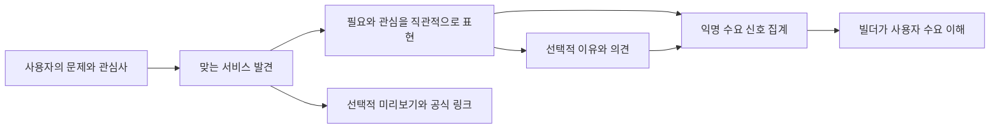

# ideation.md — Gyro 사용자 수요 측정과 스케일업 구상 (v0.3)

> 이 문서는 `prd.md`/`trd.md`가 정의하는 **현재 구현된 MVP 범위를 바꾸지 않는다.** 여기 적힌 내용은
> 다음 단계 제품 방향을 구상하기 위한 **아이디어 저장소(ideation)**이며, 실제 반영 시에는 별도로
> `prd.md`/`trd.md`를 갱신하고 `AGENTS.md`의 MVP In/Out of Scope를 다시 합의해야 한다.
> (현재 MVP는 로그인/계정 없는 1회성 스와이프 세션이 원칙이며, 이 문서의 일부 아이디어는 이 원칙과
> 충돌할 수 있다 — §7 "MVP 원칙과의 충돌 지점"에 명시해 둔다.)
>
> **업데이트**: 이 문서의 아이디어는 요구사항/기술설계 초안 형태로 `prd.md` §14(Phase 2 — "검증
> 루프" 요구사항 초안)와 `trd.md` §10(Phase 2 기술 설계 초안)에 이미 구조화되어 있다. §14.3/§10.1
> (계정 불필요 항목: 스와이프 이유 마이크로 피드백, 미리보기 재체험 의향 질문, 퍼널 드롭오프 집계)은
> **구현 완료**되어 각 문서의 정식 섹션(prd.md §5/§9-2/§12, trd.md §2.1/§5/§6/§7)으로 승격되었다.
> 빌더 계정·서비스 제출/수정 승인·기본 대시보드·공개 댓글/신고는 사용자 결정으로 `prd.md` §9-9 /
> `trd.md` §13에 승격되었다. 나머지 A/B 테스트·유료 리포트 등은 아직 미승격 아이디어다.
> 세부 배경 설명과 오픈 퀘스천은 이 문서를 계속 참고한다.
>
> **현재 방향 정정:** 사용자 중심의 직관적 수요 측정이 핵심이다. MCP 관련 확장은 과거 승격·구현
> 이력과 무관하게 현재 신규 구현 대상에서 제외하고 스케일업으로 보류한다(`prd.md` §9-6 /
> `trd.md` §11). 행동 분석·빌더 수정·전환 재측정 루프는 채택하지 않는다. 아래 §4~§8의
> 빌더 중심 검증 루프 구상은 과거 아이디어 이력이며 현재 제품 방향이나 개발 계획이 아니다.

## 0. 한 줄 요약
Gyro는 **"사용자가 나에게 필요한 서비스를 발견하고, 필요와 사용 의향을 직관적으로 표현하게 하는
수요 측정 서비스"**다. 관심 있음/없음과 선택적 의견을 통해 어떤 상황에서 필요를 느끼는지 이해한다.
발견 UX는 빌더 분석 도구의 겉면이 아니라 사용자에게 제공하는 핵심 가치다.

앱 내부의 클릭·행동 분석으로 UI 문제를 진단하거나 "실제 사용 → 빌더 수정 → 전환 재측정"까지
완료하는 검증 엔진을 지향하지 않는다. 의견은 행동으로 추정할 수 없는 필요·기대·관심 없음의 맥락을
듣는 수단이다. MCP 발견/연결과 Gyro MCP는 현재 착수하지 않고 스케일업 단계에서 별도 승격한다(§12).

---

## 1. 문제 정의

사용자는 자신의 문제를 해결할 서비스가 있는지 찾기 어렵고, 제작자는 잠재 사용자가 그 서비스를
필요로 느끼는지 알기 어렵다. 바이브벤처 작품으로 시작하되 사용자에게 참여 명분은 "학생 앱을
테스트해주기"가 아니라 "내 상황에 맞는 서비스를 찾기"다.

관심이 적다고 카드 설명 문제나 앱 품질 문제로 바로 단정하지 않는다. 사용자의 상황과 서비스가
맞지 않을 수도 있으므로 자발적 의견으로 맥락을 확인한다. 경쟁 서비스의 존재는 문제 공간의
신호일 뿐 Gyro 자체 수요의 검증 결과가 아니며, 아직 고객 테스트 근거가 없는 가설은 가설로 남긴다.

---

## 2. 기회: 왜 Gyro가 이 문제를 풀기 좋은가

- **스와이프 관심 있음/없음**은 낮은 부담으로 첫인상과 직관적 사용 의향을 표현한다. 실제 사용의
  증거는 아니며 건너뛰기와 무응답은 구분한다.
- **선택적 이유·별점·코멘트**는 "왜 필요하거나 필요하지 않은가"의 맥락을 보완한다. QA 의견이나
  사용 완료를 의무화하지 않는다.
- **미리보기·공식 링크**는 더 알아보고 싶은 사람을 위한 선택지다. 클릭·체류시간으로 만족이나
  수요를 확정하지 않는다.
- **추천 이유·랭킹·기본 빌더 대시보드**는 발견과 수요 이해를 돕는다. 인기와 검증된 품질/PMF는 구분한다.

---

## 3. 제품 컨셉 — 사용자 중심 직관적 수요 측정

수요 응답에 실제 사용·상세 피드백·빌더 수정까지 요구하지 않는다. 소규모 테스트에서는 관심 응답과
그 이유가 사용자의 상황을 설명하는지 확인한다. 수정률·수정 전후 전환은 현재 성공 조건이 아니다.
분모·응답 건수·무응답·표본 편향의 해석은 `prd.md` §7 / `trd.md` §2.3을 따른다.

### 3.1 핵심 역할(페르소나) 재정의

| 역할 | 기존 Gyro | 확장된 Gyro |
| --- | --- | --- |
| **발견자(사용자)** | 카드 스와이프 후 결과만 봄 | 동일 경험 + "왜 관심 없음을 눌렀는지" 1탭 마이크로 피드백 요청받음(선택) |
| **빌더(바이브코더)** | 카탈로그에 등록만 되는 수동적 존재 | 자기 서비스가 어떤 사용자에게 필요한지 익명 반응·의견으로 이해 |
| **운영기관(바이브벤처 등)** | 프로그램 성과 리포트 수신자 | 발견과 관심의 집계를 참고하며 실사용·개선 성과로 과장하지 않음 |

---

## 4. 과거 기능 브레인스토밍 이력 (현재 개발 계획 아님)

> §4~§8은 빌더 중심 검증 루프를 검토하던 당시의 기록이다. 개선 진단·재검증·PMF 스코어·
> 행동 분석 확장은 현재 방향에서 제외하며, 일부 구현된 기능도 수요 신호의 보조 맥락으로만 해석한다.

### 4.1 서비스 제공(Delivery) — "써보게 하기"
- **임베디드 체험 모드 강화**: 현재의 미리보기 iframe에 "체험 시작/종료" 신호를 붙여 체류시간을
  측정(완전 추적이 아니라 체류시간 버킷 정도의 가벼운 신호로 충분).
- **딥링크 변형 테스트**: 같은 서비스라도 소개 카피/스크린샷 버전을 다르게 보여주는 A/B 카드(§4.4).
- **"같이 써보기" 공유 링크**: 결과 화면에서 특정 서비스 카드를 그대로 공유 가능한 OG 카드로 추출
  (교사가 반 학생들에게 특정 서비스만 바로 보내고 싶을 때).

### 4.2 마케팅(Marketing) — "맞는 사람에게 닿게 하기"
- **인기 랭킹 고도화**(이미 1차 구현됨): 전체 랭킹 외에 "유형별 랭킹"(학생이 가장 좋아하는 서비스,
  교사가 가장 좋아하는 서비스)으로 세분화.
- **빌더 프로필/스토리 카드**: 서비스 카드 뒷면에 "이 서비스를 왜 만들었는지" 1줄 빌더 스토리를
  노출해 발견자의 공감을 유도(단순 기능 소개보다 전환율이 높다는 Product Hunt류 선례).
- **검증 배지**: "100명 체험", "관심 있음 70% 이상" 등 누적 지표 기반 배지를 카드에 노출해 신규
  진입 서비스도 신뢰를 빠르게 얻도록 지원.
- **라운드 믹스 전략**: 신규 등록 서비스를 상위 랭킹 서비스 사이사이에 일정 비율로 섞어 노출해
  "콜드 스타트 서비스"도 최소 노출량을 보장(현재 추천 정렬 로직에 "탐색(exploration)" 비중 추가).

### 4.3 피드백 → 서비스 개선(Feedback Loop) — "진짜 이유를 남기기"
- **스와이프 이유 마이크로 설문**: "관심 없음"을 선택한 직후 선택적으로 1탭 이유 태그 노출
  (예: "설명이 이해 안 됨 / 내 상황과 안 맞음 / 디자인이 별로 / 이미 써봄"). 강제하지 않고 스킵 가능
  해야 현재의 "가볍다"는 UX 원칙을 해치지 않는다.
- **임베디드 체험 후 1문항 피드백**: 미리보기를 닫을 때 "이 서비스, 다시 써보고 싶나요?" 같은 단일
  문항(예/아니오/글쎄요)만 받아 피로도 없이 신호를 더함.
- **빌더용 피드백 피드**: 자기 서비스에 쌓인 이유 태그 분포 + (동의한 경우) 자유 코멘트를 대시보드에
  모아 보여줌 — "설명이 이해 안 됨"이 1위면 카피 개선이 우선순위라는 식의 실행 가능한 인사이트.
- **"개선함" 마킹 → 재검증**: 빌더가 설명/스크린샷/링크를 갱신하면 "업데이트됨" 배지와 함께 재노출,
  이전 버전 대비 반응 변화(관심 있음 비율 변화)를 비교해 보여줌 — 개선이 실제로 먹혔는지 검증.

### 4.4 UX/제품 검증(Validation) — "진짜 쓸모 있는지 증명하기"
- **A/B 카드 테스트**: 같은 서비스에 대해 소개 카피/썸네일을 2개 버전으로 등록 → 세션을 무작위
  분배해 관심 있음 비율을 비교, 빌더에게 "어떤 버전이 더 잘 먹히는지" 리포트.
- **코호트 비교**: 유형(학생/교사/학부모)·관심사별 반응률 분리 제공 — "이 서비스는 교사에게는
  약하지만 학생에게는 강하다"는 식의 세그먼트 인사이트.
- **퍼널 드롭오프 분석**: 카드 노출 → 미리보기 클릭 → 체험 지속 → 관심 있음까지 단계별 이탈률을
  빌더 대시보드에 제공, 어느 단계에서 신뢰를 잃는지 짚어줌.
- **PMF 신호 스코어**: 관심 있음 비율, 재체험 의향 응답률, 재방문(동일 세션 내 재접속) 등을
  가중합해 "초기 PMF 신호 점수"를 산출 — 과장된 지표가 아니라 "다음에 더 investigate 해볼 가치가
  있는가"를 알려주는 방향성 지표로 포지셔닝.

---

## 5. 빌더 대시보드 (개념 스케치)

빌더가 자기 서비스를 보는 화면 하나만 있으면 위 아이디어 대부분이 실질적 가치로 연결된다. 최소
구성안:

| 섹션 | 보여줄 것 |
| --- | --- |
| 요약 | 누적 노출 수, 관심 있음 비율, 전주 대비 변화, 검증 배지 현황 |
| 피드백 | "관심 없음" 이유 태그 분포(막대그래프 수준), 자유 코멘트 목록(동의 건만) |
| 세그먼트 | 유형별/관심사별 반응률 비교 |
| 버전 이력 | 등록 이후 설명/스크린샷 변경 시점과 그 전후 반응률 비교 |
| 체험 데이터 | 미리보기 클릭 수, 평균 체류시간 버킷, 재체험 의향 응답 비율 |

> 이 대시보드는 사실상 "빌더 계정"을 전제로 한다 — 현재 MVP의 "로그인 없음" 원칙과 충돌하는
> 지점이므로 §7에서 별도로 다룬다.

---

## 6. 단계별 전략 연결 (기존 `BUSINESS.md`와의 접점)

| 구분 | Stage 1: 현재(대구 바이브벤처) | Stage 2: 한국 확장 | Stage 3: 글로벌 |
| --- | --- | --- | --- |
| 검증 루프 범위 | 마이크로 피드백 태그 + 랭킹까지만(계정 없이 가능한 범위) | 빌더 자가 등록 + 경량 대시보드(매직링크 등 무비밀번호 인증 검토) | 범용 "바이브코딩 제품 검증 플랫폼"으로 포지셔닝, API로 외부 메이커 커뮤니티/플랫폼과 연동 |
| 수익 연결 | 없음(신호 수집에 집중) | 빌더 대시보드 Pro 플랜(세그먼트 분석, A/B 테스트), 기관 리포트 과금 | 구독 + 데이터 API + 파트너(액셀러레이터/에듀테크) 연동 수수료 |
| 리스크 | 참가 학생은 바이브벤처 소속이라 "계정 생성" 요구가 과한 부담일 수 있음 — opt-in 수준으로 제한 | 빌더 수가 늘면 품질 낮은 서비스가 섞여 랭킹 신뢰도 저하 가능 — 최소 노출/검증 기준 필요 | 다국어 피드백 태그, 문화권별 반응 차이 해석 필요 |

---

## 7. MVP 원칙과의 충돌 지점 (반드시 검토 후 반영)

`AGENTS.md`/`prd.md`의 현재 MVP 원칙은 "로그인 없음, 계정 영속화 없음, 자동 개인화 모델 없음"이다.
이 문서의 아이디어 중 다음은 그 원칙과 직접 충돌하므로, 실제 구현 전 범위를 좁혀 합의가 필요하다.

1. **빌더 대시보드**는 본질적으로 "빌더 계정"이 있어야 한다 — 다만 이는 **발견자(일반 사용자)**가
   아니라 **빌더(공급자)**를 위한 별도 역할이므로, "일반 사용자 로그인 금지" 원칙과는 분리해서 논의
   가능하다(예: 발견자 플로우는 지금처럼 완전 익명 유지, 빌더만 가벼운 인증 적용).
2. **A/B 카드 테스트/세그먼트 분석**은 "자동 개인화 모델 없음" 원칙과는 다르다 — 모델 기반 추천이
   아니라 **집계 통계**이므로 원칙 위반이 아니지만, 혼동 방지를 위해 prd.md에 명시가 필요하다.
3. **마이크로 피드백 태그**는 선택적(opt-in) + 완전 익명으로 설계하면 현재 익명 퍼널 이벤트 체계
   (`POST /api/events`)를 그대로 확장해서 수용 가능 — 계정 없이도 1단계는 바로 시작할 수 있다.

**권장 우선순위**: §4.3의 "스와이프 이유 마이크로 설문"과 §4.4의 "퍼널 드롭오프 분석(집계 통계)"이
계정 없이도 구현 가능하고 즉시 빌더 가치를 만드는 가장 작은 첫걸음이다. 빌더 대시보드/계정은 그 다음
단계로 미루는 것을 제안한다.

---

## 8. 오픈 퀘스천
- 빌더 인증은 어떤 수준이 적정한가(매직링크 이메일 vs. 깃허브 OAuth vs. 바이브벤처 기관 발급 코드)?
- 마이크로 피드백 태그를 스킵 가능하게 하면 응답률이 너무 낮아지지 않는가 — 최소 응답을 유도할
  인센티브(예: 결과 화면에서 "피드백 남기면 랭킹에 내 선택도 반영돼요" 같은 가벼운 동기부여)가
  필요한가?
- 검증 배지("100명 체험" 등)의 최소 표본 기준은 얼마가 적절한가 — 너무 낮으면 신뢰도 문제, 너무
  높으면 콜드 스타트 서비스가 영원히 배지를 못 얻는 문제.
- A/B 카드 테스트가 "같은 서비스인데 다른 설명"으로 보여 발견자에게 혼란을 주지 않는가 — 세션당
  일관성(같은 사용자에게는 항상 같은 버전) 보장이 필요.

---

## 9. 아이디어: 미리보기를 "서비스 상세 아티클" 페이지로 재설계

> 상태: 아티클형 미리보기는 `prd.md` §9-3으로 승격되어 구현되었다. 빌더 계정·서비스 업데이트는
> `prd.md` §9-9로 승격되어 구현 중이며, 공개 댓글·신고·숨김 기능도 같은 섹션에서 다룬다. 공개 배포 전
> 미성년자, 개인정보, 권리·삭제 요청 및 운영기관 역할에 대한 확인이 필요하다.

### 9.1 배경 / 제안 내용
현재 미리보기(`#preview-overlay`)는 서비스 iframe만 크게 띄우는 "기능 미리보기" 형태다. 이를
**아티클/기사형 상세 페이지**로 바꾸자는 제안:

1. 상단에 **서비스 이름 + 한 줄/짧은 설명**(카드에 쓰인 소개 카피 재사용)
2. 그 아래 **미리보기**(현재의 iframe 임베드를 유지, 다만 전체 화면 대신 본문 내 한 섹션으로 축소)
3. (향후 §14.4 빌더 계정이 생기면) **원작자가 직접 남긴 설명/업데이트 노트** — "왜 만들었는지",
   "최근에 뭘 고쳤는지" 등 빌더 본인 코멘트 섹션. 빌더 계정이 없는 현재는 이 섹션을 비워두거나
   숨긴 채로 레이아웃만 먼저 마련한다.
4. 맨 아래 **댓글(피드백) 섹션** — 발견자가 자유 텍스트로 피드백을 남기는 공간. 기존 §4.3 "스와이프
   이유 마이크로 설문"이 1탭 태그였다면, 이건 그보다 한 단계 더 적극적인 사용자가 자발적으로 남기는
   서술형 피드백이다.

즉 레이아웃 순서는: **이름 → 설명 → 미리보기(임베드) → (있으면) 원작자 코멘트 → 댓글/피드백**.

### 9.2 레퍼런스 조사 (유사 "제품 상세 + 피드백" 레이아웃 패턴)

웹 검색으로 조사한 기존 서비스들의 상세 페이지 구조는 공통적으로 "위에서 아래로 소개 → 체험/증거 →
제작자 목소리 → 커뮤니티 반응" 순서를 따른다. 참고할 만한 레퍼런스 3가지:

1. **Product Hunt 제품 상세 페이지**
   - 순서: 히어로 이미지/스크린샷 → 제품명·태그라인 → 짧은 설명(문제/베네핏 중심, 1~3문단) →
     "Get It" 등 CTA → **메이커 코멘트**(제작자가 올리는 첫 댓글, "왜 만들었는지" 스토리 + 피드백
     요청으로 마무리) → **디스커션(댓글) 스레드**(메이커 배지 표시, 질문/답변/찬사 혼재, 업보트 가능).
   - 우리 제안과 가장 유사한 지점: "메이커 코멘트가 디스커션의 첫 항목으로 고정"되는 패턴 — 우리의
     "원작자 설명" 섹션도 댓글 스레드 맨 위에 고정하는 형태로 참고할 수 있다.
2. **Apple App Store / Google Play 앱 상세 페이지**
   - 순서: 아이콘·이름·부제 → 스크린샷/프리뷰 영상 → 설명(기능/베네핏) → "새로운 기능" 업데이트
     노트 → **평점/리뷰** → **개발자의 리뷰 답글**(리뷰 바로 아래 공개로 달림).
   - 참고할 지점: "업데이트 노트"가 설명 섹션 바로 아래 별도로 존재 — 이는 우리 §9.1의 "원작자
     업데이트" 섹션 설계에 직접 참고 가능(빌더가 서비스를 고칠 때마다 짧은 업데이트 노트를 남기는
     형태). 또한 "개발자가 리뷰에 달아주는 답글"은 우리 댓글 섹션에 "빌더 답글" 기능을 나중에 추가할
     근거가 된다.
3. **Medium/기술 블로그형 아티클 레이아웃** (일반적 패턴, 별도 출처 조사 불요 — 업계 표준)
   - 순서: 제목 → 부제/요약 → 대표 이미지 → 본문 → 저자 소개(글 하단, 선택적) → 댓글.
   - 참고할 지점: "저자 소개가 본문 하단에 위치"하는 점 — 우리도 원작자 코멘트를 미리보기(본문)
     하단, 댓글 위에 배치하는 안과 일치한다.

### 9.3 이 저장소 MVP 범위와의 관계
- **지금 바로 구현 가능한 부분**: (1) 이름+설명, (2) 미리보기 임베드 레이아웃 재배치는 계정 없이도
  가능 — 기존 카드 데이터(이름/설명/링크)만 재사용하면 된다.
- **계정이 필요한 부분**: (3) "원작자 설명/업데이트 노트"는 `prd.md` §14.4(빌더 계정, 아직 미구현)에
  의존한다 — 빌더 계정이 생기기 전까지는 이 섹션을 빈 상태(또는 "아직 원작자 코멘트가 없습니다")로
  둔다.
- **댓글/피드백 섹션**: AGENTS.md §4에서 금지하는 "계정/프로필 영속화"와 충돌하지 않도록, 댓글
  작성 자체는 **발견자 로그인 없이** 가능해야 한다(기존 이메일 리드 수집처럼 선택적 닉네임/이메일
  정도만). 단, 댓글 데이터를 누가 조회·관리하는지(공개 여부, 신고/모더레이션)는 별도 설계가
  필요하며 아직 미정 — §9.4 오픈 퀘스천 참고.

### 9.4 오픈 퀘스천 (추가)
- 댓글은 완전 공개(다른 발견자도 볼 수 있음)인가, 빌더에게만 비공개로 전달되는가? 공개라면
  모더레이션(욕설/스팸 필터링) 정책이 필요하다.
- 미리보기를 "오버레이(모달)"에서 "별도 페이지/섹션(아티클 형)"으로 바꾸면 현재의 "가볍게 스와이프
  하다 바로 복귀" UX 리듬이 깨지지 않는가 — 뒤로가기/닫기 동선을 어떻게 유지할지 확인 필요.
- 댓글 작성에 최소한의 스팸 방지가 필요한가(예: rate limit, 간단한 honeypot) — 계정이 없으므로
  악용 방지 설계가 §4.3 마이크로 피드백보다 더 중요해진다.
- 원작자 코멘트/업데이트 노트가 없는 서비스(빌더 미등록 상태)에서 레이아웃이 비어 보이지 않게
  하려면 어떤 플레이스홀더/CTA("원작자이신가요? 소개를 남겨보세요")를 보여줄지.

---

## 10. 관련 문서
- `prd.md`/`trd.md`: 현재 구현된 MVP 요구사항(이 문서의 아이디어는 아직 반영되지 않음).
- `BUSINESS.md`: 단계별(대구 → 한국 → 글로벌) 비즈니스 전략, 수익 구조, 경쟁 비교.
- `AGENTS.md`: 리포지토리 작업 범위 원칙(이 문서의 아이디어 실제 반영 시 재검토 대상).

---

## 11. "셔플" — 테마별 서비스 묶음 확장 (prd.md §9-4로 승격, 구현 진행 중)

### 11.1 용어 정의
- **셔플(shuffle)**: 하나의 독립된 "질문→카드 스와이프→결과" 세트를 구성하는 서비스 카탈로그 묶음.
  지금까지 Gyro의 유일한 셔플은 "대구광역시교육청 인공지능교육센터 바이브벤처 프로그램" 참가
  서비스 묶음이며, 이를 **"바이브 벤처" 셔플**이라고 명명한다(기존 랜딩 버튼 "발견 시작하기"를
  "바이브 벤처"로 개명해 이 셔플의 진입점임을 명확히 한다).
- 이번 확장으로 테마별 셔플을 여러 개 추가한다: 1차로 **SNS / 연애 / 생산성 / 게임** 4개 테마.
  랜딩에 새 진입점 "서비스 이용하기"를 추가해, 누르면 테마 선택 화면(버튼 4개)이 뜨고 테마를
  고르면 해당 셔플로 기존과 동일한 질문→스와이프→결과 플로우를 그대로 재사용한다.

### 11.2 테마별 서비스 데이터 소스
- 각 테마 셔플은 실제 존재하는 스타트업/서비스(예: SNS 테마라면 X, Threads, LinkedIn류)로
  20~30개씩 채운다. 라운드 배칭(턴)은 기존과 동일하게 최대 10장씩.
- 데이터 수집은 **합법적인 방법만** 사용한다: 각 서비스의 공식 사이트/위키/뉴스 등 공개 정보로
  이름·공식 링크·목적을 조사하고, 설명 문구는 마케팅 카피를 복사하지 않고 직접 요약해서 작성한다.
  ToS를 위반하는 크롤링/스크레이핑은 하지 않는다. 미리보기 임베드(iframe)는 기존 메커니즘을
  그대로 쓰되, X-Frame-Options 등으로 임베드가 막히는 서비스는 기존 폴백 UI(새 탭 열기 안내)로
  자연히 처리된다.
- 테마별 관심사 태그는 기존 바이브 벤처 셔플의 태그(학습/창작/생활/생산성/협업/AI)와 다른,
  테마 전용 태그 후보를 쓴다(추천 이유 설명 가능성 유지를 위해).

### 11.3 열린 질문
- 테마별 서비스 수(20~30개)를 어떻게 지속적으로 갱신/검증할지(링크 깨짐, 서비스 종료 등) —
  접속 가능 여부·리다이렉트 변경은 `prd.md` §9-5의 10분 주기 자동 점검으로 처리한다.
  콘텐츠 변경·신규 도구 발굴·리다이렉트 없는 이전은 여전히 수동 재조사가 필요하다.
- 테마가 늘어날수록(5번째 이후) 랜딩의 테마 선택 UI가 스크롤/카테고리 그룹을 요구하게 될 수
  있음 — 1차는 4개로 버튼 나열 방식까지만 다룬다.

---

## 12. 스케일업 구상 — 사람과 개인 AI 에이전트를 위한 발견·활용 플랫폼

> **사용자가 제시한 장기 비전이며 아래 기능은 미구현 아이디어다.** 현재 MVP의 계정·추천 정책이나
> API 계약을 바꾸지 않는다. 기능별로 `prd.md`/`trd.md`에 먼저 승격하고, 인증·실행·데이터 정책을
> 합의한 뒤 구현한다. 이번에 구현하는 것은 기존 카탈로그의 주기 점검(§11.3 참조)뿐이다.

> **현재 상태:** 유형·작업 기반 카탈로그, 검증 배지, 연결 결과는 과거 `prd.md` §9-6 /
> `trd.md` §11로 승격·구현되었다. 그러나 **MCP 관련 신규 구현·확장은 스케일업으로 보류**한다.
> 에이전트용 API/Gyro MCP도 현재 구현하지 않는다. 기존 코드가 있다는 이유로 현재 범위에 포함하지 않으며,
> 사용자 대상 기존 MCP 노출은 이번 방향 변경에서 그대로 두며, 유지/숨김/제거 여부는 미결정이다.
> 다시 착수하려면 PRD/TRD 재승격이 필요하다. 빌더 포털의 현행 범위는 §9-9/§13을 따른다.

### 12.1 누구의 어떤 문제를 푸는가

핵심 문제는 "새로운 것을 만드는 법"뿐 아니라 **"이미 누군가 만든 해결책이 있는데 존재를 몰라
못 쓰거나 다시 만드는 것"**이다. 출시한 지 오래된 도구도 현재의 작업에 적합하면 발견 대상이다.

| 발견자 | 찾고 싶은 것 | 발견 이후의 성공 |
| --- | --- | --- |
| 일반 사용자 | 생활·학습·생산성 문제를 해결하는 제품/서비스 | 공식 사이트에서 직접 사용 |
| 개발자 | 기존 서비스·API·개발 도구 및 대안 | 공식 문서에서 적용 조건을 확인하고 프로젝트에 활용 |
| 바이브코더 | 만들려는 기능을 이미 해결하는 제품·스킬·MCP | 중복 개발을 줄이고 작업 흐름에 연결 |
| Hermes·Claude 등 개인 AI 에이전트 활용자 | 자신의 에이전트/클라이언트와 호환되는 기능 | 권한·비용·호환성을 이해한 뒤 직접 연결 |

Hermes·Claude는 대상 사용자 환경의 예시이며, 현재 Gyro에 해당 제품 연동이나 호환성 보장이
있다는 뜻이 아니다. 사람이 발견하는 UI와 에이전트가 조회하는 인터페이스는 장차 같은 카탈로그를
공유하되, **조회와 설치/실행은 별개의 권한**으로 취급한다.

### 12.2 현재 Gyro와 연결하는 방법

| 현재 자산 | 다음 연결점(구현 전 승격 필요) | 그대로 보존할 원칙 |
| --- | --- | --- |
| 바이브 벤처·테마별 셔플 | 별도 "만들기·자동화" 진입점과 작업 목적별 묶음 | 기존 일반 사용자 동선·기존 테마 유지 |
| 유형·관심사 질문 + 설명 가능한 점수 | "무엇을 하려는가 / 어느 환경에서 쓰는가" 기반 탐색 | 초기에는 명시적 태그·필터, 자동 개인화 모델 불필요 |
| 10장 카드·추천 이유 | 제품/서비스/스킬/MCP의 유형과 "이 작업에 유용한 이유" | 가벼운 익명 발견, 유형/작업별 비교 |
| 아티클형 미리보기·공식 링크 | 서비스는 체험, 스킬/MCP는 문서·설정·사용 예시 안내 | 실행 불가능한 항목에 가짜 iframe 체험을 제공하지 않음 |
| 결과·관심 있음·피드백·퍼널 | 활용 가이드 및 공급자 개선 루프 | 관심 표시/문서 클릭을 실제 설치·성공으로 오인하지 않음 |
| 주기적 URL 생존·이동 확인 | 신뢰할 수 있는 카탈로그 운영의 바닥 | 접속 정상과 내용 안전·호환성·품질을 구분 |

예시 동선: "반복 보고서 자동화" 선택 → 웹 서비스와 MCP 후보를 같은 작업 기준으로 비교 →
권한·요금·내 환경 호환성 확인 → 웹 서비스 사용 또는 공식 연결 가이드로 이동 → 사용자가 원하면
활용 여부를 피드백. 스와이프는 사람용 발견 방식 중 하나로 유지하며, 향후 에이전트 조회에
스와이프 동작을 강요하지 않는다.

### 12.3 카탈로그를 넓힐 때 필요한 정보(설계 후보)

공통 정보는 안정적인 항목 ID, 항목 유형(`product`/`service`/`skill`/`mcp`), 해결하는 작업,
공식 사이트·문서·출처, 가격/라이선스, 최종 조사일, 마지막 접속 확인일이다. 제품/서비스의 경계와
동일 제품의 웹앱·스킬·MCP 관계는 먼저 편집 기준으로 정하고, 이름이 같다고 단순 합치지 않는다.

기존 카탈로그에는 `kind`·`tasks`·`connection`·`verification` 필드가 구현되어 있으며 호환성을 보존한다.
스킬에는 배포 형식·지원 에이전트/버전·설치 문서·필요 권한, MCP에는 제공 기능·transport·
로컬/원격 실행·인증 방식·지원 클라이언트/버전·공식 설정 문서의 추가 확장을 스케일업 후보로만 검토한다.
URL 생존 검증과 스킬/MCP의 실제 동작 검증은 구분하고,
실행 검증이 없으면 "문서 확인"으로만 표시한다. 출처와 버전을 알 수 없으면 호환됨으로 추정하지 않는다.

### 12.4 작은 연결부터 확장하는 순서와 검증

1. **현재 기반 정비(이번 범위)**: 기존 전체 카탈로그 생존·이동 주소 자동 확인. 발견 뒤 죽은 링크로
   끝나는 낭비를 줄인다. 신규 유형·연동·가입·자동 설치는 넣지 않는다.
2. **사람용 개발·자동화 발견 실험(후보)**: 기존 생산성/AI 관심사와 연결한 소규모 수동 큐레이션으로
   제품·서비스 수요부터 확인한다. 세션별 공식 문서 이동 비율과 선택적 활용 응답을 별도 측정하고,
   기존 일반 사용자 카드 진입률/공식 링크 클릭률이 악화되지 않는지 비교한다.
3. **스킬/MCP 발견 확장(스케일업 후보, 현재 착수 금지)**: 유형별 설명·호환성·권한·연결 가이드를 갖춘 항목만 추가한다.
   문서 확인 대비 연결 시도/활용 자기보고를 구분한다. 클릭만으로 설치 성공을 집계하지 않는다.
4. **에이전트용 읽기 전용 조회(스케일업 후보, 현재 착수 금지)**: 같은 카탈로그를 검색 가능한 API 또는 Gyro 자체 MCP로
   제공하는 방안을 비교한다. 공식 문서/출처·검증 시각을 함께 반환하고, 사용자 요청에 맞는 후보
   조회까지만 맡긴다. 인증·요청 제한·캐시·외부 콘텐츠 프롬프트 인젝션 대응을 설계한 뒤 진행한다.
5. **공급자 생태계(일부 승격)**: 빌더 인증·소유권 확인·검수 후 등록/업데이트·피드백 대시보드는
   `prd.md` §9-9 / `trd.md` §13으로 승격되었다. 자체 등록 항목은 운영자 검수 후에만 공개한다.

단계별 수치 목표·비교 기간·진행 기준은 실험 전 합의한다. 현재 이벤트에는 설치/실사용 성공,
개발자 역할, 재방문을 신뢰성 있게 측정하는 스키마가 없으므로 기존 집계에서 추정하지 않는다.

### 12.5 차별화와 안전 경계

현재 차별화 가설은 **"사용자에게 필요한 서비스 발견 + 직관적 수요 표현"**이다. 교육 프로그램은
초기 공급 범위이며 발견자를 테스트 인력으로 모집하는 포지션이 아니다. 개발자·에이전트로 발견자
범위를 넓히는 구상은 스케일업 후보일 뿐, MCP 확대나 개선 루프를 지금의 핵심 검증에 섞지 않는다.

비공식 카탈로그는 공개 정보/허용된 API/제출을 통해 조사하고 설명은 직접 요약한다. 외부 스킬·MCP를
Gyro 서버에서 자동 실행하거나, API 키를 수집하거나, 사용자 동의 없이 에이전트 설정을 수정하지
않는다. 향후 실행 연동은 코드 실행·권한·비밀정보 취급·철회·호환성에 대한 별도 설계가 선행되어야
한다. 유료 노출은 표시하고 적합성/정상 동작 보증과 혼동시키지 않는다.
