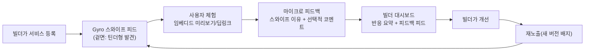

# ideation.md — Gyro를 "바이브코딩 서비스 검증 엔진"으로 확장하는 아이디어 (v0.1)

> 이 문서는 `prd.md`/`trd.md`가 정의하는 **현재 구현된 MVP 범위를 바꾸지 않는다.** 여기 적힌 내용은
> 다음 단계 제품 방향을 구상하기 위한 **아이디어 저장소(ideation)**이며, 실제 반영 시에는 별도로
> `prd.md`/`trd.md`를 갱신하고 `AGENTS.md`의 MVP In/Out of Scope를 다시 합의해야 한다.
> (현재 MVP는 로그인/계정 없는 1회성 스와이프 세션이 원칙이며, 이 문서의 일부 아이디어는 이 원칙과
> 충돌할 수 있다 — §7 "MVP 원칙과의 충돌 지점"에 명시해 둔다.)
>
> **업데이트**: 이 문서의 아이디어는 요구사항/기술설계 초안 형태로 `prd.md` §14(Phase 2 — "검증
> 루프" 요구사항 초안)와 `trd.md` §10(Phase 2 기술 설계 초안)에 이미 구조화되어 있다. §14.3/§10.1
> (계정 불필요 항목: 스와이프 이유 마이크로 피드백, 미리보기 재체험 의향 질문, 퍼널 드롭오프 집계)은
> **구현 완료**되어 각 문서의 정식 섹션(prd.md §5/§9-2/§12, trd.md §2.1/§5/§6/§7)으로 승격되었다.
> §14.4/§10.2(빌더 계정 필요 항목)는 여전히 **미구현 초안**이며, 실제 구현 착수 시에만 승격된다.
> 세부 배경 설명과 오픈 퀘스천은 이 문서를 계속 참고한다.

## 0. 한 줄 요약
Gyro를 "신규 서비스를 스와이프로 발견시키는 리드마그넷"에서, **"바이브코딩으로 만든 서비스가 실제
사용자에게 도달해 써보고, 솔직한 반응을 남기고, 그 반응이 다시 만든 사람에게 돌아가 개선으로
이어지는 전 과정(발견 → 전달 → 체험 → 피드백 → 개선 → 재검증)을 한 번에 돌리는 검증 엔진"**으로
확장한다. 틴더 스타일의 가벼운 스와이프 UX는 **사용자 쪽 진입 장벽을 낮추는 겉면(lead magnet)**으로
그대로 유지하고, 그 안쪽에 빌더(바이브코더)를 위한 가치가 쌓이는 구조를 설계한다.

---

## 1. 문제 정의

바이브코딩(생성형 AI 보조 개발)으로 만든 서비스가 폭발적으로 늘고 있지만, 만든 사람 입장에서는 이런
문제가 반복된다.

1. **실사용 통로 부족**: 완성해도 "누구에게 보여줄지"가 없다. SNS에 올려도 노출이 바이브코딩과 무관한
   팔로워에게 흩어지고, 정작 "이 문제를 겪는 잠재 사용자"에게 닿지 않는다.
2. **리뷰/피드백 채널 부재**: 사용자가 써보고도 피드백을 남길 공식적인 창구가 없다. DM이나 댓글은
   휘발되고, 구조화되지 않아 "무엇을 왜 안 좋아했는지"가 남지 않는다.
3. **검증 수단 부재**: "이 서비스가 진짜 쓸모 있는가"를 증명할 지표(관심도, 재방문, 전환)가 없어서,
   다음 버전을 만들 때도, 포트폴리오/창업 지원 사업에 제출할 때도 근거가 없다.
4. **개선 루프 단절**: 설령 피드백을 받아도 그게 다시 제품 개선으로 이어지는 구조(우선순위화 →
   반영 → 재노출 → 재검증)가 없어 일회성으로 끝난다.

즉, 바이브코딩 생태계에는 **"만들기"는 쉬워졌지만 "만든 뒤 검증하기"는 여전히 어려운 공백**이 있다.
Gyro는 지금도 "전시 → 발견"까지는 풀고 있으니, 그 뒤의 "체험 → 피드백 → 개선 → 재검증"까지
확장하면 공백 전체를 메울 수 있다.

---

## 2. 기회: 왜 Gyro가 이 문제를 풀기 좋은가

- 이미 **스와이프 자체가 이진 신호(관심 있음/없음)를 수집하는 구조**라, "써봤다"는 사실과 "첫인상"을
  동시에 포착한다 — 이는 피드백의 가장 저비용 1단계다.
- 이미 **임베디드 미리보기(iframe)**가 있어 사용자가 링크를 새로 열지 않고 같은 화면에서 "체험"까지
  할 수 있다 — 체험 데이터(체류시간, 재방문)를 붙이기만 하면 된다.
- 이미 **랭킹(인기 서비스)**이 있어 "검증된 서비스"를 가시화하는 틀이 있다 — 여기에 "만든 사람에게
  보이는 피드백 요약"을 더하면 빌더용 가치가 즉시 생긴다.
- **설명 가능한 추천 이유**를 이미 노출하고 있어, 나중에 "왜 이 유형의 사용자가 반응했는지"를
  빌더에게 그대로 보여줄 수 있는 기반이 있다.

정리하면: **지금 쌓고 있는 이벤트/UX 자산을 "사용자 발견" 용도에서 "빌더 검증" 용도로 재해석만 하면
되는 구조**라 확장 비용이 생각보다 낮다.

---

## 3. 제품 컨셉 — "Gyro 검증 루프"

겉에서 보면 사용자는 여전히 "카드를 넘기며 서비스를 발견하는" 가벼운 경험을 한다. 다만 그 뒤에서는
① 체험(임베디드) ② 피드백(이유 태그) ③ 랭킹/검증 배지 ④ 빌더 대시보드 ⑤ 재검증 루프까지
하나의 파이프라인으로 연결된다.

### 3.1 핵심 역할(페르소나) 재정의

| 역할 | 기존 Gyro | 확장된 Gyro |
| --- | --- | --- |
| **발견자(사용자)** | 카드 스와이프 후 결과만 봄 | 동일 경험 + "왜 관심 없음을 눌렀는지" 1탭 마이크로 피드백 요청받음(선택) |
| **빌더(바이브코더)** | 카탈로그에 등록만 되는 수동적 존재 | **1차 고객**. 자기 서비스의 반응 데이터·피드백·검증 배지를 보는 대시보드 소유자 |
| **운영기관(바이브벤처 등)** | 프로그램 성과 리포트 수신자 | 동일 + "어떤 팀이 피드백을 반영해 개선했는가"까지 추적 가능 |

---

## 4. 기능 브레인스토밍 (영역별)

### 4.1 서비스 제공(Delivery) — "써보게 하기"
- **임베디드 체험 모드 강화**: 현재의 미리보기 iframe에 "체험 시작/종료" 신호를 붙여 체류시간을
  측정(완전 추적이 아니라 체류시간 버킷 정도의 가벼운 신호로 충분).
- **딥링크 변형 테스트**: 같은 서비스라도 소개 카피/스크린샷 버전을 다르게 보여주는 A/B 카드(§4.4).
- **"같이 써보기" 공유 링크**: 결과 화면에서 특정 서비스 카드를 그대로 공유 가능한 OG 카드로 추출
  (교사가 반 학생들에게 특정 서비스만 바로 보내고 싶을 때).

### 4.2 마케팅(Marketing) — "맞는 사람에게 닿게 하기"
- **인기 랭킹 고도화**(이미 1차 구현됨): 전체 랭킹 외에 "유형별 랭킹"(학생이 가장 좋아하는 서비스,
  교사가 가장 좋아하는 서비스)으로 세분화.
- **빌더 프로필/스토리 카드**: 서비스 카드 뒷면에 "이 서비스를 왜 만들었는지" 1줄 빌더 스토리를
  노출해 발견자의 공감을 유도(단순 기능 소개보다 전환율이 높다는 Product Hunt류 선례).
- **검증 배지**: "100명 체험", "관심 있음 70% 이상" 등 누적 지표 기반 배지를 카드에 노출해 신규
  진입 서비스도 신뢰를 빠르게 얻도록 지원.
- **라운드 믹스 전략**: 신규 등록 서비스를 상위 랭킹 서비스 사이사이에 일정 비율로 섞어 노출해
  "콜드 스타트 서비스"도 최소 노출량을 보장(현재 추천 정렬 로직에 "탐색(exploration)" 비중 추가).

### 4.3 피드백 → 서비스 개선(Feedback Loop) — "진짜 이유를 남기기"
- **스와이프 이유 마이크로 설문**: "관심 없음"을 선택한 직후 선택적으로 1탭 이유 태그 노출
  (예: "설명이 이해 안 됨 / 내 상황과 안 맞음 / 디자인이 별로 / 이미 써봄"). 강제하지 않고 스킵 가능
  해야 현재의 "가볍다"는 UX 원칙을 해치지 않는다.
- **임베디드 체험 후 1문항 피드백**: 미리보기를 닫을 때 "이 서비스, 다시 써보고 싶나요?" 같은 단일
  문항(예/아니오/글쎄요)만 받아 피로도 없이 신호를 더함.
- **빌더용 피드백 피드**: 자기 서비스에 쌓인 이유 태그 분포 + (동의한 경우) 자유 코멘트를 대시보드에
  모아 보여줌 — "설명이 이해 안 됨"이 1위면 카피 개선이 우선순위라는 식의 실행 가능한 인사이트.
- **"개선함" 마킹 → 재검증**: 빌더가 설명/스크린샷/링크를 갱신하면 "업데이트됨" 배지와 함께 재노출,
  이전 버전 대비 반응 변화(관심 있음 비율 변화)를 비교해 보여줌 — 개선이 실제로 먹혔는지 검증.

### 4.4 UX/제품 검증(Validation) — "진짜 쓸모 있는지 증명하기"
- **A/B 카드 테스트**: 같은 서비스에 대해 소개 카피/썸네일을 2개 버전으로 등록 → 세션을 무작위
  분배해 관심 있음 비율을 비교, 빌더에게 "어떤 버전이 더 잘 먹히는지" 리포트.
- **코호트 비교**: 유형(학생/교사/학부모)·관심사별 반응률 분리 제공 — "이 서비스는 교사에게는
  약하지만 학생에게는 강하다"는 식의 세그먼트 인사이트.
- **퍼널 드롭오프 분석**: 카드 노출 → 미리보기 클릭 → 체험 지속 → 관심 있음까지 단계별 이탈률을
  빌더 대시보드에 제공, 어느 단계에서 신뢰를 잃는지 짚어줌.
- **PMF 신호 스코어**: 관심 있음 비율, 재체험 의향 응답률, 재방문(동일 세션 내 재접속) 등을
  가중합해 "초기 PMF 신호 점수"를 산출 — 과장된 지표가 아니라 "다음에 더 investigate 해볼 가치가
  있는가"를 알려주는 방향성 지표로 포지셔닝.

---

## 5. 빌더 대시보드 (개념 스케치)

빌더가 자기 서비스를 보는 화면 하나만 있으면 위 아이디어 대부분이 실질적 가치로 연결된다. 최소
구성안:

| 섹션 | 보여줄 것 |
| --- | --- |
| 요약 | 누적 노출 수, 관심 있음 비율, 전주 대비 변화, 검증 배지 현황 |
| 피드백 | "관심 없음" 이유 태그 분포(막대그래프 수준), 자유 코멘트 목록(동의 건만) |
| 세그먼트 | 유형별/관심사별 반응률 비교 |
| 버전 이력 | 등록 이후 설명/스크린샷 변경 시점과 그 전후 반응률 비교 |
| 체험 데이터 | 미리보기 클릭 수, 평균 체류시간 버킷, 재체험 의향 응답 비율 |

> 이 대시보드는 사실상 "빌더 계정"을 전제로 한다 — 현재 MVP의 "로그인 없음" 원칙과 충돌하는
> 지점이므로 §7에서 별도로 다룬다.

---

## 6. 단계별 전략 연결 (기존 `BUSINESS.md`와의 접점)

| 구분 | Stage 1: 현재(대구 바이브벤처) | Stage 2: 한국 확장 | Stage 3: 글로벌 |
| --- | --- | --- | --- |
| 검증 루프 범위 | 마이크로 피드백 태그 + 랭킹까지만(계정 없이 가능한 범위) | 빌더 자가 등록 + 경량 대시보드(매직링크 등 무비밀번호 인증 검토) | 범용 "바이브코딩 제품 검증 플랫폼"으로 포지셔닝, API로 외부 메이커 커뮤니티/플랫폼과 연동 |
| 수익 연결 | 없음(신호 수집에 집중) | 빌더 대시보드 Pro 플랜(세그먼트 분석, A/B 테스트), 기관 리포트 과금 | 구독 + 데이터 API + 파트너(액셀러레이터/에듀테크) 연동 수수료 |
| 리스크 | 참가 학생은 바이브벤처 소속이라 "계정 생성" 요구가 과한 부담일 수 있음 — opt-in 수준으로 제한 | 빌더 수가 늘면 품질 낮은 서비스가 섞여 랭킹 신뢰도 저하 가능 — 최소 노출/검증 기준 필요 | 다국어 피드백 태그, 문화권별 반응 차이 해석 필요 |

---

## 7. MVP 원칙과의 충돌 지점 (반드시 검토 후 반영)

`AGENTS.md`/`prd.md`의 현재 MVP 원칙은 "로그인 없음, 계정 영속화 없음, 자동 개인화 모델 없음"이다.
이 문서의 아이디어 중 다음은 그 원칙과 직접 충돌하므로, 실제 구현 전 범위를 좁혀 합의가 필요하다.

1. **빌더 대시보드**는 본질적으로 "빌더 계정"이 있어야 한다 — 다만 이는 **발견자(일반 사용자)**가
   아니라 **빌더(공급자)**를 위한 별도 역할이므로, "일반 사용자 로그인 금지" 원칙과는 분리해서 논의
   가능하다(예: 발견자 플로우는 지금처럼 완전 익명 유지, 빌더만 가벼운 인증 적용).
2. **A/B 카드 테스트/세그먼트 분석**은 "자동 개인화 모델 없음" 원칙과는 다르다 — 모델 기반 추천이
   아니라 **집계 통계**이므로 원칙 위반이 아니지만, 혼동 방지를 위해 prd.md에 명시가 필요하다.
3. **마이크로 피드백 태그**는 선택적(opt-in) + 완전 익명으로 설계하면 현재 익명 퍼널 이벤트 체계
   (`POST /api/events`)를 그대로 확장해서 수용 가능 — 계정 없이도 1단계는 바로 시작할 수 있다.

**권장 우선순위**: §4.3의 "스와이프 이유 마이크로 설문"과 §4.4의 "퍼널 드롭오프 분석(집계 통계)"이
계정 없이도 구현 가능하고 즉시 빌더 가치를 만드는 가장 작은 첫걸음이다. 빌더 대시보드/계정은 그 다음
단계로 미루는 것을 제안한다.

---

## 8. 오픈 퀘스천
- 빌더 인증은 어떤 수준이 적정한가(매직링크 이메일 vs. 깃허브 OAuth vs. 바이브벤처 기관 발급 코드)?
- 마이크로 피드백 태그를 스킵 가능하게 하면 응답률이 너무 낮아지지 않는가 — 최소 응답을 유도할
  인센티브(예: 결과 화면에서 "피드백 남기면 랭킹에 내 선택도 반영돼요" 같은 가벼운 동기부여)가
  필요한가?
- 검증 배지("100명 체험" 등)의 최소 표본 기준은 얼마가 적절한가 — 너무 낮으면 신뢰도 문제, 너무
  높으면 콜드 스타트 서비스가 영원히 배지를 못 얻는 문제.
- A/B 카드 테스트가 "같은 서비스인데 다른 설명"으로 보여 발견자에게 혼란을 주지 않는가 — 세션당
  일관성(같은 사용자에게는 항상 같은 버전) 보장이 필요.

---

## 9. 아이디어: 미리보기를 "서비스 상세 아티클" 페이지로 재설계

> 상태: **초안(미구현)**. 아직 `prd.md`/`trd.md`로 승격되지 않았다 — AGENTS.md §6 원칙에 따라
> 실제 구현 착수 전 해당 섹션으로 먼저 승격해야 한다.

### 9.1 배경 / 제안 내용
현재 미리보기(`#preview-overlay`)는 서비스 iframe만 크게 띄우는 "기능 미리보기" 형태다. 이를
**아티클/기사형 상세 페이지**로 바꾸자는 제안:

1. 상단에 **서비스 이름 + 한 줄/짧은 설명**(카드에 쓰인 소개 카피 재사용)
2. 그 아래 **미리보기**(현재의 iframe 임베드를 유지, 다만 전체 화면 대신 본문 내 한 섹션으로 축소)
3. (향후 §14.4 빌더 계정이 생기면) **원작자가 직접 남긴 설명/업데이트 노트** — "왜 만들었는지",
   "최근에 뭘 고쳤는지" 등 빌더 본인 코멘트 섹션. 빌더 계정이 없는 현재는 이 섹션을 비워두거나
   숨긴 채로 레이아웃만 먼저 마련한다.
4. 맨 아래 **댓글(피드백) 섹션** — 발견자가 자유 텍스트로 피드백을 남기는 공간. 기존 §4.3 "스와이프
   이유 마이크로 설문"이 1탭 태그였다면, 이건 그보다 한 단계 더 적극적인 사용자가 자발적으로 남기는
   서술형 피드백이다.

즉 레이아웃 순서는: **이름 → 설명 → 미리보기(임베드) → (있으면) 원작자 코멘트 → 댓글/피드백**.

### 9.2 레퍼런스 조사 (유사 "제품 상세 + 피드백" 레이아웃 패턴)

웹 검색으로 조사한 기존 서비스들의 상세 페이지 구조는 공통적으로 "위에서 아래로 소개 → 체험/증거 →
제작자 목소리 → 커뮤니티 반응" 순서를 따른다. 참고할 만한 레퍼런스 3가지:

1. **Product Hunt 제품 상세 페이지**
   - 순서: 히어로 이미지/스크린샷 → 제품명·태그라인 → 짧은 설명(문제/베네핏 중심, 1~3문단) →
     "Get It" 등 CTA → **메이커 코멘트**(제작자가 올리는 첫 댓글, "왜 만들었는지" 스토리 + 피드백
     요청으로 마무리) → **디스커션(댓글) 스레드**(메이커 배지 표시, 질문/답변/찬사 혼재, 업보트 가능).
   - 우리 제안과 가장 유사한 지점: "메이커 코멘트가 디스커션의 첫 항목으로 고정"되는 패턴 — 우리의
     "원작자 설명" 섹션도 댓글 스레드 맨 위에 고정하는 형태로 참고할 수 있다.
2. **Apple App Store / Google Play 앱 상세 페이지**
   - 순서: 아이콘·이름·부제 → 스크린샷/프리뷰 영상 → 설명(기능/베네핏) → "새로운 기능" 업데이트
     노트 → **평점/리뷰** → **개발자의 리뷰 답글**(리뷰 바로 아래 공개로 달림).
   - 참고할 지점: "업데이트 노트"가 설명 섹션 바로 아래 별도로 존재 — 이는 우리 §9.1의 "원작자
     업데이트" 섹션 설계에 직접 참고 가능(빌더가 서비스를 고칠 때마다 짧은 업데이트 노트를 남기는
     형태). 또한 "개발자가 리뷰에 달아주는 답글"은 우리 댓글 섹션에 "빌더 답글" 기능을 나중에 추가할
     근거가 된다.
3. **Medium/기술 블로그형 아티클 레이아웃** (일반적 패턴, 별도 출처 조사 불요 — 업계 표준)
   - 순서: 제목 → 부제/요약 → 대표 이미지 → 본문 → 저자 소개(글 하단, 선택적) → 댓글.
   - 참고할 지점: "저자 소개가 본문 하단에 위치"하는 점 — 우리도 원작자 코멘트를 미리보기(본문)
     하단, 댓글 위에 배치하는 안과 일치한다.

### 9.3 이 저장소 MVP 범위와의 관계
- **지금 바로 구현 가능한 부분**: (1) 이름+설명, (2) 미리보기 임베드 레이아웃 재배치는 계정 없이도
  가능 — 기존 카드 데이터(이름/설명/링크)만 재사용하면 된다.
- **계정이 필요한 부분**: (3) "원작자 설명/업데이트 노트"는 `prd.md` §14.4(빌더 계정, 아직 미구현)에
  의존한다 — 빌더 계정이 생기기 전까지는 이 섹션을 빈 상태(또는 "아직 원작자 코멘트가 없습니다")로
  둔다.
- **댓글/피드백 섹션**: AGENTS.md §4에서 금지하는 "계정/프로필 영속화"와 충돌하지 않도록, 댓글
  작성 자체는 **발견자 로그인 없이** 가능해야 한다(기존 이메일 리드 수집처럼 선택적 닉네임/이메일
  정도만). 단, 댓글 데이터를 누가 조회·관리하는지(공개 여부, 신고/모더레이션)는 별도 설계가
  필요하며 아직 미정 — §9.4 오픈 퀘스천 참고.

### 9.4 오픈 퀘스천 (추가)
- 댓글은 완전 공개(다른 발견자도 볼 수 있음)인가, 빌더에게만 비공개로 전달되는가? 공개라면
  모더레이션(욕설/스팸 필터링) 정책이 필요하다.
- 미리보기를 "오버레이(모달)"에서 "별도 페이지/섹션(아티클 형)"으로 바꾸면 현재의 "가볍게 스와이프
  하다 바로 복귀" UX 리듬이 깨지지 않는가 — 뒤로가기/닫기 동선을 어떻게 유지할지 확인 필요.
- 댓글 작성에 최소한의 스팸 방지가 필요한가(예: rate limit, 간단한 honeypot) — 계정이 없으므로
  악용 방지 설계가 §4.3 마이크로 피드백보다 더 중요해진다.
- 원작자 코멘트/업데이트 노트가 없는 서비스(빌더 미등록 상태)에서 레이아웃이 비어 보이지 않게
  하려면 어떤 플레이스홀더/CTA("원작자이신가요? 소개를 남겨보세요")를 보여줄지.

---

## 10. 관련 문서
- `prd.md`/`trd.md`: 현재 구현된 MVP 요구사항(이 문서의 아이디어는 아직 반영되지 않음).
- `BUSINESS.md`: 단계별(대구 → 한국 → 글로벌) 비즈니스 전략, 수익 구조, 경쟁 비교.
- `AGENTS.md`: 리포지토리 작업 범위 원칙(이 문서의 아이디어 실제 반영 시 재검토 대상).
