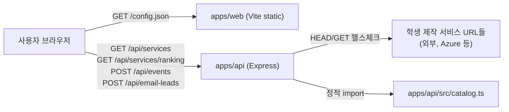

# TRD: Gyro 서비스 발견 스와이프 MVP (v1.0)

## 1. 문서 목적
- `prd.md`를 구현 가능한 기술 요구사항으로 고정한다.
- 현재 저장소에 실제로 구현·배포된 아키텍처, API, 데이터 모델을 정의한다.

## 2. 범위
### 2.1 In Scope (Web MVP)
1. 사용자 유형/관심사 사전 질문 + 서비스 카드 스와이프(라운드 배칭, 중복 제거).
2. 서비스 카탈로그의 실시간 접속 가능 여부(health check) 서버 사이드 검증.
3. 익명 퍼널 이벤트 수집 및 이메일 리드 저장(중복 방지).
4. 스와이프 이유/미리보기 재체험 의향 마이크로 피드백 + 서비스별 퍼널 드롭오프 집계 통계
   (Phase 2 §14.3 승격, 계정 불필요).

### 2.2 Out of Scope (Deferred)
1. 로그인/회원가입, 사용자 계정/프로필 영속화.
2. 실제 이메일 발송 파이프라인(SMTP/ESP 연동, 반송 처리, 원클릭 수신거부).
3. 데이터베이스 영속화 — 현재 이벤트/이메일 리드는 프로세스 메모리에만 보관된다.

> Phase 2("검증 루프") 설계 초안 중 §14.3(계정 불필요 항목)은 구현되어 §2.1 #4로 승격되었다.
> §14.4(빌더 계정 필요 항목)의 기술 설계는 §10에 별도로 정리되어 있으며, 아직 구현되지 않았다.
> §10이 실제 반영되기 전까지는 위 Out of Scope 항목이 그대로 유효하다.

## 3. 기술 스택
1. **Frontend**: TypeScript + Vite, 순수 DOM 조작(프레임워크 없음), `fetch`로 API 호출.
2. **Backend API**: Node.js + Express 5 + Zod(입력 검증) + TypeScript(ESM).
3. **Data/Storage**: 정적 카탈로그(`apps/api/src/catalog.ts`에 빌드타임 등록) + 인메모리 이벤트/이메일
   저장소. 별도 데이터베이스 없음.
4. **배포**: Azure Container Apps 2개(web/api), ACR 원격 빌드(`azd up`). `DEPLOYMENT.md` 참고.

## 4. 아키텍처 개요



- 웹 번들에는 API 베이스 URL을 하드코딩하지 않는다. 컨테이너 엔트리포인트가 런타임에
  `apps/web/public/config.json`을 기록하고, `app.ts`는 top-level await로 이를 먼저 읽은 뒤
  나머지 로직을 실행한다(`resolveApiBase`).
- API는 상태를 거의 갖지 않는다: 카탈로그는 코드에 정적으로 포함되고, 헬스체크 결과만 URL별로
  TTL 캐시된다.

## 5. 기능 요구사항 (기술 관점)

### 5.1 프론트엔드 (`apps/web/src/app.ts`)
1. `landing` → `profile` → `cards` → `results` 4개 화면을 하나의 `#app`에서 `show()`로 전환한다.
2. 카탈로그 로드(`load()`)는 비동기이므로, 로드 완료/실패 전까지 시작 버튼을 비활성화해 0/0 카드
   화면으로 진입하는 경쟁 조건을 막는다. 로드 성공 후 서비스가 0개면 "준비 중" 메시지로 버튼을
   계속 비활성 상태로 둔다.
3. 카드 스와이프는 포인터 이벤트(터치/마우스 공통)와 트랙패드 `wheel` 이벤트(가로 2핑거 스와이프)를
   모두 지원하며, 커밋 임계값(`SWIPE_COMMIT_PX`)과 속도(`SWIPE_VELOCITY_PX_MS`) 중 하나를 넘으면
   결정으로 처리한다.
4. 추천 정렬 및 턴(라운드) 구성: `matchScore(service, audience, interests)`가 관심사 태그 일치마다
   `INTEREST_WEIGHT`(기본 2)를, 선택한 사용자 유형과 일치하면 `AUDIENCE_WEIGHT`(기본 3)를 더해
   독립적으로 가중치를 분리해 계산한다. `profile-next` 클릭 시 전체 카탈로그를 이 점수로 1회
   내림차순 정렬한 뒤 `startBatch()`가 앞에서부터 `BATCH_SIZE`(10)개씩 잘라 라운드를 구성하므로,
   사용자가 선택한 발견자 유형(`audience`)과 관심사(`interests`)에 따라 1라운드가 항상 가장 잘
   맞는 10개, 다음 라운드가 그다음으로 잘 맞는 10개 순으로 구성된다. 카드 렌더링 시
   `recommendationReason()`이 `matchedInterestTags()`를 재사용해 같은 신호로 한 줄 추천 이유를
   만든다.
5. 라운드 배칭: `BATCH_SIZE = 10`. `startBatch()`가 `batchStart`/`batchEnd`를 갱신하고,
   `finishBatch()`가 남은 서비스 유무에 따라 결과 화면 문구/다음 라운드 버튼을 분기한다.
6. 결과 화면 피드백: `finishBatch()`가 관심 표시 서비스(`liked`)마다 `feedbackWidgetHtml()`로 별점
   5개(`.feedback-star`) + 코멘트 입력(`.feedback-comment`, `maxlength=300`) + 전송 버튼을 렌더링하고,
   `bindFeedbackWidgets()`가 서비스별로 로컬 `rating` 상태를 들고 있다가 전송 버튼 클릭 시
   `POST /api/events`(`name: 'service_feedback_submit'`)를 호출한다. 로그인/계정 없이 세션 ID만
   포함한다.
7. 카드 이미지는 기본적으로 그라디언트 + 서비스명 첫 글자(`.image-fallback`/
   `.service-card-initial`)로 렌더링하고, `new Image()`로 원본 스크린샷을 백그라운드에서
   미리 로드한 뒤 `onload` 성공 시에만 실제 배경 이미지로 전환한다. 이미지 로드가 실패하거나
   느려도 카드가 검은 화면으로 보이지 않도록 보장한다.
8. `#cards` 화면은 `.phone-frame` 래퍼로 감싸 좁은 화면(모바일)에서는 전체 화면을 채우고,
   `min-width:560px` 이상에서는 세로형 고정 폭(`max-width:430px`)으로 중앙 정렬해 기기 화면
   비율에 맞는 레이아웃을 제공한다.
9. 서비스 공식 링크는 카드의 "미리보기" 버튼과 결과 목록의 "미리보기" 버튼에서
   `#preview-overlay`의 `iframe`으로 임베디드 확인이 가능하다. 프레임 삽입이 차단되는 사이트를
   대비해 "새 탭에서 열기" 링크를 항상 노출하고, 로드 타임아웃(약 4초) 시 텍스트 안내로
   대체한다. 카드의 포인터 드래그 핸들러는 미리보기 버튼 클릭을 스와이프 제스처로 오인하지
   않도록 `data-preview` 대상에서는 드래그를 시작하지 않는다.
10. 랜딩/결과 화면의 "🏆 가장 많이 선택된 서비스 랭킹" 버튼은 `#ranking` 화면을 열고
    `GET /api/services/ranking`을 호출해 순위를 렌더링한다. 집계가 없으면 안내 문구를 보여주고,
    "뒤로 가기"는 랭킹을 열었던 화면(랜딩 또는 결과)으로 돌아간다.
11. **스와이프 이유 마이크로 피드백**(Phase 2 §14.3 승격): `decide('dislike')`는 질문 없이 즉시
    다음 카드로 넘어가고, 넘긴 서비스를 그 라운드의 `dislikedThisBatch` 배열에 쌓아둔다. 라운드가
    끝나 결과 화면(`finishBatch()`)에 들어서면 `dislikeReasonsHtml()`이 해당 라운드의 관심 없음
    서비스들을 모아 `#dislike-reasons`에 서비스별 이유 태그(4개) 목록을 렌더링하고,
    `bindDislikeReasons()`가 클릭을 바인딩한다. 이유 태그 클릭 시 `card_dislike` 이벤트를
    `metadata: {serviceId, reason, stage:'reason_tag'}`로 추가 전송하고(원래 스와이프 시점에 보낸
    `card_dislike` 이벤트와는 별개), 선택하지 않아도 결과 화면 이용에는 영향이 없다. 스와이프 중에는
    어떤 경우에도 이유 태그 UI가 노출되지 않는다(카드 진행을 가로막지 않도록 분리).
12. **미리보기 재체험 의향 질문**(Phase 2 §14.3 승격): 미리보기 닫기 버튼/Escape는 바로 닫지 않고
    `requestClosePreview()`가 먼저 `#retry-intent`("다시 써보고 싶나요?" 예/아니오/글쎄요 +
    건너뛰고 닫기)를 보여준다. 응답 시 `answerRetryIntent()`가 `service_click` 이벤트를
    `metadata: {serviceId, mode:'embed', stage:'preview_close', retryIntent}`로 추가 전송한 뒤
    닫고, 건너뛰기 또는 6초 타임아웃이면 응답 없이 닫힌다.
13. **테마별 "셔플"(멀티 카탈로그)**(`prd.md` §9-4 승격): `landing` 화면의 "바이브 벤처" 버튼은
    기존과 동일하게 초기 로드된 `vibe-venture` 셔플 카탈로그(`defaultServices`)로 바로 `profile`
    화면에 진입한다. 새 "서비스 이용하기" 버튼은 `theme` 화면(SNS/연애/생산성/게임 4개 테마 버튼,
    `renderThemeChoices()`)을 연다. 테마 버튼 클릭(`selectTheme()`)은 아직 카탈로그를 가져오지
    않고 선택한 테마를 `pendingThemeShuffle`에 기억한 뒤 `tier` 화면(§5.1 #15)으로 이동하며,
    실제 `GET /api/services?shuffle=`로 카탈로그를 가져와 `services`를 교체하고 `currentShuffle`
    상태를 갱신하는 작업은 `tier` 화면에서 주류/비주류/둘 다를 선택한 뒤(`selectTier()`)
    `profile` 화면으로 진입할 때 일어난다(라운드 배칭/중복 제거/헬스체크 필터링 등 기존 메커니즘
    재사용). `renderChoices()`의 관심사 태그 목록은 `SHUFFLE_TAGS[currentShuffle]`로 셔플마다 다른
    고정 어휘를 사용하며, 유형(audience) 질문은 모든 셔플이 공유한다. `profile_submit` 이벤트에는
    `metadata.shuffle`이 추가로 포함된다.
14. **홈으로 돌아가기 내비게이션**: `landing`을 제외한 모든 화면(`theme`/`tier`/`profile`/`cards`/
    `results`/`ranking`)의 상단 바(`.topbar`)는 로고(`.wordmark`, `role="button"`)와 별도의
    홈 아이콘 버튼(`.home-button`, "🏠")을 함께 제공한다. 둘 다 공용 `goHome()`을 호출해 진행 중인
    라운드 상태(`index`/`batchStart`/`batchEnd`/`liked`/`dislikedThisBatch`/`history`/`audience`/
    `interests`/`pendingThemeShuffle`)를 초기화하고 `landing` 화면으로 돌아간다(기존 결과 화면의
    "처음부터 다시 보기" 버튼과 동일한 동작이며, 그 버튼도 이제 `goHome()`을 재사용한다). 자동
    전환이 아니라 사용자가 명시적으로 클릭했을 때만 동작하며, 어떤 화면/라운드 진행 단계에서도
    접근 가능하다.
15. **테마 셔플 주류/비주류(신생) 선택**(`prd.md` §9-4 #7 / AC #15 승격): 테마 셔플
    (`sns`/`dating`/`productivity`/`game`)의 각 카탈로그 서비스는 `CatalogService.tier`
    (`'mainstream'|'emerging'`, 선택 필드)로 분류된다. 바이브 벤처 카탈로그처럼 이 필드가 없는
    서비스는 서버/클라이언트 모두 `'mainstream'`으로 간주한다. `theme` 화면에서 테마를 고르면
    바로 `tier` 화면(`renderTierChoices()`)이 뜨고 "주류 서비스 / 비주류(신생) 서비스 / 둘 다
    (추천)" 3개 버튼을 보여준다("둘 다"는 `.choice.recommended`로 시각적으로 강조되지만 필수
    선택지는 아니며 사용자가 직접 눌러야 다음으로 진행한다). 테마를 선택하면 해당 테마의 전체
    카탈로그를 백그라운드에서 미리 가져오고, 동일 테마의 요청 Promise/응답은
    메모리 캐시(5분 TTL)에서 재사용한다(`apps/web/src/catalog-loader.ts`). 티어를 선택하면 이미
    준비된 목록을 클라이언트에서 필터링하므로 티어 선택 뒤 API 왕복을 추가하지 않는다. 카탈로그
    요청 중에도 질문 화면은 즉시 표시하고, 실제 카드가 준비되기 전에는 "카드 만나보기"만 비활성화해
    0장 덱 진입을 막는다. `tier` 화면의 "← 테마 다시 고르기" 버튼은 `theme` 화면으로 돌아간다
    (홈으로 가는 것과는 별개 동작). 이 화면은 테마 셔플에만 존재하며 바이브 벤처 플로우에는
    삽입되지 않는다.

### 5.2 백엔드 API (`apps/api/src/server.ts`)
1. `GET /health` — 컨테이너 헬스체크용 상태 엔드포인트.
2. `GET /api/services` — 쿼리 파라미터 `shuffle`(`vibe-venture`|`sns`|`dating`|`productivity`|`game`,
   생략 또는 미인식 값은 `vibe-venture`로 폴백, `apps/api/src/shuffles.ts`의 `resolveShuffleCatalog`)로
   선택한 셔플의 카탈로그에, 선택적 쿼리 파라미터 `tier`(`mainstream`|`emerging`, 그 외 값/생략은
   필터링 없음 — `filterByTier()`)를 적용해 공식 링크 기준으로 중복 제거(`dedupeCatalog`)한 뒤, 각
   서비스에 대해 `checkServiceHealth()`로 실시간 접속 가능 여부를 확인하고, 실패한 서비스를 제외한
   목록을 반환한다. 셔플별 카탈로그는 `apps/api/src/catalogs/{sns,dating,productivity,game}.ts`에
   정적으로 정의되어 있으며 각 주류/비주류 티어에 각각 20~30개의 실서비스를 둔다(§9-4 #5/#7:
   공개 정보, 직접 요약한 설명文). 반복되는 카탈로그 필드는 `catalog-entry.ts` 빌더에서 생성하고,
   서비스별 공식 URL/이름/설명/태그만 데이터로 선언한다. `tier` 필드가 없는 엔트리(바이브 벤처
   카탈로그 등)는 `mainstream`으로 취급한다.
2-1. `GET /api/services/funnel`·`GET /api/services/ranking`은 `shuffles.ts`의
   `allShuffleServices()`(모든 셔플 카탈로그를 이어 붙인 배열)를 `dedupeCatalog()`로 중복 제거한
   `dedupedAllShuffles`를 집계 대상으로 사용한다 — 셔플 간 집계를 분리하지 않는다는 §9-4 #6 설계를
   그대로 따르며, 두 엔드포인트의 응답 스키마는 변경되지 않는다.
3. `POST /api/events` — 퍼널 이벤트(`landing_view`, `profile_submit`, `card_like`, `card_dislike`,
   `card_skip`, `card_undo`, `service_click`, `result_view`, `email_submit`, `service_feedback_submit`)를
   Zod로 검증 후 인메모리 배열에 적재(최대 5000건, 초과 시 오래된 항목부터 제거). `service_feedback_submit`은
   `metadata.serviceId`(필수 문자열), `metadata.rating`(필수, 1~5 정수), `metadata.comment`(선택,
   최대 300자 문자열)를 `superRefine`으로 추가 검증한다. `card_dislike`의 `metadata.reason`/
   `metadata.stage`, `service_click`의 `metadata.retryIntent`/`metadata.stage`는 기존
   `metadata: z.record(...)`이 임의 키를 허용하므로 스키마 변경 없이 수용된다.
4. `POST /api/email-leads` — 이메일 형식 검증(Zod) + 소문자 정규화 + 중복 등록 거부(409).
5. `GET /api/services/funnel`(Phase 2 §14.3 승격) — `events` 배열을 서비스 ID 기준으로 재집계해
   서비스별 노출(관심 있음+관심 없음+건너뛰기 합)/관심 있음/관심 없음/건너뛰기/미리보기 클릭 수,
   이유 태그 분포(`dislikeReasons`), 재체험 의향 분포(`retryIntent: {yes,no,unsure}`)를 반환한다.
   `metadata.stage === 'reason_tag'`인 `card_dislike`와 `metadata.stage === 'preview_close'`인
   `service_click`은 각각 이유 태그/재체험 의향 집계에만 쓰이고 기본 카운트(`dislikes`/
   `previewClicks`)에는 포함하지 않아 이중 집계를 막는다. 노출 또는 미리보기 클릭이 1회 이상인
   서비스만, 노출 수 내림차순으로 반환한다. 새 영속 저장소 없이 기존 인메모리 이벤트 배열만
   재사용한다(§6.3).
6. `GET /api/services/ranking` — `events` 배열에서 `card_like` 이벤트를 `metadata.serviceId` 기준으로
   집계하고, 선택 횟수가 1회 이상인 서비스를 내림차순 정렬해 상위 `RANKING_LIMIT`(20)개를
   `{id, name, tagline, serviceUrl, likeCount}` 형태로 반환한다. 헬스체크 통과 여부와 무관하게
   역대 누적 집계를 보여준다(별도 영속 저장소 없이 기존 인메모리 이벤트 스토어를 재사용).

### 5.3 헬스체크 서비스 (`apps/api/src/services/health-check.service.ts`)
1. URL당 HEAD 요청을 우선 시도하고, `405`/`501` 응답 시 GET으로 폴백한다.
2. 성공(`res.ok`)이면 `healthy`, 예외/비정상 상태면 `unhealthy`로 기록한다.
3. 결과는 10분 TTL로 메모리 캐시하며, 동시 요청은 하나의 in-flight Promise를 공유해 중복 호출을
   막는다. 만료 캐시는 재검증이 끝나기 전까지 반환하지 않는다.
4. `NODE_ENV=test`에서는 네트워크 호출 없이 항상 `healthy`를 반환해, 테스트 스위트가 결정적이고
   오프라인에서도 동작하도록 한다.
5. `startCatalogHealthMonitor()`는 실제 서버 기동 시 전체 셔플의 고유 원본 URL을 즉시 점검하고
   10분 간격으로 캐시를 강제 갱신한다. 최대 5개 worker, 회차 중첩 금지, 요청당 4초 제한
   (HEAD→GET 전체 포함), 응답 본문 취소로 불필요한 다운로드를 막는다. 서버 종료/종료 시그널에서
   타이머를 해제한다. 실패·URL 이동 결과와 점검 자체의 예외는 서버 로그에 기록한다.
6. 정상 응답의 `Response.url`을 `resolvedUrl`로 저장하며 HTTP(S)/자격증명 없는 URL만 반영한다.
   실패 시 원본 URL을 유지하고 `httpStatus` 또는 `error`를 기록한다. 매 회차 원본 URL부터
   다시 확인하므로 이전 이동 주소에 고착되지 않는다. 리다이렉트는 fetch의 기본 추적 제한을 따른다.
7. `/api/services`는 `resolvedUrl`을 `serviceUrl`로 반환하고 최종 URL 기준으로도 중복 제거한다.
   결과·미리보기는 이 링크를 그대로 사용한다. 랭킹은 최신 정상 캐시의 링크를 사용하되 기존의
   역대 집계 정책을 유지한다. 이미지 프록시는 헬스체크 후 최종 URL로 스크린샷을 요청하고,
   비정상 서비스에는 503을 반환한다. 이미지 디스크 캐시 키도 최종 URL에 따라 분리된다.
   이미지 응답은 `Cache-Control: public, no-cache`로 재검증해 같은 ID의 이전 URL 이미지가
   브라우저 캐시에 하루 동안 고정되지 않도록 한다(스크린샷 디스크 캐시는 재사용).
8. 상태는 프로세스별 인메모리이며 재시작 시 재확인한다. 분산 단일 스케줄러나 영속 이력은 없다.
   `infra/main.bicep`의 API `minReplicas: 1`로 scale-to-zero를 방지한다. 서버가 중지된 기간의
   점검은 수행되지 않으며, 다중 복제본에서는 각 복제본이 독립 점검한다.
9. 웹 클라이언트는 사용자가 고른 테마 카탈로그만 백그라운드 사전 로드하고, 5분간 결과를 메모리에
   보관한다. 티어 선택은 로컬 필터링으로 처리하며, 헬스체크 결과는 서버의 기존 10분 캐시를
   재사용한다.

### 5.4 서비스 카드 이미지 프록시 (`apps/api/src/image-proxy.ts`)
카탈로그의 `imageUrl`은 더 이상 `GET /api/services` 응답에 그대로 내려가지 않는다. 각 카탈로그
항목이 원래 가리키던 s.wordpress.com/mshots 스크린샷은 지연 생성 방식이라, 첫 요청에서는 실제
화면 대신 "Generating Preview..." 플레이스홀더(WordPress 로고)를 담은, 그 자체로는 정상(200) 이미지를
반환한다. 프런트엔드의 ``/`Image()` 로더 입장에서는 로드 성공이라 카드가 영영 그 플레이스홀더에
머무는 문제가 있었다.
1. `GET /api/services`는 각 서비스의 `imageUrl`을 `/api/service-image/:id` 경로로 치환해서 내려준다
   (카탈로그에 저장된 원래 문자열은 더 이상 쓰이지 않는 유휴 필드다).
2. `GET /api/service-image/:id`: id로 전체 셔플(`findServiceById`, `shuffles.ts`)에서 서비스를 찾고,
   - 디스크 캐시(`IMAGE_CACHE_DIR`, 기본 OS 임시 디렉터리, 파일명은 `serviceUrl`의 sha256)에 적중하면
     그대로 서빙한다.
   - 캐시 미스면 microlink.io 스크린샷 API(`?screenshot=true`, 인증 불필요, 동기 응답)로 실제 화면을
     한 번 가져와 캐시에 저장하고 서빙한다.
   - 스크린샷 API 호출이 실패/타임아웃(9초)하면 서비스명 이니셜 + 그라디언트 SVG를 생성해 대신
     반환한다(브라우저의 깨진 이미지 아이콘 대신 항상 유효한 이미지를 보장).
3. 프런트엔드(`apps/web/src/app.ts`)는 `resolveImageUrl()`로 `/`로 시작하는 상대 경로에 API 베이스를
   붙여서 사용한다(카드 배경, 결과 화면 리스트 썸네일 공통).

## 6. 데이터 모델

### 6.1 `CatalogService` (`apps/api/src/catalog.ts`)
```ts
type CatalogService = {
  id: string; name: string; tagline: string; description: string;
  imageUrl: string; serviceUrl: string; tags: string[];
  audiences: ('student' | 'teacher' | 'parent' | 'other')[];
  room: string; roomKey: string; number: string;
  tier?: 'mainstream' | 'emerging';
};
```

### 6.2 API 응답의 `Service` (health 필드 포함)
```ts
type Service = CatalogService & {
  health: {
    status: 'healthy' | 'unhealthy'; checkedAt: string;
    sourceUrl: string; resolvedUrl: string; urlChanged: boolean;
    httpStatus?: number; error?: string;
  };
};
```
`/api/services`는 `unhealthy` 서비스를 필터링하므로 실제로는 항상 `status: 'healthy'`만 내려간다.

### 6.3 퍼널 이벤트
```ts
type EventName =
  | 'landing_view' | 'profile_submit' | 'card_like' | 'card_dislike'
  | 'card_skip' | 'card_undo' | 'service_click' | 'result_view' | 'email_submit'
  | 'service_feedback_submit';
type FunnelEvent = { name: EventName; sessionId: string; metadata: Record<string, unknown>; createdAt: string };
```
`service_feedback_submit`의 `metadata`는 `{ serviceId: string; rating: 1|2|3|4|5; comment?: string }`
형태를 따르며, 서버는 `rating`이 1~5 정수인지, `comment`가 300자 이하인지 추가 검증한다. 이 이벤트는
현재 다른 퍼널 이벤트와 동일한 인메모리 배열에 저장되며, §10 향후 확장(서비스 소유자 피드백 포털)을
위한 원시 데이터 역할을 한다.

`card_dislike`는 두 가지 형태로 쓰인다: 스와이프 시점의 기본 이벤트(`{serviceId}`)와, 이유 태그 선택
시 전송되는 후속 이벤트(`{serviceId, reason, stage:'reason_tag'}`). `service_click`도 마찬가지로
미리보기 오픈 시점의 기본 이벤트(`{serviceId, mode:'embed'}`)와, 재체험 의향 응답 시 전송되는 후속
이벤트(`{serviceId, mode:'embed', stage:'preview_close', retryIntent:'yes'|'no'|'unsure'}`)로
나뉜다. `metadata.stage`는 둘 다 Zod 스키마 변경 없이 기존 `metadata: z.record(...)`로 수용되며,
`GET /api/services/funnel`이 `stage` 값으로 기본 카운트와 이유/의향 집계를 분리한다(§5.2 #5).

### 6.4 이메일 리드
현재는 `Set<string>`(정규화된 이메일 주소)만 보관하며, 가입 시각/동의 여부 등은 저장하지 않는다.
실데이터 영속화가 필요해지면 DB 테이블 설계가 선행되어야 한다(§2.2 Out of Scope 참고).

### 6.5 랭킹 엔트리
```ts
type RankingEntry = { id: string; name: string; tagline: string; serviceUrl: string; likeCount: number };
```
`GET /api/services/ranking`은 `likeCount > 0`인 서비스만, `likeCount` 내림차순으로 최대
`RANKING_LIMIT`(20)개까지 반환한다. 별도 영속 저장소 없이 §6.3 `FunnelEvent` 배열을 즉시
재집계한 값이므로, 프로세스 재시작 시 집계가 초기화된다(§2.2 Out of Scope의 "DB 없음" 전제와 동일한
trade-off).

### 6.6 퍼널 드롭오프 엔트리 (Phase 2 §14.3 승격)
```ts
type FunnelEntry = {
  id: string; name: string; impressions: number; likes: number; dislikes: number; skips: number;
  previewClicks: number; dislikeReasons: Record<string, number>;
  retryIntent: { yes: number; no: number; unsure: number };
  dwellBuckets: Record<string, number>;
};
```
`GET /api/services/funnel`은 §6.5와 마찬가지로 §6.3 이벤트 배열의 실시간 재집계 값이며, 별도
영속 저장소가 없어 프로세스 재시작 시 초기화된다. `impressions`는 `likes+dislikes+skips`로 계산되며,
별도의 "카드 노출" 이벤트가 없어 실제 노출이 아니라 스와이프 반응(결정) 수를 근사치로 사용한다.


## 7. API 스펙

| 메서드/경로 | 설명 | 검증 | 응답 |
| --- | --- | --- | --- |
| `GET /health` | 컨테이너 헬스체크 | - | `{ status: 'ok', service, timestamp }` |
| `GET /api/services` | 헬스체크 통과 + 중복 제거된 카탈로그 | `?shuffle=vibe-venture\|sns\|dating\|productivity\|game`(선택, 기본/미인식 값은 `vibe-venture`) | `{ services: Service[] }` |
| `GET /api/services/ranking` | 누적 `card_like` 횟수 기준 상위 `RANKING_LIMIT`(20)개 서비스 랭킹 | - | `{ ranking: RankingEntry[] }` |
| `GET /api/services/funnel` | 서비스별 노출/관심 있음/관심 없음/건너뛰기/미리보기 클릭/이유 태그/재체험 의향/체류시간 버킷 집계 | - | `{ funnel: FunnelEntry[] }` |
| `POST /api/events` | 퍼널 이벤트 적재 | Zod(`eventSchema`) | `202 { accepted: true }` / `400` |
| `POST /api/email-leads` | 이메일 리드 저장 | Zod(`emailSchema`) | `201` / `409` 중복 / `400` |

CORS: `WEB_ORIGIN` 환경변수로 허용 오리진을 설정하며, 미설정 시 `*`.

## 8. 테스트 전략
- API: Vitest + Supertest. `apps/api/tests/integration.gyro.test.ts`(엔드포인트 통합, `card_dislike`/
  `service_click`의 `reason`/`retryIntent`/`dwellBucket` 후속 이벤트 수락과 `GET /api/services/funnel`
  집계 이중 집계 방지 포함), `apps/api/tests/unit.health-check.test.ts`(헬스체크 캐시/폴백/테스트
  환경 단축 경로).
- Web: Vitest + jsdom. `apps/web/tests/catalog-load.unit.test.ts`(시작 버튼 경쟁 조건 가드),
  `apps/web/tests/match-score.unit.test.ts`(`matchScore`/`matchedInterestTags` 가중치 분리 검증).
- 모든 테스트는 `NODE_ENV=test`에서 외부 네트워크 호출 없이 동작해야 한다.

## 9. 비기능 요구사항
1. 웹 번들에 API 비밀값을 포함하지 않는다(런타임 `config.json` 주입).
2. 헬스체크 타임아웃은 4초로 제한해 느린/죽은 서비스가 `/api/services` 응답 전체를 지연시키지
   않도록 한다.
3. 이벤트 저장소는 최대 5000건으로 제한해 메모리 누수를 방지한다.

## 10. Phase 2 — "검증 루프" 기술 설계 초안 (§10.1 구현 완료, §10.2 이후 미구현)

> `prd.md` §14의 요구사항 초안에 대응하는 기술 설계 초안이다. §10.1(§14.3, 계정 불필요)은
> **구현 완료**되어 §2.1/§5.1/§5.2/§6.3/§6.6/§7로 승격되었다(이 하위 섹션은 구현 기록으로 유지).
> §10.2(§14.4, 빌더 계정 필요) 이후는 여전히 **미구현**이다. 착수 시 해당 설계를 §2~§7로 승격하고
> 이 섹션은 제거(또는 "완료"로 표시)한다.

### 10.1 §14.3 (계정 불필요) — API 스키마 변경 없이 수용 가능 — ✅ 구현 완료
- `card_dislike` 이벤트의 `metadata`에 `reason?: string` 필드를 추가한다. `eventSchema`의
  `metadata: z.record(z.string(), z.unknown()).optional()`이 이미 임의 키를 허용하므로 **Zod 스키마
  변경이 필요 없다.** 프론트엔드에서 허용 가능한 `reason` 값 집합(`'unclear' | 'not_relevant' |
  'bad_design' | 'already_used'`)만 상수로 정의해 전송한다(`apps/web/src/app.ts`의
  `DISLIKE_REASONS`). 이중 집계를 막기 위해 `metadata.stage: 'reason_tag'`도 함께 보낸다.
- `service_click` 이벤트의 `metadata`에 `retryIntent?: 'yes' | 'no' | 'unsure'` 필드를 추가한다
  (동일하게 스키마 변경 불필요), `metadata.stage: 'preview_close'`로 기본 미리보기-클릭 이벤트와
  구분한다. 같은 `stage: 'preview_close'` 이벤트에 `dwellBucket?: '<5s' | '5-15s' | '15-30s' |
  '30-60s' | '60s+'` 필드도 함께 보낼 수 있다 — 미리보기를 닫기 시작하는 시점(닫기 버튼/Escape)에
  열람 시작 시각과의 차이를 클라이언트에서 버킷 문자열로만 계산해 전송하므로(원시 밀리초
  미전송), 재체험 의향 응답 여부와 무관하게 매 미리보기 종료마다 전송된다
  (`apps/web/src/app.ts`의 `dwellBucket`/`requestClosePreview`).
- 퍼널 드롭오프 집계는 `GET /api/services/ranking`과 유사하게 기존 `events` 배열을 서비스별로
  재집계하는 읽기 전용 엔드포인트 `GET /api/services/funnel`로 구현했다 — 새 저장소 없이 기존
  인메모리 이벤트 스토어만 재사용한다(§5.2 #5, §6.6).

### 10.2 §14.4 (빌더 계정 필요) — 아키텍처 전제 변경 필요
- **인증**: 빌더 인증 방식은 미확정(매직링크 이메일 / GitHub OAuth / 바이브벤처 기관 발급 코드 등
  `ideation.md` §8 오픈 퀘스천 참고). 어떤 방식이든 발견 사용자 플로우(`landing/profile/cards/
  results/ranking`)와는 완전히 분리된 신규 라우트(`/builder/*`)로 설계해 기존 무로그인 플로우에
  영향을 주지 않는다.
- **영속화 전제 변경**: 현재 "DB 없음, 인메모리 전용"(§2.2/§6.4) 전제가 깨진다. 최소한 다음 엔티티는
  프로세스 재시작에도 살아남는 저장소(SQLite/Postgres 등)가 필요하다 — 빌더 계정, 서비스별 버전
  이력, (선택) A/B 카드 변형. 이벤트/랭킹 집계는 당분간 인메모리로 유지해도 되지만, 빌더 대시보드가
  참조하는 이상 재시작 시 리포트가 초기화되는 trade-off를 명시적으로 감수해야 한다.
- **신규 데이터 모델(초안)**:
  ```ts
  type Builder = { id: string; email: string; createdAt: string };
  type ServiceVersion = {
    serviceId: string; versionNo: number; tagline: string; description: string;
    imageUrl: string; createdAt: string;
  };
  type CardVariant = { serviceId: string; variantId: 'a' | 'b'; tagline: string; imageUrl: string };
  type ImprovementReport = {
    serviceId: string; status: 'free_preview' | 'paid_unlocked'; generatedAt: string;
    summary: string; prioritizedSuggestions: string[];
  };
  ```
- **신규 엔드포인트(초안, 미구현)**:
  | 메서드/경로 | 설명 | 인증 |
  | --- | --- | --- |
  | `POST /api/builder/auth/request` | 매직링크 등 인증 요청 | - |
  | `GET /api/builder/services/:id/dashboard` | 요약/피드백/세그먼트/버전이력/체험 데이터 조회 | 빌더 |
  | `POST /api/builder/services/:id/versions` | 서비스 설명/이미지 갱신(버전 이력 생성) | 빌더 |
  | `POST /api/builder/services/:id/variants` | A/B 카드 변형 등록 | 빌더 |
  | `GET /api/builder/services/:id/feedback` | 서비스별 `service_feedback_submit` 원시 별점·코멘트
    열람(무료) | 빌더 |
  | `POST /api/builder/services/:id/improvement-report` | 결제 후 정성 분석·우선순위 제안 리포트
    생성/조회(유료) | 빌더 + 결제 확인 |
- **추천 정렬 로직 영향**: §14.4.6의 "탐색 노출 비율"은 `profile-next` 클릭 시의 1회성 정렬
  (`app.ts`의 태그/유형 일치 점수 계산)에 "일정 비율 무작위 셔플"을 섞는 방식으로 구현 가능하며,
  이는 모델 기반 추천이 아니므로 AGENTS.md §4의 "자동 개인화 모델 금지"에 해당하지 않는다.
- **§14.4.7(피드백 포털 + 유료 개선 리포트) 추가 고려사항**: `GET .../feedback`는 기존
  `service_feedback_submit` 이벤트를 서비스 ID로 재집계하는 읽기 전용 쿼리이므로 §10.1과 유사하게
  스키마 변경은 필요 없지만, **빌더-서비스 소유권 매핑**(어느 빌더가 어느 `serviceId`를 소유하는지)이
  선행되어야 한다 — 현재 카탈로그(`catalog.ts`)에는 소유자 필드가 없으므로 Phase 2 착수 시 추가해야
  한다. `improvement-report` 생성은 결제 게이트가 필요하므로 PG(결제대행) 연동(토스페이먼츠 등 국내
  PG 우선 검토, `BUSINESS.md` §5.4 참고)과 환불/영수증 처리 정책이 별도로 필요하며, 이는 §2.2의
  "서비스별 결제·예약 연동 금지"가 금지하는 카탈로그 서비스 자체의 결제가 아니라 플랫폼의 자체
  유료 기능이므로 범위상 구분된다.

### 10.3 테스트 전략 확장(초안)
- §10.1 항목 — ✅ 구현 완료. `integration.gyro.test.ts`에 `metadata.reason`/`metadata.retryIntent`
  포함 후속 이벤트가 `202`로 수락되는지, `GET /api/services/funnel`이 `stage` 태그로 기본 카운트와
  이유/의향 집계를 분리(이중 집계 방지)하는지 검증하는 테스트를 추가했다(스키마 변경이 없어 기존
  Zod 검증 테스트는 그대로 유효).
- §10.2 항목은 영속 저장소(DB) 도입이 선행되어야 하므로, 테스트 전략도 그때 함께 설계한다(예:
  테스트용 임시 DB 파일/인메모리 SQLite 등 — 현재는 미확정).

### 10.4 롤아웃 순서 제안
1. ✅ §10.1(API 확장 없음) → 프론트엔드 UI만 추가, 가장 낮은 리스크. (완료)
2. ✅ §10.1의 `GET /api/services/funnel` 신규 엔드포인트 추가. (완료)
3. §10.2 착수 전 ADR 작성: 인증 방식 확정, DB 선택, 기존 "DB 없음" 전제를 깨는 것에 대한 합의.
4. §10.2 빌더 대시보드 최소 버전(읽기 전용 요약 + 피드백 피드) 구현.
5. 검증 배지, A/B 카드 테스트, 버전 이력 비교는 대시보드 안정화 후 순차 추가.
6. 피드백 포털 무료 열람(`GET .../feedback`)은 §10.2 최소 버전과 함께 제공하고, 유료 개선 리포트
   (`POST .../improvement-report`)는 PG 연동·환불 정책 확정 후 마지막 단계로 추가한다.
