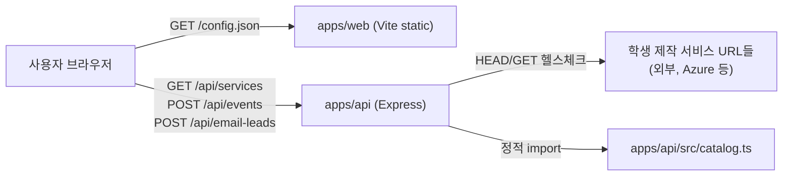

# TRD: Gyro 서비스 발견 스와이프 MVP (v1.0)

## 1. 문서 목적
- `prd.md`를 구현 가능한 기술 요구사항으로 고정한다.
- 현재 저장소에 실제로 구현·배포된 아키텍처, API, 데이터 모델을 정의한다.

## 2. 범위
### 2.1 In Scope (Web MVP)
1. 사용자 유형/관심사 사전 질문 + 서비스 카드 스와이프(라운드 배칭, 중복 제거).
2. 서비스 카탈로그의 실시간 접속 가능 여부(health check) 서버 사이드 검증.
3. 익명 퍼널 이벤트 수집 및 이메일 리드 저장(중복 방지).

### 2.2 Out of Scope (Deferred)
1. 로그인/회원가입, 사용자 계정/프로필 영속화.
2. 실제 이메일 발송 파이프라인(SMTP/ESP 연동, 반송 처리, 원클릭 수신거부).
3. 데이터베이스 영속화 — 현재 이벤트/이메일 리드는 프로세스 메모리에만 보관된다.

## 3. 기술 스택
1. **Frontend**: TypeScript + Vite, 순수 DOM 조작(프레임워크 없음), `fetch`로 API 호출.
2. **Backend API**: Node.js + Express 5 + Zod(입력 검증) + TypeScript(ESM).
3. **Data/Storage**: 정적 카탈로그(`apps/api/src/catalog.ts`에 빌드타임 등록) + 인메모리 이벤트/이메일
   저장소. 별도 데이터베이스 없음.
4. **배포**: Azure Container Apps 2개(web/api), ACR 원격 빌드(`azd up`). `DEPLOYMENT.md` 참고.

## 4. 아키텍처 개요



- 웹 번들에는 API 베이스 URL을 하드코딩하지 않는다. 컨테이너 엔트리포인트가 런타임에
  `apps/web/public/config.json`을 기록하고, `app.ts`는 top-level await로 이를 먼저 읽은 뒤
  나머지 로직을 실행한다(`resolveApiBase`).
- API는 상태를 거의 갖지 않는다: 카탈로그는 코드에 정적으로 포함되고, 헬스체크 결과만 URL별로
  TTL 캐시된다.

## 5. 기능 요구사항 (기술 관점)

### 5.1 프론트엔드 (`apps/web/src/app.ts`)
1. `landing` → `profile` → `cards` → `results` 4개 화면을 하나의 `#app`에서 `show()`로 전환한다.
2. 카탈로그 로드(`load()`)는 비동기이므로, 로드 완료/실패 전까지 시작 버튼을 비활성화해 0/0 카드
   화면으로 진입하는 경쟁 조건을 막는다. 로드 성공 후 서비스가 0개면 "준비 중" 메시지로 버튼을
   계속 비활성 상태로 둔다.
3. 카드 스와이프는 포인터 이벤트(터치/마우스 공통)와 트랙패드 `wheel` 이벤트(가로 2핑거 스와이프)를
   모두 지원하며, 커밋 임계값(`SWIPE_COMMIT_PX`)과 속도(`SWIPE_VELOCITY_PX_MS`) 중 하나를 넘으면
   결정으로 처리한다.
4. 추천 정렬은 `profile-next` 클릭 시 관심사 태그 일치 수 + 유형 일치 여부로 1회 계산해 정렬하고,
   카드 렌더링 시 `recommendationReason()`이 같은 신호로 한 줄 추천 이유를 만든다.
5. 라운드 배칭: `BATCH_SIZE = 10`. `startBatch()`가 `batchStart`/`batchEnd`를 갱신하고,
   `finishBatch()`가 남은 서비스 유무에 따라 결과 화면 문구/다음 라운드 버튼을 분기한다.

### 5.2 백엔드 API (`apps/api/src/server.ts`)
1. `GET /health` — 컨테이너 헬스체크용 상태 엔드포인트.
2. `GET /api/services` — 카탈로그를 공식 링크 기준으로 중복 제거(`dedupeCatalog`)한 뒤, 각 서비스에
   대해 `checkServiceHealth()`로 실시간 접속 가능 여부를 확인하고, 실패한 서비스를 제외한 목록을
   반환한다.
3. `POST /api/events` — 퍼널 이벤트(`landing_view`, `profile_submit`, `card_like`, `card_dislike`,
   `card_skip`, `card_undo`, `service_click`, `result_view`, `email_submit`)를 Zod로 검증 후
   인메모리 배열에 적재(최대 5000건, 초과 시 오래된 항목부터 제거).
4. `POST /api/email-leads` — 이메일 형식 검증(Zod) + 소문자 정규화 + 중복 등록 거부(409).

### 5.3 헬스체크 서비스 (`apps/api/src/services/health-check.service.ts`)
1. URL당 HEAD 요청을 우선 시도하고, `405`/`501` 응답 시 GET으로 폴백한다.
2. 성공(`res.ok`)이면 `healthy`, 예외/비정상 상태면 `unhealthy`로 기록한다.
3. 결과는 10분 TTL로 메모리 캐시하며, 동시 요청은 하나의 in-flight Promise를 공유해 중복 호출을
   막는다.
4. `NODE_ENV=test`에서는 네트워크 호출 없이 항상 `healthy`를 반환해, 테스트 스위트가 결정적이고
   오프라인에서도 동작하도록 한다.

## 6. 데이터 모델

### 6.1 `CatalogService` (`apps/api/src/catalog.ts`)
```ts
type CatalogService = {
  id: string; name: string; tagline: string; description: string;
  imageUrl: string; serviceUrl: string; tags: string[];
  audiences: ('student' | 'teacher' | 'parent' | 'other')[];
  room: string; roomKey: string; number: string;
};
```

### 6.2 API 응답의 `Service` (health 필드 포함)
```ts
type Service = CatalogService & { health: { status: 'healthy' | 'unhealthy'; checkedAt: string } };
```
`/api/services`는 `unhealthy` 서비스를 필터링하므로 실제로는 항상 `status: 'healthy'`만 내려간다.

### 6.3 퍼널 이벤트
```ts
type EventName =
  | 'landing_view' | 'profile_submit' | 'card_like' | 'card_dislike'
  | 'card_skip' | 'card_undo' | 'service_click' | 'result_view' | 'email_submit';
type FunnelEvent = { name: EventName; sessionId: string; metadata: Record<string, unknown>; createdAt: string };
```

### 6.4 이메일 리드
현재는 `Set<string>`(정규화된 이메일 주소)만 보관하며, 가입 시각/동의 여부 등은 저장하지 않는다.
실데이터 영속화가 필요해지면 DB 테이블 설계가 선행되어야 한다(§2.2 Out of Scope 참고).

## 7. API 스펙

| 메서드/경로 | 설명 | 검증 | 응답 |
| --- | --- | --- | --- |
| `GET /health` | 컨테이너 헬스체크 | - | `{ status: 'ok', service, timestamp }` |
| `GET /api/services` | 헬스체크 통과 + 중복 제거된 카탈로그 | - | `{ services: Service[] }` |
| `POST /api/events` | 퍼널 이벤트 적재 | Zod(`eventSchema`) | `202 { accepted: true }` / `400` |
| `POST /api/email-leads` | 이메일 리드 저장 | Zod(`emailSchema`) | `201` / `409` 중복 / `400` |

CORS: `WEB_ORIGIN` 환경변수로 허용 오리진을 설정하며, 미설정 시 `*`.

## 8. 테스트 전략
- API: Vitest + Supertest. `apps/api/tests/integration.gyro.test.ts`(엔드포인트 통합),
  `apps/api/tests/unit.health-check.test.ts`(헬스체크 캐시/폴백/테스트 환경 단축 경로).
- Web: Vitest + jsdom. `apps/web/tests/catalog-load.unit.test.ts`(시작 버튼 경쟁 조건 가드).
- 모든 테스트는 `NODE_ENV=test`에서 외부 네트워크 호출 없이 동작해야 한다.

## 9. 비기능 요구사항
1. 웹 번들에 API 비밀값을 포함하지 않는다(런타임 `config.json` 주입).
2. 헬스체크 타임아웃은 4초로 제한해 느린/죽은 서비스가 `/api/services` 응답 전체를 지연시키지
   않도록 한다.
3. 이벤트 저장소는 최대 5000건으로 제한해 메모리 누수를 방지한다.
