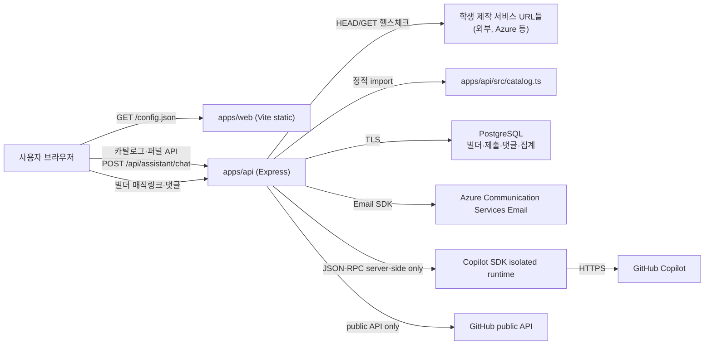

# TRD: Gyro 대화형 AI 서비스 발견 Web MVP (v1.1)

## 1. 문서 목적
- `prd.md`를 구현 가능한 기술 요구사항으로 고정한다.
- 현재 저장소에 실제로 구현·배포된 아키텍처, API, 데이터 모델을 정의한다.
- 승격 요구사항의 구현 상태와 현재 API 계약을 §11에 구분해 기록한다.

## 2. 범위
### 2.1 In Scope (Web MVP)
1. 사용자 유형/관심사 사전 질문 + 서비스 카드 스와이프(라운드 배칭, 중복 제거).
2. 서비스 카탈로그의 실시간 접속 가능 여부(health check) 서버 사이드 검증.
3. 익명 퍼널 이벤트 수집 및 이메일 리드 저장(중복 방지).
4. 스와이프 이유/미리보기 재체험 의향 마이크로 피드백 + 서비스별 퍼널 드롭오프 집계 통계
   (Phase 2 §14.3 승격, 계정 불필요).
5. 작업 기준 발견 + 검증된 연결 가이드 3단계(`prd.md` §9-6 승격, 구현 완료, 상세 §11):
   유형·작업 기반 카탈로그/가이드 → 검증 수준 배지 → 익명 연결 결과 피드백·집계.
   기존 API를 후방 호환 확장하며 신규 엔드포인트·계정·외부 스킬/MCP 자동 실행은 도입하지 않는다.
6. 홈 대화형 서비스 발견과 GitHub Copilot SDK 연동(`prd.md` §9-8 승격, 상세 §12). 추천 후보는 수동 검수된
   카탈로그에서만 선택하고, 공개 GitHub 정보 분석은 공개 API의 저장소 설명·언어·README로 제한한다.
7. 출처·라이선스·확인일·요금 확인 상태를 기록하는 상한 없는 수동 검수 카탈로그.
8. 빌더 이메일 매직링크 인증, 운영자 승인형 서비스 소유권·등록·수정, 소유 서비스 성과 대시보드,
   공개 익명 댓글·신고·운영자 숨김(`prd.md` §9-9).

### 2.2 Out of Scope (Deferred)
1. 발견 사용자 계정/프로필 영속화 및 사용자 로그인.
2. 결과 저장/뉴스레터 등 마케팅 이메일 발송과 반송·수신거부 처리.
3. 발견자 계정·대화·프로필·AI 요청의 영속 저장.
4. 비공개 GitHub 저장소 접근, 임의 웹사이트 수집, 카탈로그 후보 자동 공개, AI에 의한 카탈로그 수정.

> Phase 2 §14.3의 계정 불필요 항목은 구현되어 §2.1 #4로 승격되었다. 빌더 포털·댓글은 `prd.md` §9-9와
> 본 문서 §13으로 승격되었다. 실제 외부 배포에는 PostgreSQL, Azure Communication Services Email,
> `WEB_ORIGIN`, `BUILDER_ADMIN_TOKEN` 운영 설정이 필요하다.

## 3. 기술 스택
1. **Frontend**: TypeScript + Vite, 순수 DOM 조작(프레임워크 없음), `fetch`로 API 호출.
2. **Backend API**: Node.js + Express 5 + Zod(입력 검증) + TypeScript(ESM).
3. **Data/Storage**: 검수된 정적 TypeScript 카탈로그, 기존 인메모리 이메일 리드/퍼널 이벤트와
   `DATABASE_URL`로 연결하는 PostgreSQL. DB에는 빌더 계정·세션 해시·소유권·검수 제출·공개 댓글 및
   발견자 개인 단위 이벤트가 아닌 서비스별 집계만 저장한다. 대화/추천 로그는 저장하지 않는다.
4. **배포**: Azure Container Apps 2개(web/api), ACR 원격 빌드(`azd up`). 빌더 포털은 별도
   PostgreSQL과 Azure Communication Services Email 설정이 없으면 비활성화된다. `DEPLOYMENT.md` 참고.

## 4. 아키텍처 개요



- 웹 번들에는 API 베이스 URL을 하드코딩하지 않는다. 컨테이너 엔트리포인트가 런타임에
  `apps/web/public/config.json`을 기록하고, `app.ts`는 top-level await로 이를 먼저 읽은 뒤
  나머지 로직을 실행한다(`resolveApiBase`).
- 기존 발견 퍼널·이메일 리드는 프로세스 메모리에 남는다. 빌더 자원은 PostgreSQL에 저장되며 매직링크와
  로그인 세션은 해시만 보관한다. AI 대화 내용과 공개 README는 영구 저장하지 않는다. SDK는 요청별 임시
  디렉터리에서 실행하며 요청 종료 시 해당 디렉터리를 제거한다.

## 5. 기능 요구사항 (기술 관점)

### 5.1 프론트엔드 (`apps/web/src/app.ts`)
1. `landing`(소개) → `home`(서비스) → `discovery` → `profile` → `cards` → `results` 화면을
   하나의 `#app`에서 `show()`로 전환한다. 현행 IA는 `prd.md` §9-7-1이 이전 랜딩 관련 설명보다 우선한다.
   랜딩 헤더는 유저/빌더 전환과 서비스 CTA만, 서비스 헤더는 홈·내 피드·발견·설정 공통 탭만 제공한다.
   하위 발견 화면은 발견 탭으로 표시하며 `aria-current`를 갱신한다. 중복 화면별 로고는 제거한다.
   `#home`/`#feed`/`#discover`/`#settings` 해시로 직접 진입 및 뒤로/앞으로를 지원하고,
   매직링크의 `#token=...`은 기존 인증 처리만 사용한다. 하위 플로우는 기본 탭 해시로 정규화한다.
   랜딩 유저/빌더는 권한이 아닌 일시적 소개 상태다. 각각 기존 ThemeAI Paper/Midnight 토큰을 쓰며
   서비스 테마 선호(`gyro.appearance-theme`)와 분리한다. 서비스 기본값은 진입 랜딩 테마,
   저장된 유효한 서비스 테마가 있으면 이를 우선한다.
   내 피드 관심 목록은 페이지 메모리의 서비스 ID 맵으로 라운드 초기화와 분리하며 영구 저장하지 않는다.
   기존 빌더 포털은 내 피드 안에 유지하고 인증·승인·공개 준비 게이트를 변경하지 않는다.
   승인된 빌더의 기존 `GET /api/builder/services` 응답을 공유 카드 컴포넌트로 표시하고,
   수정 제안 버튼은 기존 제출 폼을 채운다. 로그아웃/계정 조회 실패 시 소유 목록을 비운다.
   설정은 드롭다운이 아닌 독립 화면이며, 발견은 기존 검색/유형 필터의 리스트 레이아웃을 사용한다.
2. 카탈로그 로드(`load()`)는 비동기이므로, 로드 완료/실패 전까지 시작 버튼을 비활성화해 0/0 카드
   화면으로 진입하는 경쟁 조건을 막는다. 로드 성공 후 서비스가 0개면 "준비 중" 메시지로 버튼을
   계속 비활성 상태로 둔다.
3. 카드 스와이프는 포인터 이벤트(터치/마우스 공통)와 트랙패드 `wheel` 이벤트(가로 2핑거 스와이프)를
   모두 지원하며, 커밋 임계값(`SWIPE_COMMIT_PX`)과 속도(`SWIPE_VELOCITY_PX_MS`) 중 하나를 넘으면
   결정으로 처리한다.
4. 추천 정렬 및 턴(라운드) 구성: `matchScore(service, audience, interests)`가 관심사 태그 일치마다
   `INTEREST_WEIGHT`(기본 2)를, 선택한 사용자 유형과 일치하면 `AUDIENCE_WEIGHT`(기본 3)를 더해
   독립적으로 가중치를 분리해 계산한다. `profile-next` 클릭 시 전체 카탈로그를 이 점수로 1회
   내림차순 정렬한 뒤 `startBatch()`가 앞에서부터 `BATCH_SIZE`(10)개씩 잘라 라운드를 구성하므로,
   사용자가 선택한 발견자 유형(`audience`)과 관심사(`interests`)에 따라 1라운드가 항상 가장 잘
   맞는 10개, 다음 라운드가 그다음으로 잘 맞는 10개 순으로 구성된다. 카드 렌더링 시
   `recommendationReason()`이 `matchedInterestTags()`를 재사용해 같은 신호로 한 줄 추천 이유를
   만든다.
5. 라운드 배칭: `BATCH_SIZE = 10`. `startBatch()`가 `batchStart`/`batchEnd`를 갱신하고,
   `finishBatch()`가 남은 서비스 유무에 따라 결과 화면 문구/다음 라운드 버튼을 분기한다.
6. 결과 화면 피드백: `finishBatch()`가 관심 표시 서비스(`liked`)마다 `feedbackWidgetHtml()`로 별점
   5개(`.feedback-star`) + 코멘트 입력(`.feedback-comment`, `maxlength=300`) + 전송 버튼을 렌더링하고,
   `bindFeedbackWidgets()`가 서비스별로 로컬 `rating` 상태를 들고 있다가 전송 버튼 클릭 시
   `POST /api/events`(`name: 'service_feedback_submit'`)를 호출한다. 로그인/계정 없이 세션 ID만
   포함한다.
7. 카드 이미지는 기본적으로 그라디언트 + 서비스명 첫 글자(`.image-fallback`/
   `.service-card-initial`)로 렌더링하고, `new Image()`로 원본 스크린샷을 백그라운드에서
   미리 로드한 뒤 `onload` 성공 시에만 실제 배경 이미지로 전환한다. 이미지 로드가 실패하거나
   느려도 카드가 검은 화면으로 보이지 않도록 보장한다.
8. `#cards` 화면은 `.phone-frame` 래퍼로 감싸 좁은 화면(모바일)에서는 전체 화면을 채우고,
   `min-width:560px` 이상에서는 세로형 고정 폭(`max-width:430px`)으로 중앙 정렬해 기기 화면
   비율에 맞는 레이아웃을 제공한다.
9. 서비스 공식 링크는 카드의 "미리보기" 버튼과 결과 목록의 "미리보기" 버튼에서
   `#preview-overlay`의 `iframe`으로 임베디드 확인이 가능하다. 프레임 삽입이 차단되는 사이트를
   대비해 "새 탭에서 열기" 링크를 항상 노출하고, 로드 타임아웃(약 4초) 시 텍스트 안내로
   대체한다. 카드의 포인터 드래그 핸들러는 미리보기 버튼 클릭을 스와이프 제스처로 오인하지
   않도록 `data-preview` 대상에서는 드래그를 시작하지 않는다.
10. 랜딩/결과 화면의 "🏆 가장 많이 선택된 서비스 랭킹" 버튼은 `#ranking` 화면을 열고
    `GET /api/services/ranking`을 호출해 순위를 렌더링한다. 집계가 없으면 안내 문구를 보여주고,
    "뒤로 가기"는 랭킹을 열었던 화면(랜딩 또는 결과)으로 돌아간다.
11. **스와이프 이유 마이크로 피드백**(Phase 2 §14.3 승격): `decide('dislike')`는 질문 없이 즉시
    다음 카드로 넘어가고, 넘긴 서비스를 그 라운드의 `dislikedThisBatch` 배열에 쌓아둔다. 라운드가
    끝나 결과 화면(`finishBatch()`)에 들어서면 `dislikeReasonsHtml()`이 해당 라운드의 관심 없음
    서비스들을 모아 `#dislike-reasons`에 서비스별 이유 태그(4개) 목록을 렌더링하고,
    `bindDislikeReasons()`가 클릭을 바인딩한다. 이유 태그 클릭 시 `card_dislike` 이벤트를
    `metadata: {serviceId, reason, stage:'reason_tag'}`로 추가 전송하고(원래 스와이프 시점에 보낸
    `card_dislike` 이벤트와는 별개), 선택하지 않아도 결과 화면 이용에는 영향이 없다. 스와이프 중에는
    어떤 경우에도 이유 태그 UI가 노출되지 않는다(카드 진행을 가로막지 않도록 분리).
12. **미리보기 재체험 의향 질문**(Phase 2 §14.3 승격): 미리보기 닫기 버튼/Escape는 바로 닫지 않고
    `requestClosePreview()`가 먼저 `#retry-intent`("다시 써보고 싶나요?" 예/아니오/글쎄요 +
    건너뛰고 닫기)를 보여준다. 응답 시 `answerRetryIntent()`가 `service_click` 이벤트를
    `metadata: {serviceId, mode:'embed', stage:'preview_close', retryIntent}`로 추가 전송한 뒤
    닫고, 건너뛰기 또는 6초 타임아웃이면 응답 없이 닫힌다.
13. **테마별 "셔플"(멀티 카탈로그)**(`prd.md` §9-4 승격): `landing` 화면의 "바이브 벤처" 버튼은
    기존과 동일하게 초기 로드된 `vibe-venture` 셔플 카탈로그(`defaultServices`)로 바로 `profile`
    화면에 진입한다. 새 "서비스 이용하기" 버튼은 `theme` 화면(SNS/연애/생산성/게임 4개 테마 버튼,
    `renderThemeChoices()`)을 연다. 테마 버튼 클릭(`selectTheme()`)은 아직 카탈로그를 가져오지
    않고 선택한 테마를 `pendingThemeShuffle`에 기억한 뒤 `tier` 화면(§5.1 #15)으로 이동하며,
    실제 `GET /api/services?shuffle=`로 카탈로그를 가져와 `services`를 교체하고 `currentShuffle`
    상태를 갱신하는 작업은 `tier` 화면에서 주류/비주류/둘 다를 선택한 뒤(`selectTier()`)
    `profile` 화면으로 진입할 때 일어난다(라운드 배칭/중복 제거/헬스체크 필터링 등 기존 메커니즘
    재사용). `renderChoices()`의 관심사 태그 목록은 `SHUFFLE_TAGS[currentShuffle]`로 셔플마다 다른
    고정 어휘를 사용하며, 유형(audience) 질문은 모든 셔플이 공유한다. `profile_submit` 이벤트에는
    `metadata.shuffle`이 추가로 포함된다.
14. **홈으로 돌아가기 내비게이션**: `landing`을 제외한 모든 화면(`theme`/`tier`/`profile`/`cards`/
    `results`/`ranking`)의 상단 바(`.topbar`)는 로고(`.wordmark`, `role="button"`)와 별도의
    홈 아이콘 버튼(`.home-button`, "🏠")을 함께 제공한다. 둘 다 공용 `goHome()`을 호출해 진행 중인
    라운드 상태(`index`/`batchStart`/`batchEnd`/`liked`/`dislikedThisBatch`/`history`/`audience`/
    `interests`/`pendingThemeShuffle`)를 초기화하고 `landing` 화면으로 돌아간다(기존 결과 화면의
    "처음부터 다시 보기" 버튼과 동일한 동작이며, 그 버튼도 이제 `goHome()`을 재사용한다). 자동
    전환이 아니라 사용자가 명시적으로 클릭했을 때만 동작하며, 어떤 화면/라운드 진행 단계에서도
    접근 가능하다.
15. **테마 셔플 주류/비주류(신생) 선택**(`prd.md` §9-4 #7 / AC #15 승격): 테마 셔플
    (`sns`/`dating`/`productivity`/`game`)의 각 카탈로그 서비스는 `CatalogService.tier`
    (`'mainstream'|'emerging'`, 선택 필드)로 분류된다. 바이브 벤처 카탈로그처럼 이 필드가 없는
    서비스는 서버/클라이언트 모두 `'mainstream'`으로 간주한다. `theme` 화면에서 테마를 고르면
    바로 `tier` 화면(`renderTierChoices()`)이 뜨고 "주류 서비스 / 비주류(신생) 서비스 / 둘 다
    (추천)" 3개 버튼을 보여준다("둘 다"는 `.choice.recommended`로 시각적으로 강조되지만 필수
    선택지는 아니며 사용자가 직접 눌러야 다음으로 진행한다). 테마를 선택하면 해당 테마의 전체
    카탈로그를 백그라운드에서 미리 가져오고, 동일 테마의 요청 Promise/응답은
    메모리 캐시(5분 TTL)에서 재사용한다(`apps/web/src/catalog-loader.ts`). 티어를 선택하면 이미
    준비된 목록을 클라이언트에서 필터링하므로 티어 선택 뒤 API 왕복을 추가하지 않는다. 카탈로그
    요청 중에도 질문 화면은 즉시 표시하고, 실제 카드가 준비되기 전에는 "카드 만나보기"만 비활성화해
    0장 덱 진입을 막는다. `tier` 화면의 "← 테마 다시 고르기" 버튼은 `theme` 화면으로 돌아간다
    (홈으로 가는 것과는 별개 동작). 이 화면은 테마 셔플에만 존재하며 바이브 벤처 플로우에는
    삽입되지 않는다.
16. **홈 대화형 발견**(`prd.md` §9-8): 랜딩의 주된 영역은 다중 턴 AI 대화다. 브라우저는 대화를
     메모리에서만 유지하고 매 요청 마지막 12개 메시지를 `POST /api/assistant/chat`으로 보낸다.
     명시 동의가 없으면 전송하지 않는다. API 실패는 상태 메시지로 보여주며 AI 응답을 성공처럼 꾸미지
     않는다. 응답은 검수된 카탈로그 ID의 서비스 카드로 렌더링하고, 검색·카탈로그 목록은 아래 보조
     섹션에 계속 제공한다.

### 5.2 백엔드 API (`apps/api/src/server.ts`)
1. `GET /health` — 컨테이너 헬스체크용 상태 엔드포인트.
2. `GET /api/services` — 쿼리 파라미터 `shuffle`(`vibe-venture`|`sns`|`dating`|`productivity`|`game`|`task`,
   생략 또는 미인식 값은 `vibe-venture`로 폴백, `apps/api/src/shuffles.ts`의 `resolveShuffleCatalog`)로
   선택한 셔플의 카탈로그에 선택적 쿼리 파라미터 `tier`(`mainstream`|`emerging`, 그 외 값/생략은
   필터링 없음 — `filterByTier()`)를 적용한다. task 셔플에는 선택적 `task`·`kind` 필터를 추가 적용하며,
   유효하지 않은 task/kind 값은 필터를 생략한 것으로 처리한다. 유형 미지정 항목은 `service`로 간주한다.
   후보를 공식 링크 기준으로 중복 제거(`dedupeCatalog`)한 다음 `checkServiceHealth()`로 실시간 접속
   가능 여부를 확인하고, 실패한 서비스를 제외한
   목록을 반환한다. 테마 카탈로그는 `apps/api/src/catalogs/{sns,dating,productivity,game}.ts`에
   정적으로 정의되어 있으며 주류/비주류 티어는 항목 수 제한 없이 확장한다(§9-4 #5/#7: 허용된 공개 정보,
   사람이 확인하고 직접 요약한 설명). 반복되는 카탈로그 필드는 `catalog-entry.ts` 빌더에서 생성하고,
   서비스별 공식 URL/이름/설명/태그만 데이터로 선언한다. `tier` 필드가 없는 엔트리(바이브 벤처
   카탈로그 등)는 `mainstream`으로 취급한다. 작업 카탈로그는 `catalogs/task.ts`에서 별도 큐레이션한다(§11).
2-1. `GET /api/services/funnel`·`GET /api/services/ranking`은 `shuffles.ts`의
   `allShuffleServices()`(모든 셔플 카탈로그를 이어 붙인 배열)를 `dedupeCatalog()`로 중복 제거한
   `dedupedAllShuffles`를 집계 대상으로 사용한다 — 셔플 간 집계를 분리하지 않는다는 §9-4 #6 설계를
   그대로 따른다. 랭킹 응답 스키마는 유지하고 퍼널은 §11.2의 연결 결과·문서 클릭 필드를 추가한다.
3. `POST /api/events` — 퍼널 이벤트(`landing_view`, `profile_submit`, `card_like`, `card_dislike`,
   `card_skip`, `card_undo`, `service_click`, `result_view`, `email_submit`, `service_feedback_submit`,
   `connection_report`)를
   Zod로 검증 후 인메모리 배열에 적재(최대 5000건, 초과 시 오래된 항목부터 제거). `service_feedback_submit`은
   `metadata.serviceId`(필수 문자열), `metadata.rating`(필수, 1~5 정수), `metadata.comment`(선택,
   최대 300자 문자열)를 `superRefine`으로 추가 검증한다. `card_dislike`의 `metadata.reason`/
   `metadata.stage`, `service_click`의 `metadata.retryIntent`/`metadata.stage`는 기존
   `metadata: z.record(...)`이 임의 키를 허용하므로 스키마 변경 없이 수용된다.
4. `POST /api/email-leads` — 이메일 형식 검증(Zod) + 소문자 정규화 + 중복 등록 거부(409).
5. `GET /api/services/funnel`(Phase 2 §14.3 승격) — `events` 배열을 서비스 ID 기준으로 재집계해
   서비스별 노출(관심 있음+관심 없음+건너뛰기 합)/관심 있음/관심 없음/건너뛰기/미리보기 클릭 수,
   이유 태그 분포(`dislikeReasons`), 재체험 의향 분포(`retryIntent: {yes,no,unsure}`)를 반환한다.
   `metadata.stage === 'reason_tag'`인 `card_dislike`와 `metadata.stage === 'preview_close'`인
   `service_click`은 각각 이유 태그/재체험 의향 집계에만 쓰이고 기본 카운트(`dislikes`/
   `previewClicks`)에는 포함하지 않아 이중 집계를 막는다. 연결 결과는 `connection`에 자기 보고
   성공/일부 성공/실패 및 실패 이유를 집계하고, 가이드 문서 링크 클릭은 별도 `docClicks`로 반환해
   설치 성공과 혼합하지 않는다. 노출·미리보기·문서 클릭·연결 결과 중 하나 이상 집계된 서비스를
   노출 수 내림차순으로 반환한다. 새 영속 저장소 없이 기존 인메모리 이벤트 배열만
   재사용한다(§6.3).
6. `GET /api/services/ranking` — `events` 배열에서 `card_like` 이벤트를 `metadata.serviceId` 기준으로
   집계하고, 선택 횟수가 1회 이상인 서비스를 내림차순 정렬해 상위 `RANKING_LIMIT`(20)개를
   `{id, name, tagline, serviceUrl, likeCount}` 형태로 반환한다. 헬스체크 통과 여부와 무관하게
   역대 누적 집계를 보여준다(별도 영속 저장소 없이 기존 인메모리 이벤트 스토어를 재사용).
7. **AI 대화 서비스**(`apps/api/src/assistant-recommendation.ts`, 상세 §12): 요청을 Zod로 검증하고
   GitHub Copilot SDK를 호출한다. 응답 추천은 해당 요청의 카탈로그 후보 ID 집합에
   포함되는 경우만 반환한다. 추천 결과는 기존 헬스체크 캐시를 통과한 항목만 포함한다.

### 5.3 헬스체크 서비스 (`apps/api/src/services/health-check.service.ts`)
1. URL당 HEAD 요청을 우선 시도하고, `405`/`501` 응답 시 GET으로 폴백한다.
2. 성공(`res.ok`)이면 `healthy`, 예외/비정상 상태면 `unhealthy`로 기록한다.
3. 결과는 10분 TTL로 메모리 캐시하며, 동시 요청은 하나의 in-flight Promise를 공유해 중복 호출을
   막는다. 만료 캐시는 재검증이 끝나기 전까지 반환하지 않는다.
4. `NODE_ENV=test`에서는 네트워크 호출 없이 항상 `healthy`를 반환해, 테스트 스위트가 결정적이고
   오프라인에서도 동작하도록 한다.
5. `startCatalogHealthMonitor()`는 실제 서버 기동 시 전체 셔플의 고유 원본 URL을 즉시 점검하고
   10분 간격으로 캐시를 강제 갱신한다. 최대 5개 worker, 회차 중첩 금지, 요청당 4초 제한
   (HEAD→GET 전체 포함), 응답 본문 취소로 불필요한 다운로드를 막는다. 서버 종료/종료 시그널에서
   타이머를 해제한다. 실패·URL 이동 결과와 점검 자체의 예외는 서버 로그에 기록한다.
6. 리다이렉트는 수동 추적하고 매 이동마다 HTTP(S)·자격증명 부재·공인 IP 주소를 재검증한다.
   사설/예약/로컬 주소는 거부하며, DNS 결과를 연결에 고정해 검증 이후 DNS 재바인딩을 차단한다.
   HTTPS에서 HTTP로의 강등과 5회를 넘는 이동도 거부한다. 성공한 최종 URL을 `resolvedUrl`로 기록하고
   실패 시 원본 URL을 유지하며 `httpStatus` 또는 `error`를 남긴다. 매 회차 원본부터 다시 확인한다.
7. `/api/services`는 `resolvedUrl`을 `serviceUrl`로 반환하고 최종 URL 기준으로도 중복 제거한다.
   결과·미리보기는 이 링크를 그대로 사용한다. 랭킹은 최신 정상 캐시의 링크를 사용하되 기존의
   역대 집계 정책을 유지한다. 이미지 프록시는 헬스체크 후 최종 URL로 스크린샷을 요청하고,
   비정상 서비스에는 503을 반환한다. 이미지 디스크 캐시 키도 최종 URL에 따라 분리된다.
   이미지 응답은 `Cache-Control: public, no-cache`로 재검증해 같은 ID의 이전 URL 이미지가
   브라우저 캐시에 하루 동안 고정되지 않도록 한다(스크린샷 디스크 캐시는 재사용).
8. 상태는 프로세스별 인메모리이며 재시작 시 재확인한다. 분산 단일 스케줄러나 영속 이력은 없다.
   `infra/main.bicep`의 API `minReplicas: 1`로 scale-to-zero를 방지한다. 서버가 중지된 기간의
   점검은 수행되지 않으며, 다중 복제본에서는 각 복제본이 독립 점검한다.
9. 웹 클라이언트는 사용자가 고른 테마 카탈로그만 백그라운드 사전 로드하고, 5분간 결과를 메모리에
   보관한다. 티어 선택은 로컬 필터링으로 처리하며, 헬스체크 결과는 서버의 기존 10분 캐시를
   재사용한다.

### 5.4 서비스 카드 이미지 프록시 (`apps/api/src/image-proxy.ts`)
카탈로그의 `imageUrl`은 더 이상 `GET /api/services` 응답에 그대로 내려가지 않는다. 각 카탈로그
항목이 원래 가리키던 s.wordpress.com/mshots 스크린샷은 지연 생성 방식이라, 첫 요청에서는 실제
화면 대신 "Generating Preview..." 플레이스홀더(WordPress 로고)를 담은, 그 자체로는 정상(200) 이미지를
반환한다. 프런트엔드의 ``/`Image()` 로더 입장에서는 로드 성공이라 카드가 영영 그 플레이스홀더에
머무는 문제가 있었다.
1. `GET /api/services`는 각 서비스의 `imageUrl`을 `/api/service-image/:id` 경로로 치환해서 내려준다
   (카탈로그에 저장된 원래 문자열은 더 이상 쓰이지 않는 유휴 필드다).
2. `GET /api/service-image/:id`: id로 전체 셔플(`findServiceById`, `shuffles.ts`)에서 서비스를 찾고,
   - 디스크 캐시(`IMAGE_CACHE_DIR`, 기본 OS 임시 디렉터리, 파일명은 `serviceUrl`의 sha256)에 적중하면
     그대로 서빙한다.
   - 캐시 미스면 microlink.io 스크린샷 API(`?screenshot=true`, 인증 불필요, 동기 응답)로 실제 화면을
     한 번 가져와 캐시에 저장하고 서빙한다.
   - 스크린샷 API 호출이 실패/타임아웃(9초)하면 서비스명 이니셜 + 그라디언트 SVG를 생성해 대신
     반환한다(브라우저의 깨진 이미지 아이콘 대신 항상 유효한 이미지를 보장).
3. 프런트엔드(`apps/web/src/app.ts`)는 `resolveImageUrl()`로 `/`로 시작하는 상대 경로에 API 베이스를
   붙여서 사용한다(카드 배경, 결과 화면 리스트 썸네일 공통).

## 6. 데이터 모델

### 6.1 `CatalogService` (`apps/api/src/catalog.ts`)
```ts
type CatalogService = {
  id: string; name: string; tagline: string; description: string;
  imageUrl: string; serviceUrl: string; tags: string[];
  audiences: ('student' | 'teacher' | 'parent' | 'other')[];
  room: string; roomKey: string; number: string;
  tier?: 'mainstream' | 'emerging';
  pricing?: { model: 'free' | 'freemium' | 'paid' | 'unknown'; note?: string; verifiedAt?: string; source?: string };
};
```

### 6.2 API 응답의 `Service` (health 필드 포함)
```ts
type Service = CatalogService & {
  health: {
    status: 'healthy' | 'unhealthy'; checkedAt: string;
    sourceUrl: string; resolvedUrl: string; urlChanged: boolean;
    httpStatus?: number; error?: string;
  };
};
```
`/api/services`는 `unhealthy` 서비스를 필터링하므로 실제로는 항상 `status: 'healthy'`만 내려간다.

### 6.3 퍼널 이벤트
```ts
type EventName =
  | 'landing_view' | 'profile_submit' | 'card_like' | 'card_dislike'
  | 'card_skip' | 'card_undo' | 'service_click' | 'result_view' | 'email_submit'
  | 'service_feedback_submit';
type FunnelEvent = { name: EventName; sessionId: string; metadata: Record<string, unknown>; createdAt: string };
```
`service_feedback_submit`의 `metadata`는 `{ serviceId: string; rating: 1|2|3|4|5; comment?: string }`
형태를 따르며, 서버는 `rating`이 1~5 정수인지, `comment`가 300자 이하인지 추가 검증한다. 이 이벤트는
현재 다른 퍼널 이벤트와 동일한 인메모리 배열에 저장되며, §10 향후 확장(서비스 소유자 피드백 포털)을
위한 원시 데이터 역할을 한다.

`card_dislike`는 두 가지 형태로 쓰인다: 스와이프 시점의 기본 이벤트(`{serviceId}`)와, 이유 태그 선택
시 전송되는 후속 이벤트(`{serviceId, reason, stage:'reason_tag'}`). `service_click`도 마찬가지로
미리보기 오픈 시점의 기본 이벤트(`{serviceId, mode:'embed'}`)와, 재체험 의향 응답 시 전송되는 후속
이벤트(`{serviceId, mode:'embed', stage:'preview_close', retryIntent:'yes'|'no'|'unsure'}`)로
나뉜다. `metadata.stage`는 둘 다 Zod 스키마 변경 없이 기존 `metadata: z.record(...)`로 수용되며,
`GET /api/services/funnel`이 `stage` 값으로 기본 카운트와 이유/의향 집계를 분리한다(§5.2 #5).

### 6.4 이메일 리드
현재는 `Set<string>`(정규화된 이메일 주소)만 보관하며, 가입 시각/동의 여부 등은 저장하지 않는다.
실데이터 영속화가 필요해지면 DB 테이블 설계가 선행되어야 한다(§2.2 Out of Scope 참고).

### 6.5 랭킹 엔트리
```ts
type RankingEntry = { id: string; name: string; tagline: string; serviceUrl: string; likeCount: number };
```
`GET /api/services/ranking`은 `likeCount > 0`인 서비스만, `likeCount` 내림차순으로 최대
`RANKING_LIMIT`(20)개까지 반환한다. 별도 영속 저장소 없이 §6.3 `FunnelEvent` 배열을 즉시
재집계한 값이므로, 프로세스 재시작 시 집계가 초기화된다(§2.2 Out of Scope의 "DB 없음" 전제와 동일한
trade-off).

### 6.6 퍼널 드롭오프 엔트리 (Phase 2 §14.3 승격)
```ts
type FunnelEntry = {
  id: string; name: string; impressions: number; likes: number; dislikes: number; skips: number;
  previewClicks: number; dislikeReasons: Record<string, number>;
  retryIntent: { yes: number; no: number; unsure: number };
  dwellBuckets: Record<string, number>;
};
```
`GET /api/services/funnel`은 §6.5와 마찬가지로 §6.3 이벤트 배열의 실시간 재집계 값이며, 별도
영속 저장소가 없어 프로세스 재시작 시 초기화된다. `impressions`는 `likes+dislikes+skips`로 계산되며,
별도의 "카드 노출" 이벤트가 없어 실제 노출이 아니라 스와이프 반응(결정) 수를 근사치로 사용한다.


## 7. API 스펙

| 메서드/경로 | 설명 | 검증 | 응답 |
| --- | --- | --- | --- |
| `GET /health` | 컨테이너 헬스체크 | - | `{ status: 'ok', service, timestamp }` |
| `GET /api/services` | 바이브벤처 프로그램 제작 서비스 중 헬스체크 통과 + 중복 제거된 카탈로그 | `?shuffle=vibe-venture\|sns\|dating\|productivity\|game\|task`(선택, 기본/미인식 값은 `vibe-venture`); task 셔플에서 선택적 `task`/`kind` 필터 | `{ services: Service[] }` |
| `GET /api/services/ranking` | 바이브벤처 프로그램 제작 서비스만 대상으로 누적 `card_like` 횟수 기준 상위 `RANKING_LIMIT`(20)개 랭킹 | - | `{ ranking: RankingEntry[] }` |
| `GET /api/services/funnel` | 바이브벤처 프로그램 제작 서비스별 노출/관심 있음/관심 없음/건너뛰기/미리보기·문서 클릭/이유 태그/재체험 의향/체류시간/연결 결과 집계 | - | `{ funnel: FunnelEntry[] }` |
| `POST /api/events` | 퍼널 이벤트 적재 | Zod(`eventSchema`) | `202 { accepted: true }` / `400` |
| `POST /api/email-leads` | 이메일 리드 저장 | Zod(`emailSchema`) | `201` / `409` 중복 / `400` |
| `POST /api/assistant/chat` | 다중 턴 대화 기반 바이브벤처 프로그램 제작 서비스 추천 | 메시지 role/content, techStack, 공개 GitHub URL Zod 검증 | `{ reply, recommendations, analyzedRepository? }` / `400` 입력·저장소 오류 / `413` 요청 크기 / `429` 요청 한도 / `502` AI 오류 / `503` 환경 설정 누락 |

CORS: `WEB_ORIGIN` 환경변수로 허용 오리진을 설정하며, 미설정 시 `*`. Copilot 호출은 아래 서버 환경
변수(`GYRO_ASSISTANT_PROVIDER`, `COPILOT_MODEL`, 배포 시 `COPILOT_GITHUB_TOKEN`)를 사용하며
토큰은 브라우저 설정/번들에 넣지 않는다.

## 8. 테스트 전략
- API: Vitest + Supertest. `apps/api/tests/integration.gyro.test.ts`(엔드포인트 통합, `card_dislike`/
  `service_click`의 `reason`/`retryIntent`/`dwellBucket` 후속 이벤트 수락과 `GET /api/services/funnel`
  집계 이중 집계 방지 포함), `apps/api/tests/unit.health-check.test.ts`(헬스체크 캐시/폴백/테스트
  환경 단축 경로).
- Web: Vitest + jsdom. `apps/web/tests/catalog-load.unit.test.ts`(시작 버튼 경쟁 조건 가드),
  `apps/web/tests/match-score.unit.test.ts`(`matchScore`/`matchedInterestTags` 가중치 분리 및 작업 태그 점수),
  `apps/web/tests/catalog-loader.unit.test.ts`(작업 필터 캐시), `apps/web/tests/task-discovery.unit.test.ts`
  (작업 진입·빈 결과·안전한 가이드 렌더링·연결 결과 제출).
- 모든 테스트는 `NODE_ENV=test`에서 외부 네트워크 호출 없이 동작해야 한다.

## 9. 비기능 요구사항
1. 웹 번들에 API 비밀값을 포함하지 않는다(런타임 `config.json` 주입).
2. 헬스체크 타임아웃은 4초로 제한해 느린/죽은 서비스가 `/api/services` 응답 전체를 지연시키지
   않도록 한다.
3. 이벤트 저장소는 최대 5000건으로 제한해 메모리 누수를 방지한다.
4. AI 요청은 사용자 IP 기준 15분당 12회로 제한하고, 한 요청의 메시지 수·길이와 README 처리 크기를
   제한한다. 요청 본문·저장소 내용·SDK 오류 원문을 로그에 남기지 않는다.
5. Copilot SDK는 서버에서만 호출하며, `GYRO_ASSISTANT_PROVIDER`, `COPILOT_MODEL`,
   배포 시 `COPILOT_GITHUB_TOKEN`을 사용한다. 설정 미완료는 `503`, 모델 오류는
   `502`로 반환하며 대체 성공 응답을 만들지 않는다.

## 10. Phase 2 — "검증 루프" 구현 기록 및 잔여 설계

> `prd.md` §14의 기존 설계 초안에 대응한다. §10.1(§14.3, 계정 불필요)은 구현 완료되어
> §2.1/§5.1/§5.2/§6.3/§6.6/§7로 승격되었다. 빌더 포털·댓글은 §13으로 승격·구현되었으므로,
> §10.2는 현재 동작 명세가 아니라 미승격 잔여 아이디어의 기록으로만 본다.

### 10.1 §14.3 (계정 불필요) — API 스키마 변경 없이 수용 가능 — ✅ 구현 완료
- `card_dislike` 이벤트의 `metadata`에 `reason?: string` 필드를 추가한다. `eventSchema`의
  `metadata: z.record(z.string(), z.unknown()).optional()`이 이미 임의 키를 허용하므로 **Zod 스키마
  변경이 필요 없다.** 프론트엔드에서 허용 가능한 `reason` 값 집합(`'unclear' | 'not_relevant' |
  'bad_design' | 'already_used'`)만 상수로 정의해 전송한다(`apps/web/src/app.ts`의
  `DISLIKE_REASONS`). 이중 집계를 막기 위해 `metadata.stage: 'reason_tag'`도 함께 보낸다.
- `service_click` 이벤트의 `metadata`에 `retryIntent?: 'yes' | 'no' | 'unsure'` 필드를 추가한다
  (동일하게 스키마 변경 불필요), `metadata.stage: 'preview_close'`로 기본 미리보기-클릭 이벤트와
  구분한다. 같은 `stage: 'preview_close'` 이벤트에 `dwellBucket?: '<5s' | '5-15s' | '15-30s' |
  '30-60s' | '60s+'` 필드도 함께 보낼 수 있다 — 미리보기를 닫기 시작하는 시점(닫기 버튼/Escape)에
  열람 시작 시각과의 차이를 클라이언트에서 버킷 문자열로만 계산해 전송하므로(원시 밀리초
  미전송), 재체험 의향 응답 여부와 무관하게 매 미리보기 종료마다 전송된다
  (`apps/web/src/app.ts`의 `dwellBucket`/`requestClosePreview`).
- 퍼널 드롭오프 집계는 `GET /api/services/ranking`과 유사하게 기존 `events` 배열을 서비스별로
  재집계하는 읽기 전용 엔드포인트 `GET /api/services/funnel`로 구현했다 — 새 저장소 없이 기존
  인메모리 이벤트 스토어만 재사용한다(§5.2 #5, §6.6).

### 10.2 §14.4 잔여 아이디어 — 현행 요구사항은 §13 참조
- 현행 빌더 인증은 §13에 정의된 이메일 매직링크다. 신규 빌더는 운영자가 바이브벤처 프로그램 참가를
  명시적으로 확인·기록하고 승인해야 하며, API도 확인된 승인 계정에만 쓰기 권한을 부여한다.
- 아래 데이터 모델·저장소 메모는 구현 전 초안이며 현행 스키마/API 계약으로 사용하지 않는다.
- **영속화 전제 변경**: 현재 "DB 없음, 인메모리 전용"(§2.2/§6.4) 전제가 깨진다. 최소한 다음 엔티티는
  프로세스 재시작에도 살아남는 저장소(SQLite/Postgres 등)가 필요하다 — 빌더 계정, 서비스별 버전
  이력, (선택) A/B 카드 변형. 이벤트/랭킹 집계는 당분간 인메모리로 유지해도 되지만, 빌더 대시보드가
  참조하는 이상 재시작 시 리포트가 초기화되는 trade-off를 명시적으로 감수해야 한다.
- **신규 데이터 모델(초안)**:
  ```ts
  type Builder = { id: string; email: string; createdAt: string };
  type ServiceVersion = {
    serviceId: string; versionNo: number; tagline: string; description: string;
    imageUrl: string; createdAt: string;
  };
  type CardVariant = { serviceId: string; variantId: 'a' | 'b'; tagline: string; imageUrl: string };
  type ImprovementReport = {
    serviceId: string; status: 'free_preview' | 'paid_unlocked'; generatedAt: string;
    summary: string; prioritizedSuggestions: string[];
    pricing?: { model: 'free' | 'freemium' | 'paid' | 'unknown'; note?: string; verifiedAt?: string; source?: string };
  };
  ```
- **신규 엔드포인트(초안, 미구현)**:
  | 메서드/경로 | 설명 | 인증 |
  | --- | --- | --- |
  | `POST /api/builder/auth/request` | 매직링크 등 인증 요청 | - |
  | `GET /api/builder/services/:id/dashboard` | 요약/피드백/세그먼트/버전이력/체험 데이터 조회 | 빌더 |
  | `POST /api/builder/services/:id/versions` | 서비스 설명/이미지 갱신(버전 이력 생성) | 빌더 |
  | `POST /api/builder/services/:id/variants` | A/B 카드 변형 등록 | 빌더 |
  | `GET /api/builder/services/:id/feedback` | 서비스별 `service_feedback_submit` 원시 별점·코멘트
    열람(무료) | 빌더 |
  | `POST /api/builder/services/:id/improvement-report` | 결제 후 정성 분석·우선순위 제안 리포트
    생성/조회(유료) | 빌더 + 결제 확인 |
- **추천 정렬 로직 영향**: §14.4.6의 "탐색 노출 비율"은 `profile-next` 클릭 시의 1회성 정렬
  (`app.ts`의 태그/유형 일치 점수 계산)에 "일정 비율 무작위 셔플"을 섞는 방식으로 구현 가능하며,
  이는 모델 기반 추천이 아니므로 AGENTS.md §4의 "자동 개인화 모델 금지"에 해당하지 않는다.
- **§14.4.7(피드백 포털 + 유료 개선 리포트) 추가 고려사항**: `GET .../feedback`는 기존
  `service_feedback_submit` 이벤트를 서비스 ID로 재집계하는 읽기 전용 쿼리이므로 §10.1과 유사하게
  스키마 변경은 필요 없지만, **빌더-서비스 소유권 매핑**(어느 빌더가 어느 `serviceId`를 소유하는지)이
  선행되어야 한다 — 현재 카탈로그(`catalog.ts`)에는 소유자 필드가 없으므로 Phase 2 착수 시 추가해야
  한다. `improvement-report` 생성은 결제 게이트가 필요하므로 PG(결제대행) 연동(토스페이먼츠 등 국내
  PG 우선 검토, `BUSINESS.md` §5.4 참고)과 환불/영수증 처리 정책이 별도로 필요하며, 이는 §2.2의
  "서비스별 결제·예약 연동 금지"가 금지하는 카탈로그 서비스 자체의 결제가 아니라 플랫폼의 자체
  유료 기능이므로 범위상 구분된다.

### 10.3 테스트 전략 확장(초안)
- §10.1 항목 — ✅ 구현 완료. `integration.gyro.test.ts`에 `metadata.reason`/`metadata.retryIntent`
  포함 후속 이벤트가 `202`로 수락되는지, `GET /api/services/funnel`이 `stage` 태그로 기본 카운트와
  이유/의향 집계를 분리(이중 집계 방지)하는지 검증하는 테스트를 추가했다(스키마 변경이 없어 기존
  Zod 검증 테스트는 그대로 유효).
- §10.2 항목은 영속 저장소(DB) 도입이 선행되어야 하므로, 테스트 전략도 그때 함께 설계한다(예:
  테스트용 임시 DB 파일/인메모리 SQLite 등 — 현재는 미확정).

### 10.4 롤아웃 순서 제안
1. ✅ §10.1(API 확장 없음) → 프론트엔드 UI만 추가, 가장 낮은 리스크. (완료)
2. ✅ §10.1의 `GET /api/services/funnel` 신규 엔드포인트 추가. (완료)
3. §10.2 착수 전 ADR 작성: 인증 방식 확정, DB 선택, 기존 "DB 없음" 전제를 깨는 것에 대한 합의.
4. §10.2 빌더 대시보드 최소 버전(읽기 전용 요약 + 피드백 피드) 구현.
5. 검증 배지, A/B 카드 테스트, 버전 이력 비교는 대시보드 안정화 후 순차 추가.
6. 피드백 포털 무료 열람(`GET .../feedback`)은 §10.2 최소 버전과 함께 제공하고, 유료 개선 리포트
   (`POST .../improvement-report`)는 PG 연동·환불 정책 확정 후 마지막 단계로 추가한다.

## 11. 작업 기준 발견 + 검증된 연결 가이드 기술 설계 (`prd.md` §9-6 승격, ✅ 구현됨)

모든 변경은 **후방 호환 optional 필드/값 추가**로 하며 기존 API 계약·테마 셔플 동작을 바꾸지 않는다.
신규 엔드포인트는 만들지 않고 기존 `GET /api/services`, `POST /api/events`, `GET /api/services/funnel`을
확장한다(AGENTS.md §5 최소 API 세트 유지).

### 11.1 데이터 모델 (`apps/api/src/catalog.ts`)
```ts
type CatalogService = {                             // 기존 필드에 아래 optional 필드를 추가
  kind?: 'product' | 'service' | 'skill' | 'mcp';   // 기본 'service'
  tasks?: string[];                                  // 해결하는 작업 태그 (예: 'report-automation')
  connection?: {                                     // skill/mcp 전용
    agents: { name: string; versionNote?: string }[];  // 지원 클라이언트/버전, 모르면 []
    transport?: 'stdio' | 'http' | 'sse';            // mcp
    runtime?: 'local' | 'remote';                    // mcp
    auth?: 'none' | 'api_key' | 'oauth' | 'unknown';
    permissions: string[];                           // 필요 권한·키 설명
    installSteps: string[];                          // 한국어 설치 단계
    exampleUsage?: string;                           // 한 줄 사용 예시
    docsUrl: string;
  };
  verification?: {                                   // 기본 level 'link'
    level: 'link' | 'docs' | 'install';
    verifiedAt?: string; environment?: string;       // docs/install은 verifiedAt 필수, install은 environment 필수
    sources: string[];                               // 조사 출처
  };
};
```
- `verification.level`은 카탈로그 파일에 사람이 기록한 값이며 헬스체크 결과로 자동 상승하지 않는다.
  `link`는 기존 헬스체크 통과를 의미한다(응답 `health`와 별개).
- `skill`/`mcp` 항목도 `serviceUrl`(공식 페이지)을 가지므로 기존 헬스체크·중복 제거·이미지 프록시를
  그대로 사용한다. 이미지가 없는 항목은 텍스트 기반 대체 UI를 쓴다.
- 작업 셔플은 `apps/api/src/catalogs/task.ts`의 수동 큐레이션 27개 항목(국내 메신저·공공 데이터·결제 포함)을 제공한다. 출처·환경·검증일을
  기록하지 않은 값은 UI에서 "확인 안 됨"/"검증일 미기록"으로 표시하며, 헬스체크로 상위 검증 수준을 올리지 않는다.
- `pricing`은 선택 필드다. 확인된 무료/부분 무료/유료만 `verifiedAt`·`source`와 함께 기록하고, 필드가
  없는 기존 항목은 UI와 AI 프롬프트에서 `unknown`("요금 확인 필요")으로 취급한다.
- API 테스트에서 카탈로그 유형·작업 태그, 연결 가이드 필수 필드, 검증 출처와 상위 검증 수준의 필수 날짜를 확인한다.

### 11.2 API 변경
- `GET /api/services?shuffle=task`(신규 shuffle 값, 기존 값은 그대로) + 선택 `&task=<태그>`·`&kind=<유형>`
  필터. 미인식 `task`/`kind`는 필터 없음이 아니라 빈 결과가 되지 않도록 무시하고 전체 task 셔플을 반환한다.
  응답 `Service`에 위 optional 필드가 그대로 포함된다.
- `POST /api/events`: `EventName`에 `connection_report` 추가.
  `metadata: { serviceId: string; outcome: 'success'|'partial'|'fail'; reason?: ConnectionReason; agent?: string }`,
  `ConnectionReason = 'install_blocked'|'auth_issue'|'permission_issue'|'incompatible'|'docs_outdated'|'other'`.
  서버는 `outcome`/`reason` 허용값과 선택적 `agent` 길이를 검증하며 연결 결과 메타데이터는 허용 필드만 보존한다.
  실패 이유는 `partial`/`fail`에만 허용하고 `success`와 함께 보내면 400을 반환한다.
  키·토큰·설정 파일 내용은 받지 않는다.
- `GET /api/services/funnel`의 `FunnelEntry`에
  `connection?: { success; partial; fail; total; successRate: number | null; selfReported: true; reasons: Record<string, number> }`
  추가. `docClicks`는 별도 카운터(`service_click`의 `mode:'guide'`)로 분리하며 성공으로 합산하지 않는다.
  `total = success + partial + fail`, `successRate = success / total`(0~1), 보고가 없으면 `null`이다.
  기존 필드·집계는 변경하지 않으며, 추천 점수·정렬에 사용하지 않는다.

### 11.3 프론트엔드
- 랜딩에 "작업으로 찾기" 진입 → 작업 선택 화면 → 기존 프로필 질문 생략 가능(작업이 곧 선호) → 스와이프.
  기존 `matchScore`는 `tasks` 일치를 가산하는 방식으로 확장하되 기존 항목 점수는 변하지 않는다.
- 카드: 유형 뱃지 + 검증 배지(링크/문서/설치 + 검증일). `kind`가 `skill`/`mcp`이면 "미리보기" 대신
  "연결 가이드" 패널(§11.1 `connection` 렌더링, 누락 값은 "확인 안 됨")을 연다.
- 가이드 패널 하단에 선택적 연결 결과 폼(성공/일부 성공/실패 + 실패 이유 태그, 스킵·닫기 가능).
  전송 성공 후 닫고, 실패 시 선택을 유지한 채 오류와 재시도 버튼을 제공한다. 전송 중 중복 제출을 막고
  스킵·닫기는 언제든 가능하다. 일부 성공에도 이유를 남길 수 있으며 성공을 고르면 이전 실패 이유를 지운다.
- 외부 링크는 `rel="noopener noreferrer"`, 가이드의 외부 텍스트는 이스케이프(textContent)로 렌더링한다.
- 랜딩은 `createCatalogLoader`의 기본(`vibe-venture`) 응답을 백그라운드에서 재사용한다. 검색은 이름·소개·
  태그·작업 문자열과 유형 필터로 클라이언트에서 처리하며 새 API나 검색어 이벤트를 추가하지 않는다.
  유형 미지정 항목은 `service`로 간주한다. 기본 목록은 항목 일부부터 보여주며 검색/필터 결과는 페이지 단위로
  추가 표시해 카탈로그가 커져도 모든 결과를 한 번에 DOM에 렌더링하지 않는다.
- 홈 카탈로그 항목은 공식 링크와 기존 미리보기/연결 가이드로 연결한다. 카탈로그 로드 오류·빈 결과는
  랜딩 내 상태 메시지로 안내하며 다른 발견 진입을 막지 않는다.
- 홈은 대화창을 우선 표시하고 Product Hunt식 검색/서비스 목록은 아래에 제공한다. 기존 고정 메뉴
  "홈", "주제별 탐색", "작업으로 찾기"를 유지한다.
- `Paper`/`Clay`/`Midnight` 토큰 CSS를 `apps/web/src/themes/`에 두고 루트 `<html data-theme>`에 적용한다.
  기본값은 `Midnight`이며 설정은 허용된 테마 ID만 적용하고 `localStorage`에만 저장한다.
  ThemeAI의 Geist/Geist Mono/Fraunces를 불러오고 한글 글리프는 Noto Sans KR로 보완한다.
  Tailwind/shadcn 설정이나 서버 프로필은 도입하지 않는다.

### 11.4 테스트
- API: `kind`/`task` 필터, 유형 미지정 항목의 기존 동작 회귀, `connection_report` 값 검증(400 케이스),
  funnel 집계에서 `connection`과 `docClicks` 분리, 카탈로그 스키마 불변식(`docs`/`install` 필수 필드).
- Web: 연결 가이드 렌더링(누락 값 "확인 안 됨"), 스킬/MCP에서 iframe 미리보기 미노출, 검증 배지 표시.
- Web: 검색어/유형 필터 매칭, 홈 카드 및 발견 메뉴, 설정 테마 적용과 저장.
- Web: 공통 고정 헤더의 핵심 메뉴 레이블·화면별 활성 상태·Midnight 초기 테마를 검증한다.
- Web: 중복 버튼/키보드 결정 방지, 애니메이션 중 화면 이동 시 취소, 라운드 내 1회 되돌리기·건너뛰기,
  배치 거절 이유·미리보기 반복 닫기/응답/스킵/시간 초과, 랭킹 실패 후 빈 결과 복구, 별점 필수 및
  피드백 전송 실패 상태를 검증한다. 웹 빌드에 TypeScript 검사도 포함한다.
- 브라우저 검증 시 고정 헤더를 제외한 카드 프레임 안에 관심 없음·되돌리기·건너뛰기·관심 있음
  버튼이 모두 들어오는지 모바일/데스크톱에서 확인한다. 카드 프레임은 공통 `.shell`의 최소 높이를
  상속하지 않고 남은 뷰포트 높이를 사용한다.

### 11.5 롤아웃 및 이후 단계
1) §11.1 스키마 + 수동 검수 큐레이션 + 카드/가이드 UI ✅ → 2) 검증 배지 ✅ → 3) 연결 결과 피드백·집계 ✅.
이후(별도 승격): 에이전트용 읽기 전용 조회, 공급자 제출·런치 보드(§10.2 빌더 계정 연계).
외부 콘텐츠를 에이전트에 반환하는 단계가 오면 프롬프트 인젝션·요청 제한·캐시 설계를 선행한다.

## 12. 대화형 AI 서비스 발견 기술 설계 (`prd.md` §9-8 승격)

### 12.1 요청/응답
- `POST /api/assistant/chat` 요청: `{ messages: [{ role: 'user'|'assistant', content: string }], techStack?: string, repoUrl?: string }`.
  메시지는 1~12개, 사용자 입력은 1~1500자, 이전 assistant 응답은 1~2500자, 기술환경 500자 이하,
  저장소 URL 300자 이하로 Zod 검증하며 Express JSON 본문 제한(32KiB)을 함께 적용한다.
  브라우저는 성공한 최근 6턴(12메시지)만 메모리에 보관하고, 다음 요청은 과거 최대 5턴+새 사용자
  입력으로 구성한다. UTF-8 JSON이 30KiB를 넘으면 가장 오래된 사용자/assistant 쌍부터 제거한다.
- `repoUrl`은 HTTPS `github.com/{owner}/{repo}` URL만 허용한다. `api.github.com`의 공개 저장소,
  languages, README 엔드포인트에서 공개 정보만 가져오며 자격증명은 보내지 않는다. README 응답은 64KB
  제한, 모델에 전달하는 텍스트는 12,000자로 자른다. 다른 호스트·저장소 경로·비공개 저장소는 거부하고,
  코드를 실행하지 않는다.
- 서버는 대화/기술환경/공개 README를 프롬프트에 넣어 GitHub Copilot SDK를 호출한다.
  카탈로그 후보는 기존 발견 API와 같은 `healthyCatalog` 헬퍼로 헬스체크를 통과하고 원본·최종 공식 URL의
  중복을 제거한 뒤 어휘 일치 점수 상위 60개를 골라 모델 컨텍스트를 제한한다(카탈로그
  자체의 개수 제한은 아니다). 후보 ID 밖의 생성 결과와 중복 ID는 제거하고, 최대 5개 결과만 응답한다. 무작위
  서비스 ID나 카탈로그 외 추천은 표시하지 않는다.
- 응답은 `{ reply, recommendations: [{ reason, service: Service }], analyzedRepository?: { url, languages } }`.
  추천 항목은 기존 헬스체크를 통과한 경우에만 포함한다. 가격 데이터 누락은 `unknown`으로 표시한다.
- AI 설정·Copilot 인증 누락은 `503`, provider 오류/비정상 JSON은 `502`, 잘못된 요청·저장소 주소/접근 오류는 `400`,
  로컬 모드에서 외부 요청은 `403`, 요청 한도/동시 처리 초과는 `429`로 반환한다.
- 잘못된 JSON은 본문을 로그에 남기지 않고 `400`, 크기 초과는 `413`으로 반환한다. 이벤트·이메일·
  요청 제한 메모리는 `createApp()` 인스턴스별로 분리하며 영속 저장소를 도입하지 않는다.

### 12.2 개인정보·보안·운영
- 로컬 인증 모드는 `GYRO_ASSISTANT_PROVIDER=copilot-local`, `NODE_ENV=development`, `COPILOT_MODEL` 명시 시에만 활성화한다.
  로컬 API는 이 모드에서 `127.0.0.1`에만 바인딩하고 AI 경로는 실제 소켓의 loopback 주소와 로컬 Origin/Host만
  허용한다. 프록시 헤더로 로컬 요청을 가장할 수 없고, 공개 배포에서는 `503`으로 차단한다.
- 공개 배포는 `GYRO_ASSISTANT_PROVIDER=copilot`, `COPILOT_MODEL`, `COPILOT_GITHUB_TOKEN`을 명시한다.
  PAT는 `github_pat_` 형식의 fine-grained token만 허용하고 SDK의 `gitHubToken`으로 전달하며
  `useLoggedInUser: false`로 자동 인증 대체를 금지한다. classic PAT는 지원하지 않는다.
  GitHub Actions의 `COPILOT_GITHUB_TOKEN` secret과 `COPILOT_MODEL` variable을 읽어 API Container App의
  `copilot-github-token` secret 및 secret reference로 주입한다. 비밀·모델 누락 시 배포를 실패시키고,
  토큰은 이미지 빌드 인수·웹 컨테이너·로그·`GITHUB_ENV`에 쓰지 않는다. 갱신한 PAT로 재배포하면 새
  리비전이 새 토큰을 사용한다.
- `@github/copilot-sdk`의 `mode: "empty"`와 빈 도구 목록, 거부 permission handler로 기본 셸·파일·MCP·스킬
  실행을 차단한다. 요청별 임시 런타임 디렉터리와 세션을 사용하고 종료·실패 시 세션/프로세스/디렉터리를 정리한다.
  로컬은 개발자 GitHub CLI 인증, 공개 서버는 명시적 PAT만 사용하며 토큰을 로그·응답·웹 번들로 전달하지 않는다.
- 공개 저장소 URL은 입력값을 GitHub 호스트로 제한해 서버 측 URL 요청을 고정한다. README와 사용자가 쓴
  메시지는 신뢰할 수 없는 분석 자료로 취급하고 시스템 프롬프트 지시를 대체할 수 없도록 안내한다.
- 대화 프롬프트, 저장소 URL, README, 인증 토큰 및 SDK 원문 오류는 로그·인메모리 이벤트·이메일 리드에
  기록하지 않는다. 장기 대화 상태는 브라우저 세션 메모리에만 두고 새 대화 시 제거한다.
  SDK 요청별 임시 상태는 성공·실패·응답 제한 시간 초과 시 런타임 종료 후 제거한다.
- 사용자 동의를 체크한 뒤에만 요청한다. UI에서 개인정보·비밀번호·API 키를 입력하지 말라는 점과 GitHub
  Copilot 및 선택한 모델 제공자에게 전송된다는 사실을 요청 전에 안내한다.
- IP 기준 15분당 12회 제한을 두고 `Retry-After`를 반환한다. 제한 상태는 프로세스 메모리이며 서버 재시작
  시 초기화된다. 인증 계정의 Copilot 사용량·조직 정책이 적용된다. 요청은 프로세스당 최대 한 건씩
  처리하고 SDK 응답 제한 시간은 60초로 둔다. 전체 복제본·IP에 걸친 비용 상한은 보장하지 않으며
  운영자가 GitHub 사용량 예산과 경고를 별도 설정한다.

### 12.3 카탈로그 성장·데이터 수급
- 항목 수에 상한을 두지 않고 기존 셔플·유형·작업 분류로 묶는다. 출처·확인일·요금 검증·라이선스 및
  유지 상태는 사람의 검수 기록으로 남긴다. 승인된 정적 카탈로그 변경은 PR로 검토하는 것을 초기
  데이터 게시 절차로 한다.
- 후보 발굴은 공식 API·허용된 공개 피드·공식 사이트/문서·공개 저장소/디렉터리에서 수행한다.
  Product Hunt, LinkedIn, X, Threads는 접근이 허용된 경로만 사용하고, ToS 위반 크롤링이나 자동 게시를
  하지 않는다.
- 정적 데이터와 인메모리 발견 이벤트 구조는 초기 운영용이다. 빌더 제출·승인·댓글 데이터는 PostgreSQL에
  저장하고 서비스별 집계만 영속화한다. 전체 카탈로그 DB 및 Azure AI Search는 별도 검토 대상으로 남긴다.

### 12.4 테스트
- API: 요청 스키마/한도, Copilot 설정 누락·오류, 응답 ID allowlist, 공개 GitHub URL 검증/메타데이터 전달,
  README 크기 제한, 비공개·외부 도메인 거부, 건강하지 않은 추천 제외를 mock fetch로 확인한다.
- Web: 동의 전 전송 금지, 사용자/AI 다중 턴 표시, 카탈로그 추천 카드, 요금 미확인 표시, 오류 표시와
  새 대화 초기화, 긴 한국어 응답을 포함한 UTF-8 요청 크기, 실패 입력 복원과 실패 턴 중복 방지를 검증한다.

## 13. 빌더 포털·서비스 제출·공개 댓글 기술 설계 (`prd.md` §9-9)

### 13.1 저장소와 상태
- `apps/api/src/builder-portal.ts`는 PostgreSQL 저장소 어댑터와 테이블 초기화를 제공한다.
  `GYRO_BUILDER_PORTAL_ENABLED=true`를 운영자가 명시한 경우에만 저장소와 빌더·댓글 API를 활성화한다.
  기본 비활성 상태에서는 DB 연결·스키마 초기화를 하지 않고 빌더·댓글·관리자 API는 `503`을 반환하며,
  기존 발견 API는 계속 동작한다. DB 설정만으로 공개 댓글을 활성화하지 않는다.
- Gyro의 대상 카탈로그는 바이브벤처 프로그램에서 제작된 서비스로 한정한다. 현재 정적 카탈로그 전체는
  제품 담당자 결정에 따라 적격으로 간주한다. 탐색 셔플은 출처 범위를 넓히지 않는 분류이며 검색·랭킹·
  퍼널·댓글·AI 추천도 동일한 프로그램 제작 서비스만 사용한다. 신규 빌더 계정은 운영자가 프로그램 참가
  여부를 확인한 뒤 승인하고, 신규 서비스는 승인된 계정에서 제출되어 별도 운영자 승인을 거쳐 공개된다.
- 테이블은 빌더 이메일/상태/바이브벤처 참가 확인 여부, 1회용 매직링크 해시, 세션 해시, 서비스별 소유권,
  제출 대기열, 공개 댓글/신고 수, 서비스 지표, 관리자 변경 감사 로그를 저장한다. 참가 확인은 운영자의
  명시적 승인 요청으로만 설정되며, 참가 확인 취소는 계정 정지와 함께 기록한다. 매직링크 원문·세션 원문·
  발견자 세션 ID 및 자유 코멘트 이벤트는 이 DB에 저장하지 않는다.
- 사용자 퍼널에서 관심·반응·별점이 오면 식별자와 텍스트 없이 서비스 단위 카운터·별점 합/건수만 DB에
  반영한다. 기존 퍼널 API의 구체 이벤트 배열은 여전히 프로세스 메모리에만 존재한다.
- 신규 서비스/수정 제안은 제출 큐에만 생성된다. 운영자가 승인하면 공개 카탈로그 오버레이에 적용되고,
  공개 서비스 API·헬스체크·검색·랭킹·퍼널·AI 후보에 반영된다. 대기 중/반려된 서비스는 노출되지 않는다.
- 빌더가 기존 카탈로그 항목의 수정 권한을 얻으려면 공개 서비스 ID와 공개적으로 확인 가능한 근거를
  제출하고, 운영자가 계정과 소유권을 각각 승인해야 한다. 코드 카탈로그는 원본으로 남고 승인된 변경은
  PostgreSQL 오버레이로 적용한다. 사용자 제공 이미지 URL은 받지 않으며 기존 서비스 화면 이미지 프록시를
  계속 사용한다.

### 13.2 API 계약
| 메서드/경로 | 동작 | 접근 |
| --- | --- | --- |
| `POST /api/builder/auth/request` | 이메일 매직링크 발송 요청 | 공개, Origin 및 IP/이메일 제한 |
| `POST /api/builder/auth/verify` | 만료·일회용 토큰 검증, HttpOnly 세션 쿠키 발급 | 공개, 지정 Origin |
| `GET /api/builder/me`, `POST /api/builder/auth/logout` | 세션 확인/폐기 | 빌더 세션 |
| `POST /api/builder/services/ownership-requests` | 정적 카탈로그 서비스 소유권 확인 요청 | 인증 빌더 |
| `POST /api/builder/services` | 신규 서비스 제출 | 승인된 빌더 |
| `POST /api/builder/services/:id/proposals` | 소유 서비스 수정안 제출 | 승인된 소유 빌더 |
| `GET /api/builder/services`, `GET /api/builder/dashboard` | 소유 서비스와 집계 지표 조회 | 승인된 빌더 |
| `GET /api/services/:id/comments`, `POST /api/services/:id/comments` | 공개 댓글 조회/즉시 게시 | 공개 |
| `POST /api/services/:id/comments/:commentId/report` | 공개 댓글 신고 | 공개, IP 제한 |
| `/api/admin/builders/:id` | 참가 확인값을 포함한 빌더 승인 또는 확인 취소·계정 정지 | `X-Admin-Token` |
| `/api/admin/*` | 소유권/제출 승인·반려, 신고 댓글 숨김/복구/영구 삭제 | `X-Admin-Token` |

- 공개 설정이 켜진 경우 DB·정확한 웹 Origin·관리자 토큰·메일 발신 설정을 시작 시 검증하고,
  설정 누락 시 시작을 실패시킨다. 검증 후 스키마를 초기화한다. 매직링크는 15분·1회 사용, 세션은
  7일 만료다. 세션 쿠키는 HttpOnly이며, 프로덕션에서 Secure/SameSite=None을 사용한다. 빌더 변경
  요청은 `WEB_ORIGIN`과 정확히 일치하는 Origin만 허용한다. 관리자 인증은 `BUILDER_ADMIN_TOKEN`과
  constant-time 비교를 사용하고 브라우저 `sessionStorage`/`localStorage`에 토큰을 저장하지 않는다.
  매직링크는 정적 호스팅에서 직접 열 수 있는 웹 루트의 `/#token=...` 형식을 사용하며, 웹앱이
  토큰을 확인하면 빌더 화면으로 전환한다. 서버 라우팅이 없는 `/builder` 경로는 사용하지 않는다.
- 이메일은 `AZURE_COMMUNICATION_EMAIL_CONNECTION_STRING`과 `AZURE_COMMUNICATION_EMAIL_SENDER`로
  Azure Communication Services Email에서 발송한다. 설정이 없거나 발송이 실패하면 성공 응답으로 숨기지 않는다.
- 댓글은 기본 익명, 선택 닉네임, 이메일 미수집이다. 텍스트는 브라우저에서 HTML로 해석하지 않고
  `textContent`로 표시한다. 댓글은 즉시 공개되고 IP별 게시 1시간 5회/신고 1시간 20회 제한을 둔다.
  신고 댓글 숨김·복구·영구 삭제, 계정/소유권/제출 변경에는 감사 로그를 기록한다. 영구 삭제는 되돌릴 수
  없으므로 운영자 화면에서 별도 확인을 거친다.
- 서비스 등록은 이름·소개·공식 HTTPS 링크·태그를 받는다. 카탈로그 출처/권리/요금/검증 배지는 기존
  운영자 검수 원칙을 따르며 빌더가 직접 검증 수준을 올리지 못한다.
- 빌더 API는 세션의 계정 상태와 참가 확인값을 함께 확인한다. `approved`와 `programVerified: true`가
  모두 유효해야 제출·수정·대시보드 기능을 사용할 수 있으며, 승인 API는 확인값이 누락되거나 거짓이면
  거부한다.

### 13.3 공개 배포 전제 및 테스트
- 현재 Bicep이 PostgreSQL/메일 리소스를 프로비저닝하지 않는다. 운영 배포 전 private networking/
  firewall을 포함한 PostgreSQL 리소스 준비, Container App secret 설정, 검증된 발신 주소, 고유한
  관리자 토큰, 개인정보 처리방침·이용약관·미성년자·댓글 신고/삭제 절차를 운영자가 마련해야 한다.
  이 조건이 충족되기 전에는 `GYRO_BUILDER_PORTAL_ENABLED`를 켜지 않는다.
  테마 서비스의 승인된 수정은 원래 해당 항목이 속한 셔플에만 반영하고, 신규 제출만 기본/작업 셔플에
  추가한다. 수정·신규 항목에도 동일한 `tier` 필터를 적용한다.
- 테스트는 매직링크 1회 사용·Origin 검사·대기 제출의 비노출·운영자 승인 후 노출·권한 없는 수정 거부·
  댓글 익명 게시·신고·숨김·관리자 인증을 검증한다. PostgreSQL 통합 테스트는 별도 임시 데이터베이스를
  사용하며 실제 이메일은 발송하지 않는다.
